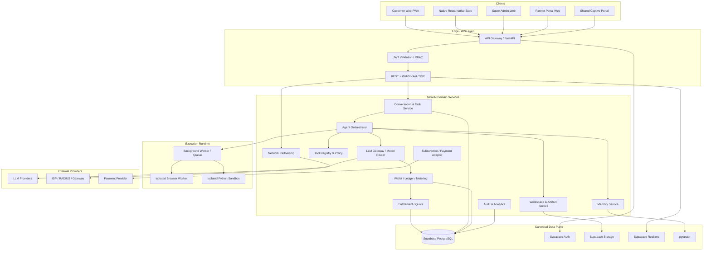
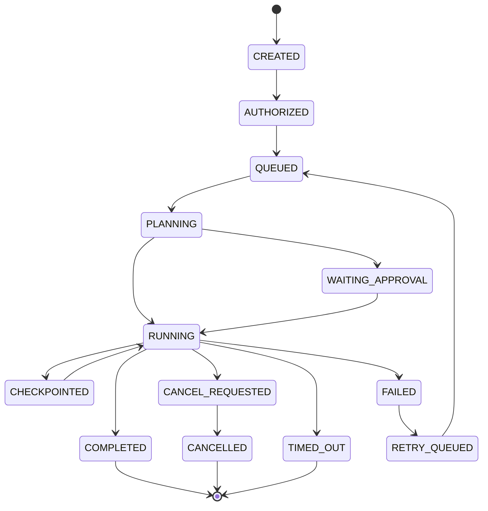
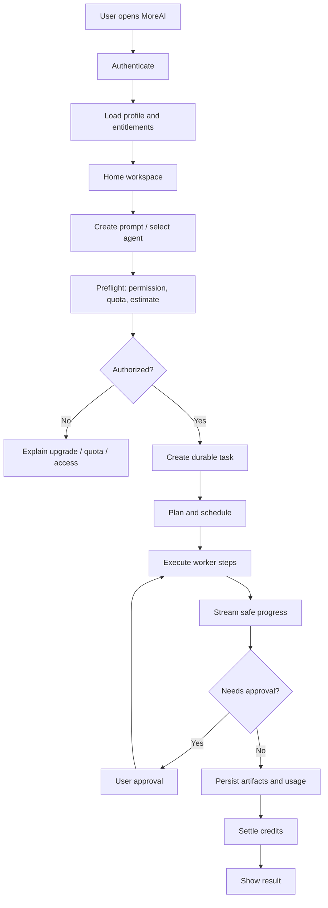

# MOREAI --- MASTER PRODUCT REQUIREMENTS DOCUMENT (MASTER PRD)

**Dokumen:** MoreAI Master PRD\
**Versi:** 1.2 --- Full backend source integration, UI preservation, dan integration-first delivery\
**Tanggal:** 11 November 2026\
**Status:** Draft induk untuk engineering discovery, source migration,
design completion, implementation, dan acceptance\
**Bahasa:** Indonesia\
**Produk:** MoreAI --- AI Workspace, Agent Platform & Network
Partnership Ecosystem

------------------------------------------------------------------------

## 0. Pernyataan penting, ruang lingkup, dan cara membaca dokumen

Dokumen ini mengonsolidasikan keputusan dan kebutuhan MoreAI yang sudah
dibahas: produk AI agent, migrasi OpenManusWeb, monorepo mandiri,
aplikasi web PWA, aplikasi Native React Native Expo, Super Admin,
Partner Portal, Captive Portal multi-tenant, FastAPI, worker, sandbox,
Supabase, sistem kredit dan entitlement, integrasi provider LLM, Network
Partnership, design system Playful Neo-Brutalist / Soft Pastel, UI/UX
mobile-first, serta workflow operasional dan roadmap.

### 0.1 Dua deliverable yang berbeda

1.  **Master PRD ini** adalah spesifikasi produk, arsitektur target,
    aturan implementasi, kontrak perilaku, workflow, data model
    konseptual, keamanan, desain, migrasi, dan acceptance criteria.
2.  **Source code OpenManusWeb** harus disalin melalui proses Git/source
    migration ke repository MoreAI. Source code tidak ditempel
    seluruhnya ke dalam dokumen PRD karena kode adalah artefak
    repository yang harus dipertahankan sebagai file dengan path,
    riwayat, dependency, aset, konfigurasi, dan lisensi aslinya.

Dengan demikian, dokumen ini mewajibkan migrasi menyeluruh atas seluruh
file source yang relevan dari upstream, tetapi **tidak mengklaim bahwa
source sudah disalin, aplikasi sudah dibangun, atau endpoint sudah
berjalan**. Pekerjaan tersebut baru berstatus selesai setelah ada
commit, manifest file, hasil build, pengujian, dan verifikasi repository
tujuan.

### 0.2 Aturan integritas source

-   Upstream: `https://github.com/YunQiAI/OpenManusWeb.git`
-   Baseline branch yang menjadi referensi audit sebelumnya:
    `dev_web_app`.
-   Repository upstream yang ditemukan bersifat publik dan README
    menyatakan proyek sebagai web app untuk OpenManus. Daftar root yang
    terlihat mencakup `.github`, `app`, `assets`, `config`, `examples`,
    `tools`, `.gitattributes`, `.gitignore`, `.pre-commit-config.yaml`,
    `CODE_OF_CONDUCT.md`, `DEVELOPMENT_LOG.md`, `LICENSE`, `README.md`,
    `README_zh.md`, `main.py`, `pytest.ini`, `requirements.txt`,
    `run_flow.py`, `setup.py`, dan `web_run.py`.
-   File `LICENSE` pada branch yang diperiksa berisi MIT License dengan
    copyright notice `Copyright (c) 2025 manna_and_poem`. Seluruh
    salinan atau substantial portions wajib mempertahankan copyright
    notice dan teks lisensi.
-   Simpan `THIRD_PARTY_NOTICES.md` di root MoreAI dan pertahankan file
    `LICENSE` upstream di direktori source mirror/vendor.
-   Jangan menghapus attribution, menyamarkan asal komponen, atau
    menyatakan seluruh implementasi upstream sebagai karya orisinal
    MoreAI.
-   Audit lisensi semua dependency dan aset tambahan secara terpisah.
    Lisensi MIT pada repository tidak otomatis melisensikan seluruh
    dependency pihak ketiga, logo, merek, model, atau data eksternal.
-   Jangan menyalin secret, API key, `.env` privat, credential, browser
    profile, log berisi data pribadi, atau artefak runtime yang tidak
    aman. Jika ada file semacam itu di repository sumber, catat dan
    karantina; jangan masukkan ke history baru. Source code, aset
    produk, file konfigurasi contoh, tests, scripts, docs, dotfiles, dan
    workflow yang sah tetap harus diinventarisasi dan dipertahankan.
-   Jangan melakukan perubahan destruktif terhadap repository upstream.

### 0.3 Status keputusan

Istilah yang dipakai: - **Confirmed**: eksplisit disepakati di
percakapan. - **Target**: rancangan arsitektur yang harus diwujudkan. -
**Proposed / tunable**: rekomendasi awal yang harus dapat dikonfigurasi
dan belum menjadi angka final. - **Open decision**: memerlukan keputusan
bisnis/operasional sebelum production. - **Not implemented**: belum ada
bukti implementasi atau verifikasi.

------------------------------------------------------------------------

# 1. Visi produk dan positioning

MoreAI adalah **AI Workspace dan Agent Platform** yang memungkinkan
individu dan organisasi menggunakan AI untuk riset, analisis, pembuatan
konten, coding, browsing, pengolahan dokumen, otomasi pekerjaan, dan
workflow multi-step. MoreAI menggabungkan agent runtime, model routing,
tool execution, memory, workspace, credit wallet, entitlement,
subscription, serta jaringan distribusi melalui partner Wi-Fi.

MoreAI bukan sekadar chat wrapper. Produk harus menyediakan pengalaman
kerja yang berkelanjutan: pengguna dapat membuat tugas, menjalankan
agent, memantau progres, mengelola hasil dan file, melanjutkan
percakapan, mengatur akses AI, serta mengakses benefit partner secara
aman.

## 1.1 Misi

-   Membuat kemampuan AI agent yang kompleks mudah digunakan melalui UI
    yang sederhana.
-   Menyatukan berbagai model dan tools melalui satu LLM Gateway / Model
    Router.
-   Menyediakan kontrol biaya dan penggunaan melalui metering, wallet,
    quota, ledger, dan subscription.
-   Mendistribusikan akses AI melalui kemitraan venue dan jaringan Wi-Fi
    tanpa mengunci produk pada satu ISP.
-   Menjaga pengalaman konsisten di Web PWA, Native Mobile, Super Admin,
    Partner Portal, dan Captive Portal.

## 1.2 Prinsip produk

1.  **One platform, multiple clients** --- seluruh aplikasi memakai API
    dan domain engine yang sama.
2.  **Backend-authoritative** --- keputusan harga, role, kredit, quota,
    akses, verifikasi, dan status pembayaran tidak boleh ditentukan
    frontend.
3.  **Supabase as canonical database** --- tidak membuat database kedua
    untuk menggantikan PostgreSQL utama.
4.  **FastAPI as business API** --- frontend tidak mengakses provider
    LLM atau menjalankan privileged logic secara langsung.
5.  **Real data only** --- tidak menggunakan fake/mock data untuk
    menyatakan fitur sudah terintegrasi. Data ilustrasi hanya boleh ada
    di design mockup dan harus diberi label.
6.  **Secure execution** --- browser dan Python execution wajib
    terisolasi, dibatasi, diaudit, dan memiliki lifecycle.
7.  **Modular integration** --- provider LLM, payment, RADIUS, gateway,
    Captive Portal, dan ISP API memakai adapter.
8.  **Fail closed for sponsored access** --- kegagalan verifikasi tidak
    boleh memberi Partner Free Access.
9.  **Paid entitlement independent** --- paid access tidak hilang hanya
    karena pengguna meninggalkan jaringan partner.
10. **Mobile-first, responsive** --- desain dimulai dari layar kecil dan
    berkembang ke tablet/desktop.

## 1.3 Target pengguna

-   Individu / personal AI users.
-   Professional, creator, researcher, developer, student.
-   Power users yang membutuhkan agent dan tool execution.
-   Partner venue: cafe, restoran, coworking, kampus, perpustakaan,
    hotel, ruang publik, fasilitas publik.
-   Partner operator dan staff cabang.
-   Super Admin, Finance Admin, Support, Security Admin, Platform
    Operator.
-   Di masa depan: ISP pusat, network operator, enterprise Wi-Fi
    provider.

------------------------------------------------------------------------

# 2. Product scope

## 2.1 In scope

### Core AI Platform

-   Authentication dan user profile.
-   Chat workspace dan conversation history.
-   Task / agent run management.
-   Planning dan step execution.
-   Agent registry dan agent marketplace.
-   LLM provider registry dan model routing.
-   Tool registry dan permission policy.
-   Browser automation.
-   Python/code execution pada isolated sandbox.
-   File upload, storage, workspace, artifact, export.
-   Memory dan personalization.
-   Streaming status, progress events, cancellation.
-   Usage metering dan audit.

### Monetization & Access

-   Wallet.
-   Immutable credit ledger.
-   Credit grant, purchase, spend, refund/reversal.
-   Usage metering per model/provider/tool.
-   General Free entitlement.
-   Partner Free entitlement.
-   Paid subscription entitlement.
-   Purchased credits.
-   Quota windows, usage limits, priority and concurrency policy.
-   Invoice/payment integration (provider adapter; provider final belum
    ditetapkan di PRD ini).

### Network Partnership

-   Partner organizations.
-   Partner members.
-   Locations / branches.
-   Wi-Fi networks.
-   Network providers / ISP metadata.
-   Per-network verification configuration.
-   Geo-WiFi verification.
-   Access codes.
-   Campaign-based rewards.
-   Partner sessions.
-   Captive Portal (shared multi-tenant; later phase).
-   RADIUS integration (later phase).
-   Gateway Connector (later phase).
-   Central ISP API adapter (later phase).
-   Hybrid verification policy.
-   Partner dashboard and analytics.
-   Super Admin governance and audit.

### Clients

-   Customer Web PWA.
-   Native React Native Expo app.
-   Super Admin Web.
-   Partner Portal Web.
-   Shared Captive Portal Web.
-   FastAPI backend.
-   Worker services.
-   Sandbox runtime.

## 2.2 Out of scope for initial baseline

-   Membuat database terpisah di luar Supabase PostgreSQL sebagai sumber
    utama.
-   Mengizinkan frontend memanggil LLM provider langsung.
-   Mengambil alih seluruh autentikasi internet pelanggan ISP. MoreAI
    hanya mengelola entitlement AI; Wi-Fi gateway tetap mengelola akses
    internet venue sesuai konfigurasi venue.
-   Menganggap IP geolocation cukup akurat sebagai pengganti
    GPS/geolocation radius 500m.
-   Menganggap browser dapat membaca SSID Wi-Fi secara universal.
-   Menjamin captive portal auto-popup pada seluruh OS/perangkat.
-   Membuat portal terpisah untuk setiap partner. Captive Portal harus
    satu aplikasi shared multi-tenant.
-   Menggunakan fake data sebagai bukti integrasi produksi.
-   Menjalankan arbitrary Python/browser JavaScript pada proses API
    utama.

------------------------------------------------------------------------

# 3. Product architecture overview

## 3.1 Logical architecture



## 3.2 Trust boundaries

-   Client applications are untrusted.
-   FastAPI is the trusted business boundary after authentication and
    authorization.
-   Worker and sandbox are isolated execution boundaries.
-   Supabase service-role key hanya boleh berada di trusted server
    environment.
-   LLM provider credentials hanya boleh berada di server-side secret
    management.
-   Partner router / RADIUS / ISP callback dianggap external input dan
    harus diverifikasi.
-   Webhook payment wajib signature verification, idempotency, replay
    protection, dan event audit.
-   File content, browser pages, tool output, model output, dan prompt
    dari user diperlakukan sebagai untrusted data.

## 3.3 Architectural invariants

1.  Satu canonical PostgreSQL project/schema family untuk domain MoreAI.
2.  Semua akses data sensitif melalui API / server-side policy; RLS
    tetap aktif sebagai defense-in-depth.
3.  Tidak ada credit issuance dari frontend.
4.  Tidak ada entitlement grant berdasarkan query client yang belum
    diverifikasi.
5.  Tidak ada LLM call tanpa usage record dan policy check.
6.  Setiap mutasi finansial/entitlement/network session harus
    idempotent.
7.  Setiap agent run memiliki durable state dan correlation ID.
8.  Browser/Python worker tidak memiliki akses bebas ke secret platform.
9.  Setiap partner network dapat memiliki verification method berbeda.
10. Fallback verification harus explicit policy; tidak boleh menurunkan
    security secara diam-diam.

------------------------------------------------------------------------

# 4. Target independent monorepo

## 4.1 Repository identity

Nama produk dan repository: `MoreAI` (nama GitHub repository tujuan
masih perlu ditetapkan). Repository tujuan harus berdiri sendiri, bukan
sekadar mengganti nama folder upstream. Upstream tetap dicatat sebagai
sumber third-party dan dapat ditelusuri.

## 4.2 Target directory structure

``` text
MoreAI/
├── apps/
│   ├── web/                         # Customer Next.js PWA
│   │   ├── app/
│   │   ├── components/
│   │   ├── features/
│   │   ├── hooks/
│   │   ├── lib/
│   │   ├── public/
│   │   ├── styles/
│   │   └── tests/
│   ├── mobile/                      # React Native Expo
│   │   ├── app/
│   │   ├── src/
│   │   │   ├── components/
│   │   │   ├── features/
│   │   │   ├── navigation/
│   │   │   ├── services/
│   │   │   ├── store/
│   │   │   └── theme/
│   │   ├── assets/
│   │   └── tests/
│   ├── admin/                       # Super Admin Web
│   ├── partner-portal/              # Partner dashboard
│   ├── captive-portal/              # Shared multi-tenant Wi-Fi portal
│   ├── api/                         # FastAPI application
│   ├── worker/                      # Async/background worker entrypoint
│   └── sandbox/                     # Isolated execution service image/config
│
├── engine/
│   ├── agents/
│   │   ├── base/
│   │   ├── react/
│   │   ├── toolcall/
│   │   ├── manus/
│   │   ├── registry/
│   │   └── policies/
│   ├── orchestration/
│   │   ├── planner/
│   │   ├── executor/
│   │   ├── task_graph/
│   │   ├── scheduler/
│   │   ├── state_machine/
│   │   └── evaluator/
│   ├── tools/
│   │   ├── browser/
│   │   ├── python/
│   │   ├── search/
│   │   ├── file/
│   │   ├── connectors/
│   │   └── registry/
│   ├── llm/
│   │   ├── providers/
│   │   ├── router/
│   │   ├── policies/
│   │   ├── streaming/
│   │   └── cost/
│   ├── memory/
│   │   ├── short_term/
│   │   ├── long_term/
│   │   ├── embeddings/
│   │   └── retrieval/
│   ├── credits/
│   │   ├── wallet/
│   │   ├── ledger/
│   │   ├── quota/
│   │   └── metering/
│   ├── entitlements/
│   ├── subscriptions/
│   └── network_partnership/
│       ├── organizations/
│       ├── locations/
│       ├── networks/
│       ├── providers/
│       ├── verification/
│       │   ├── base.py
│       │   ├── geo_wifi/
│       │   ├── captive_portal/
│       │   ├── radius/
│       │   ├── gateway/
│       │   └── central_isp/
│       ├── sessions/
│       ├── access_codes/
│       ├── campaigns/
│       ├── rewards/
│       ├── policies/
│       └── analytics/
│
├── packages/
│   ├── ui-web/
│   ├── ui-native/
│   ├── design-tokens/
│   ├── icons/
│   ├── api-client/
│   ├── types/
│   ├── validation/
│   ├── config/
│   └── localization/
│
├── supabase/
│   ├── migrations/
│   ├── functions/
│   ├── seed/
│   ├── tests/
│   └── config.toml
│
├── vendor/
│   └── openmanusweb/                # Complete upstream source mirror / provenance
│
├── infrastructure/
│   ├── docker/
│   ├── deployment/
│   ├── monitoring/
│   ├── secrets/
│   ├── networking/
│   └── scripts/
│
├── docs/
│   ├── product/
│   ├── architecture/
│   ├── api/
│   ├── data/
│   ├── security/
│   ├── design/
│   ├── operations/
│   ├── migration/
│   └── runbooks/
│
├── tests/
│   ├── unit/
│   ├── integration/
│   ├── contract/
│   ├── e2e/
│   ├── security/
│   ├── performance/
│   └── fixtures/
│
├── .github/
│   └── workflows/
├── THIRD_PARTY_NOTICES.md
├── LICENSE
├── README.md
├── CONTRIBUTING.md
├── SECURITY.md
├── CODEOWNERS
├── package.json
├── pnpm-workspace.yaml
├── turbo.json
├── pyproject.toml
├── uv.lock
├── .gitignore
└── .env.example
```

## 4.3 Monorepo tooling

Target recommendation: - pnpm workspace + Turborepo untuk
TypeScript/JavaScript packages dan apps. - Python workspace dikelola
dengan `uv`, `pyproject.toml`, dan `uv.lock`. - Shared API schema
menggunakan OpenAPI generated TypeScript client atau kontrak
schema-first. - CI memisahkan lint, typecheck, unit, integration, build,
security, dan e2e. - Docker image terpisah untuk API, worker, browser
worker, dan Python sandbox. - Jangan memaksa seluruh apps berjalan dalam
satu process. - Shared packages tidak boleh mengandung environment
secret atau business logic privileged yang hanya aman di server.

## 4.4 Source migration strategy

### Required source inventory

Inventaris semua branch/ref dan file upstream sebelum migrasi. Root
inventory yang sudah terlihat:

``` text
.github/
app/
assets/
config/
examples/
tools/
.gitattributes
.gitignore
.pre-commit-config.yaml
CODE_OF_CONDUCT.md
DEVELOPMENT_LOG.md
LICENSE
README.md
README_zh.md
main.py
pytest.ini
requirements.txt
run_flow.py
setup.py
web_run.py
```

Daftar tersebut adalah root-level inventory, bukan jaminan seluruh
nested files sudah terhitung. Migrasi wajib menghasilkan
machine-readable manifest dari seluruh tracked files, misalnya
`docs/migration/openmanusweb-file-manifest.txt`.

### Recommended migration procedure

``` bash
# 1. Mirror clone: mempertahankan seluruh refs dan Git objects
git clone --mirror https://github.com/YunQiAI/OpenManusWeb.git
cd OpenManusWeb.git
git show-ref

# 2. Buat working clone dari mirror
cd ..
git clone OpenManusWeb.git MoreAI
cd MoreAI

# 3. Tambahkan upstream remote dan checkout baseline branch yang diaudit
git remote add upstream https://github.com/YunQiAI/OpenManusWeb.git
git fetch upstream --prune
git checkout -b migration/openmanusweb-dev-web-app upstream/dev_web_app

# 4. Simpan manifest file tracked
git ls-tree -r --name-only HEAD > docs/migration/openmanusweb-file-manifest.txt

# 5. Buat source snapshot provenance di vendor/
mkdir -p vendor/openmanusweb
git archive HEAD | tar -x -C vendor/openmanusweb

# 6. Simpan upstream metadata
git log --oneline --decorate --all > docs/migration/openmanusweb-history.txt
git remote -v > docs/migration/openmanusweb-remotes.txt
```

Perintah di atas adalah prosedur yang direkomendasikan, belum dieksekusi
dalam penyusunan PRD ini. Implementer harus memastikan default branch,
branch `dev_web_app`, tag, submodule, Git LFS, generated assets, dan
semua refs sebelum menetapkan baseline final.

### Migration rules

-   Snapshot source penuh harus dapat dibandingkan dengan upstream
    commit.
-   Tidak boleh menghapus file source yang tidak dikenal hanya karena
    belum dipakai pada UI baru.
-   Setiap file harus dikategorikan: `preserved`, `adapted`, `moved`,
    `replaced`, `deprecated-with-reason`, atau `excluded-security`.
-   Setiap file yang dipindahkan ke `engine/` atau `apps/api/` harus
    memiliki mapping source path → target path.
-   Semua source assets, prompt templates, tool definitions, config
    examples, scripts, examples, tests, CI workflows, docs, dan dotfiles
    harus tercakup.
-   Jika file runtime seperti `workspace/`, logs, cache, atau browser
    state muncul, tentukan kebijakan terpisah dan jangan menyertakan
    data privat.
-   Jangan menghapus upstream history sebelum provenance snapshot dan
    manifest diverifikasi.
-   Simpan source baseline di `vendor/openmanusweb` atau git subtree
    dengan provenance. Kode hasil adaptasi di `engine/` harus memiliki
    attribution yang sesuai.
-   Pertahankan seluruh notice MIT untuk source yang disalin dan
    substantial portions.
-   Jalankan source diff, file count, binary/assets check, dan license
    scan setelah migrasi.

### Upstream source capabilities known from inspection

Dokumentasi upstream menjelaskan: - FastAPI web application. - Native
HTML/CSS/JavaScript web interface. - WebSocket real-time updates. - Chat
API, stop-session API, session result API. - File workspace APIs. - Logs
and parsed logs APIs. - Thinking/progress endpoints. - Browser and
tool-based agent execution. - Local file-system workspace for
artifacts/logs.

Sumber: `README.md`, `app/web/README.md`, `DEVELOPMENT_LOG.md`,
`requirements.txt`, dan `LICENSE` di branch `dev_web_app`.

------------------------------------------------------------------------

# 5. Source OpenManusWeb: functional baseline and adaptation map

## 5.1 Baseline agent architecture

Audit source sebelumnya mengidentifikasi kelompok modul berikut (perlu
diverifikasi ulang terhadap manifest final):

-   `app/agent/base.py`
-   `app/agent/react.py`
-   `app/agent/toolcall.py`
-   `app/agent/manus.py`
-   `app/flow/planning.py`
-   `app/tool/planning.py`
-   `app/tool/browser_use_tool.py`
-   `app/tool/python_execute.py`
-   `app/tool/google_search.py`
-   `app/tool/file_saver.py`
-   `app/llm.py`
-   `app/agent/llm_wrapper.py`
-   `app/web/app.py`
-   `app/web/log_handler.py`
-   `app/web/log_parser.py`
-   `app/web/thinking_tracker.py`
-   `app/schema.py`
-   config files, prompts, examples, assets, tests, scripts, and
    workflows.

## 5.2 Existing behavior to preserve or improve

### Agent hierarchy

-   BaseAgent: lifecycle and base state.
-   ReActAgent: reasoning/action loop pattern.
-   ToolCallAgent: tool-call interaction.
-   Manus: concrete general-purpose agent.
-   PlanningFlow: task planning and step execution.
-   PlanningTool: plan state and plan-related tool interface.

### Tools

-   Python execution.
-   Browser automation.
-   Google search.
-   File saving.
-   Termination.
-   Planning and any additional tools discovered during complete source
    inventory.

### LLM layer

-   AsyncOpenAI / AsyncAzureOpenAI compatible client usage.
-   Provider base URL and API key configuration.
-   Tool/function calling.
-   Streaming/callback behavior.
-   Retry policy.
-   Vision model configuration where supported.

### Web experience

-   Chat request and session management.
-   WebSocket live progress.
-   User-visible task progress and activity.
-   Workspace file listing and retrieval.
-   Logs and parsed logs.
-   Stop/cancel action.
-   Frontend graceful degradation when WebSocket is unavailable (as
    described in development log).

## 5.3 Risks identified in baseline audit

The following findings were noted in a prior partial source review and
must be revalidated against the exact migrated commit:

1.  `process_prompt` creates workspace and uses process-global
    `os.chdir`.
2.  It mutates environment variables during task execution.
3.  Manus agent and PlanningFlow lifecycle were constructed per request.
4.  PlanningTool keeps plans in memory.
5.  Session state and progress can be in-memory.
6.  Cancellation may occur only at step boundaries.
7.  Python `exec()` path is not a hardened sandbox by itself.
8.  Browser tool may permit JavaScript execution and broad browser
    access.
9.  Global working directory/environment mutations can cause
    cross-request concurrency bugs.
10. Durable task recovery, strong sandbox isolation, and long-term
    semantic memory were not established by the partial review.
11. ThinkingTracker is progress/observability presentation; it must not
    expose private hidden chain-of-thought. Only safe, concise activity
    summaries, task steps, tool status, and user-facing explanations may
    be shown.

These are not assertions that every current upstream version has
identical defects. They are mandatory security and architecture review
points.

## 5.4 Adaptation mapping

  --------------------------------------------------------------------------
  Upstream concern        MoreAI target              Required change
  ----------------------- -------------------------- -----------------------
  Agent classes           `engine/agents/`           Preserve behavior, add
                                                     dependency injection
                                                     and policy boundaries

  PlanningFlow            `engine/orchestration/`    Durable task graph,
                                                     checkpoints, retries,
                                                     recovery

  PlanningTool            Planner service + DB       Persist plan and step
                                                     state

  LLM client              `engine/llm/`              Central router,
                                                     metering, provider
                                                     policy, timeout and
                                                     fallback

  Browser tool            `engine/tools/browser/`    Isolated browser
                                                     worker, domain
                                                     allowlist, audit

  Python tool             `engine/tools/python/` +   Container isolation,
                          sandbox                    quotas, no host access

  Search tool             `engine/tools/search/`     Provider adapters,
                                                     source provenance

  FileSaver               Workspace service          Supabase Storage,
                                                     signed access, artifact
                                                     metadata

  WebSocket               API realtime gateway       Authenticated task
                                                     stream, event
                                                     persistence/replay

  Local session dict      Task/session repository    Durable PostgreSQL
                                                     state

  Local config            Server config + secret     No secrets in client or
                          store                      committed config

  Logs                    Structured telemetry       Redaction, retention,
                                                     trace IDs

  HTML/JS web UI          Next.js PWA                Rebuild UI with shared
                                                     design system

  Static templates        New app layouts            Preserve interaction
                                                     requirements, not
                                                     obsolete presentation
  --------------------------------------------------------------------------

------------------------------------------------------------------------

# 6. Application surfaces and detailed functional requirements

## 6.1 Customer Web PWA --- `apps/web`

### Purpose

Primary responsive browser experience for personal AI workspace, chat,
agents, files, billing, access and account management.

### Navigation

-   Home / Workspace.
-   Chat history.
-   Agents.
-   Tools / Connectors.
-   Tasks / Runs.
-   Files / Artifacts.
-   Memory.
-   Credits / Wallet.
-   Plans / Subscription.
-   Partner Wi-Fi Access.
-   Notifications.
-   Profile / Settings / Help.

### Screens and behavior

#### A. Public entry and authentication

-   Welcome / product introduction.
-   Sign up, sign in, password reset, OAuth provider flows.
-   Email verification and session management.
-   Terms and privacy consent.
-   Onboarding preferences.
-   Loading, error, expired session and rate-limited states.

#### B. Home workspace

-   Greeting and active workspace.
-   Credit and entitlement status.
-   Recent conversations and tasks.
-   Quick action prompts.
-   Suggested agents and tools.
-   Partner access availability card if the user is in an eligible
    campaign/network.
-   Clear separation between paid, partner-sponsored, and general free
    access.

#### C. Chat workspace

-   Conversation list and search.
-   Conversation detail.
-   Message composer.
-   File attachments.
-   Agent selector.
-   Model selector (only models allowed by entitlement and policy).
-   Tool permission prompts.
-   Streaming assistant response.
-   User-facing activity timeline.
-   Stop/cancel task.
-   Retry / regenerate where safe.
-   Copy/export.
-   Citation/source display.
-   Artifact preview.
-   Error, timeout, quota exceeded, provider failure and insufficient
    credits states.

#### D. Agent marketplace

-   Browse/search/filter agents.
-   Agent detail, capability, supported tools, data access scope, credit
    estimate and policy.
-   Start agent task.
-   Agent version and availability.
-   User feedback and rating (moderated).
-   No agent may silently exceed permissions declared in its manifest.

#### E. Tools and connectors

-   Tool directory.
-   Connector authorization and revoke.
-   Browser/search/file/Python tool capabilities.
-   Permission scope, privacy description and limits.
-   Tool run confirmation for risky actions.
-   Tool execution history.
-   Tool output viewer.

#### F. Tasks and run monitor

-   Task queue and run history.
-   Run detail and progress.
-   Step state: queued, running, waiting approval, completed, failed,
    cancelled, timed out.
-   Safe user-facing activity summaries (not private hidden reasoning).
-   Retry from checkpoint when idempotent.
-   Pause/cancel when supported.
-   Download artifacts.
-   Failure reason and support correlation ID.

#### G. Workspace and files

-   Folder/file list.
-   Upload and preview.
-   Generated artifact browser.
-   File metadata, owner, task link, retention.
-   Download via signed URL.
-   Access control and virus/content scanning policy.
-   No direct arbitrary filesystem path access.

#### H. Memory

-   Memory status and consent.
-   User can review, correct, disable, or request deletion through
    supported privacy controls.
-   Memory source and scope labels.
-   Memory must not silently ingest unrelated private files.
-   Separate conversation history from durable user memory.

#### I. Wallet and billing

-   Paid credit balance.
-   Credit transactions.
-   Credit package catalog.
-   Subscription plans.
-   Usage history by task/model.
-   Payment checkout and payment status.
-   Invoice/receipt.
-   Refund/reversal status.
-   Clear display of sponsored quota separate from paid credits.

#### J. Partner Wi-Fi activation

-   List or detect available partner campaign only from server-verified
    evidence.
-   Explain required verification method.
-   Geo-WiFi flow: Wi-Fi/network proof + user-permitted geolocation +
    venue access code.
-   Captive Portal flow: signed gateway/session proof; code optional per
    campaign.
-   RADIUS/gateway/ISP methods as adapters.
-   Explain location permission and purpose.
-   Show access session status and remaining sponsored quota.
-   If verification fails, do not grant Partner Free. General Free
    remains available if user is eligible.
-   Paid Access remains usable independently.

#### K. Profile/settings

-   Profile and security.
-   Device/session management.
-   Notification preferences.
-   Language and appearance.
-   Light/dark theme.
-   Privacy and memory.
-   Connected integrations.
-   Account deletion and export requests.

## 6.2 Native Mobile --- `apps/mobile` (React Native Expo)

### Purpose

Native mobile client with the same product capabilities and domain
policies as Web PWA, optimized for touch, native lifecycle and device
permissions.

### Required capabilities

-   Sign-in and secure session.
-   Chat, streaming, task monitor.
-   File picker, camera/document attachment where permitted.
-   Push notification registration.
-   Deep links and universal links.
-   Biometric unlock as optional local convenience (not replacement for
    server authentication).
-   Secure token storage using platform secure storage.
-   Geolocation permission for Geo-WiFi.
-   App state handling, offline/poor-network states.
-   Share/export artifacts.
-   Native navigation and safe areas.
-   Subscription and purchase flow through the approved payment policy
    (store policy review required if in-app digital purchases are
    offered).

### Native-specific UX

-   Thumb-friendly navigation.
-   Bottom tabs for primary destinations.
-   Bottom sheets for agent/model selection.
-   Full-screen task execution detail.
-   Keyboard-aware composer.
-   Native permission rationale before OS permission dialog.
-   No silent location collection.
-   Do not claim the app can read Wi-Fi SSID universally; network
    evidence must come from supported native APIs or gateway
    integration.

### Parity rule

The same server-side entitlement, credit, session, agent and tool
policies apply to web and native. UI may differ; business outcomes may
not.

## 6.3 Super Admin Web --- `apps/admin`

### Purpose

Platform control plane. Only privileged roles may enter. All privileged
actions are audited.

### Main modules

1.  Platform overview and service health.
2.  User directory and user detail.
3.  Roles, permissions, staff invitations.
4.  Agent registry and versions.
5.  Tool registry and policies.
6.  LLM provider configuration.
7.  Model routing and cost policies.
8.  Usage and cost analytics.
9.  Credit packages, wallet and ledger explorer.
10. Subscription and payment reconciliation.
11. Partner organizations and members.
12. Locations and Wi-Fi networks.
13. Verification policy builder.
14. Campaigns, codes and rewards.
15. Network sessions and revocation.
16. Partner usage and sponsored cost allocation.
17. Security events and audit logs.
18. Feature flags and configuration.
19. Support operations and user impersonation controls (if enabled,
    heavily audited and time-limited).
20. System settings.

### Role model (target)

-   `super_admin`: full platform governance.
-   `platform_admin`: platform operations excluding selected sensitive
    finance/security controls.
-   `finance_admin`: payment, credit, pricing and reconciliation.
-   `support_admin`: support workflows with limited PII exposure.
-   `security_admin`: access/security review and incident response.
-   `partner_manager`: partner onboarding and partner governance.
-   `read_only_analyst`: reporting only.

Role definitions and permission scopes must be implemented server-side.
Frontend route guards are supplementary only.

## 6.4 Partner Portal --- `apps/partner-portal`

### Purpose

Partner organization and venue operations dashboard.

### Modules

-   Partner organization overview.
-   Locations/branches.
-   Wi-Fi networks per location.
-   Verification method status and setup instructions.
-   Staff/member access.
-   Campaign request and campaign view.
-   Access code batches and QR distribution.
-   Active and historical sessions.
-   Sponsored credit usage.
-   Campaign redemption.
-   Analytics by venue, network, campaign and period.
-   Reports/export.
-   Billing/sponsored budget view where contract permits.
-   Support and onboarding checklist.

### Partner roles

-   `partner_owner`: organization-level administration.
-   `partner_admin`: manage branches/networks/campaign requests.
-   `location_manager`: selected venue only.
-   `partner_staff`: access code distribution and basic session support.
-   `partner_analyst`: read-only analytics.

Partner members must only access their own organization and authorized
locations. Tenant isolation is mandatory.

## 6.5 Shared Captive Portal --- `apps/captive-portal`

### Purpose

One multi-tenant portal application that renders partner-specific
branding/configuration using signed context from the network
gateway/controller.

### Requirements

-   One deployment and codebase for all partners.
-   Resolve partner, location, network and campaign via verified signed
    token / gateway context.
-   Do not trust arbitrary query parameters as proof of network
    presence.
-   MikroTik Hotspot adapter as an initial candidate; later
    UniFi/controller adapters.
-   Optional code requirement per campaign.
-   Link MoreAI account or create/sign in.
-   Show terms, privacy and venue identity.
-   Verify gateway session proof server-side.
-   Issue a MoreAI entitlement session only after valid proof and policy
    check.
-   Return appropriate success/failure page to gateway.
-   Provide QR and manual URL fallback.
-   Explain that captive portal auto-popup depends on OS/router behavior
    and cannot be guaranteed universally.
-   Keep Wi-Fi internet authentication separate from MoreAI AI
    entitlement.
-   Use explicit walled-garden configuration for required MoreAI
    domains; avoid broad unrestricted bypass.
-   Rate-limit portal attempts and prevent replay.

------------------------------------------------------------------------

# 7. AI agent engine and orchestration

## 7.1 Agent runtime responsibilities

-   Receive a user task with authenticated user, workspace, entitlement,
    tool policy and correlation ID.
-   Validate request and estimate/authorize usage.
-   Create durable task record.
-   Select agent version.
-   Build task plan.
-   Validate tool access and approval requirements.
-   Execute steps through worker.
-   Stream safe progress events.
-   Meter model and tool usage.
-   Persist outputs and artifacts.
-   Complete, fail, cancel or pause the task.
-   Settle credit usage transactionally according to policy.
-   Emit audit/telemetry events.

## 7.2 Agent lifecycle state machine



## 7.3 Planning and execution

-   Planner creates structured steps with objective, dependencies,
    expected output, tool requirement, risk and estimated usage.
-   Planner output is validated against schema.
-   Plan version and step order are persisted.
-   Executor schedules ready steps.
-   Independent safe steps may run concurrently within configured
    limits.
-   Mutating/external actions may require explicit user approval.
-   Step result, retry count, duration, tool calls and usage are
    persisted.
-   A checkpoint is written after each meaningful step.
-   Recovery resumes from last valid checkpoint only if idempotency and
    external side-effect policy allow.
-   A failed tool call must not silently be treated as success.
-   Agent must stop on exhausted budget, revoked entitlement, policy
    violation or cancellation.

## 7.4 Evaluation

-   Task outcome quality.
-   Tool success rate.
-   Correctness and groundedness.
-   Citation/source quality where applicable.
-   Cost per completed task.
-   Latency and time-to-first-token.
-   Retry/failure rate.
-   User feedback.
-   Regression datasets and task suites.
-   Evaluation must not leak private chain-of-thought.

## 7.5 Memory architecture

-   Short-term: conversation and current task context.
-   Long-term: user-approved preferences and useful durable context.
-   Semantic retrieval: pgvector embeddings.
-   Metadata and ownership: PostgreSQL.
-   File memory: references to authorized Storage objects, not
    uncontrolled full copies.
-   User privacy controls: inspect, edit, disable, export/delete
    according to policy.
-   Memory access must be scoped by user, workspace, tenant and consent.
-   Retrieval results are untrusted context and cannot override
    system/security policy.

------------------------------------------------------------------------

# 8. LLM Gateway and Model Router

## 8.1 Responsibilities

-   Provider registry.
-   Model registry and capability metadata.
-   Provider credentials and secret rotation.
-   Routing by capability, cost, latency, region, availability and
    policy.
-   Retry and fallback.
-   Rate limit and concurrency.
-   Streaming response normalization.
-   Tool/function calling normalization.
-   Vision and multimodal capability metadata.
-   Token and cost metering.
-   Provider health and circuit breaker.
-   Request/response redaction policy.
-   Usage reconciliation.

## 8.2 Provider abstraction

Each provider adapter should implement: - `validate_config` -
`list_or_sync_models` (where supported) - `capabilities` - `chat` -
`stream_chat` - `tool_call` - `vision` (when supported) -
`estimate_cost` - `health_check` - normalized error mapping.

Provider API key must never be exposed to clients or logged.

## 8.3 Routing policy

Router may consider: - User plan / entitlement. - Agent capability
requirement. - Context window. - Tool calling support. - Vision/audio
support. - Provider availability. - Cost budget. - Latency target. -
Region and data policy. - Admin allowlist. - User-selected model
preference where permitted.

If provider fallback changes model, UI should disclose selected model
where appropriate.

## 8.4 Metering

Every model request must record: - request ID and task ID. -
user/workspace. - provider and model. - input/output token counts when
available. - cached token counts when available. - image/audio usage
dimensions where applicable. - provider reported cost and internal
normalized cost. - pricing version. - currency and exchange-rate source
if cost conversion is used. - latency, status and error category. -
credit charge and reconciliation state.

No LLM call may bypass the central metering path.

------------------------------------------------------------------------

# 9. Tool system and execution security

## 9.1 Tool registry

Each tool definition includes: - stable tool ID and version. - name and
description. - input/output JSON schema. - capability tags. - permission
scope. - risk class. - required approval mode. - execution
environment. - timeout and resource limits. - idempotency behavior. -
audit category. - availability by plan/agent.

## 9.2 Browser automation

-   Runs in isolated browser worker/container.
-   Separate browser context per task or approved session scope.
-   No access to host filesystem or internal cloud metadata endpoints.
-   Domain allowlist/denylist.
-   SSRF protection and private IP blocking.
-   Download scanning and file size limits.
-   Cookie/session isolation.
-   User approval for login, payment, form submission or irreversible
    action.
-   Capture action log and result, not sensitive page contents beyond
    allowed retention.
-   JavaScript execution disabled unless a tool capability explicitly
    requires it and is policy-approved.
-   Browser timeout, concurrency and cost budget enforced.

## 9.3 Python execution

-   Dedicated ephemeral container or microVM sandbox.
-   Non-root user.
-   Read-only base image.
-   Temporary workspace.
-   CPU, memory, process, disk, network and wall-clock limits.
-   No host mounts.
-   No Docker socket.
-   No production secrets.
-   Network disabled by default; controlled egress only when required.
-   Kill process tree on timeout/cancel.
-   Persist only approved artifacts to object storage.
-   Audit code execution metadata; avoid retaining unnecessary sensitive
    code/output.
-   Arbitrary `exec()` in API process is prohibited.

## 9.4 File tools

-   File path normalized and scoped.
-   No path traversal.
-   MIME/extension validation.
-   File size limits.
-   Malware scanning where applicable.
-   Signed download links with expiry.
-   Object ownership/tenant checks.
-   File lifecycle and retention policies.

------------------------------------------------------------------------

# 10. Credit, wallet, quota, entitlement and subscription

These domains must remain separate. A balance is not the same thing as
access entitlement; a sponsored quota is not paid credit.

## 10.1 Wallet

Represents purchased/paid credit balance and related financial state.

## 10.2 Immutable ledger

All credit changes are ledger entries: - purchase credit. - promotional
grant. - partner-sponsored usage allocation (where applicable). - usage
debit. - refund. - reversal. - manual adjustment (privileged, reason and
approval required). - expiry (only if product policy introduces it).

Ledger entries are append-only. Corrections use reversal/compensating
entries, not destructive updates.

## 10.3 Entitlement

Determines what a user is allowed to access: - General Free. - Partner
Free. - Paid subscription. - Purchased credit access. - Admin/internal
entitlement. - Promotional entitlement.

Entitlement policy contains start/end, source, quota, allowed
model/tool/agent, priority, concurrency and scope.

## 10.4 General Free

Proposed baseline from discussion: - 100 credits per rolling 6-hour
window. - No rollover is a proposed rule, not final approved business
policy. - Exact reset semantics, timezone, burst limits, concurrency and
abuse policy require configuration and product approval. - General Free
is available subject to account and abuse policies.

## 10.5 Partner Free

Confirmed model: - Available only when user is verified on a partner
network and has valid campaign eligibility/access code. - Session-based
access. - Campaign-based rewards. - Hybrid verification architecture. -
When user leaves partner network or proof/session expires, Partner Free
entitlement ends. - General Free may become available if the user
qualifies. - Partner quota is separate from purchased wallet credits. -
No Partner Free grant if verification fails. - Each partner, location
and network can have its own verification method and policy.

## 10.6 Paid access

Confirmed requirement: - User may separately subscribe/pay or purchase
credits. - Paid access must remain independent from partner Wi-Fi
connection. - Leaving a partner network must not revoke paid
subscription or paid credits. - Partner-sponsored benefit is additive
and does not replace paid entitlement.

## 10.7 Entitlement resolution

Recommended resolution order: 1. Validate identity and account status.
2. Load all active entitlements. 3. Check task/model/tool eligibility.
4. Determine applicable priority and concurrency. 5. Choose funding
source according to policy. 6. Reserve quota/credits atomically. 7.
Execute task. 8. Settle actual usage. 9. Release unused reservation or
create compensating adjustment. 10. Persist audit and usage records.

The policy must explicitly define whether partner sponsored quota or
paid credits is consumed first when both exist. This remains an open
business decision. UI must show the source of consumption before
execution where material.

## 10.8 Atomicity and idempotency

-   Unique idempotency key per payment, credit grant, debit, entitlement
    issuance and webhook.
-   Use DB transaction / RPC for atomic balance and ledger mutation.
-   Lock or use safe concurrency strategy for wallet/quota windows.
-   Never trust client-submitted amount or balance.
-   Duplicate webhook must not duplicate credit.
-   Reversal must reference original transaction.
-   Failed job settlement must be recoverable and auditable.

------------------------------------------------------------------------

# 11. Network Partnership system

## 11.1 Business model

MoreAI partners directly with venue operators, not only with central
ISPs. A cafe may use Biznet, a restaurant IndiHome, a campus its own
Wi-Fi, or a hotel another provider. MoreAI partnership is with the
venue/operator, while ISP metadata is recorded as network context.

Direct ISP central partnership remains a future option. The architecture
must support it without requiring it for initial launch.

### Initial venue categories

-   Cafe and restaurant.
-   Coworking space.
-   Campus and university.
-   Public library.
-   Hotel and accommodation.
-   Public venue and facility.
-   Community space.
-   Retail and commercial venue.
-   Other approved partner locations.

## 11.2 Domain entities

-   Partner Organization.
-   Partner Member.
-   Partner Location / Branch.
-   Network Provider (ISP / internal / managed Wi-Fi).
-   Partner Network / SSID metadata.
-   Verification Configuration.
-   Campaign.
-   Campaign Rule.
-   Access Code Batch / Code.
-   Verification Attempt.
-   Verification Evidence.
-   Network Session.
-   Session Event.
-   Sponsored Entitlement.
-   Reward / Quota Allocation.
-   Partner Usage Allocation.
-   Audit Event.

## 11.3 Verification methods --- selectable per network

Super Admin can configure a method independently for each partner,
location and Wi-Fi network. Branches belonging to one organization may
use different methods.

### Method A --- Geo-WiFi

Initial default candidate for early partner rollout.

Evidence layers: 1. Network/Wi-Fi evidence from supported and verifiable
source. 2. Browser/app geolocation permission and coordinate/accuracy.
3. Venue access code / campaign token.

Requirements: - Default radius example 500m, configurable per
location. - Use Haversine distance. - Evaluate reported accuracy and
boundary uncertainty. - Ask for re-check or fail closed near boundary. -
Explicit browser/device permission. - IP geolocation is not a substitute
for GPS radius. - Do not claim browser can read SSID universally. -
Store minimal evidence and verification outcome; avoid continuous
location tracking. - Location permission must explain purpose. - If
device has no usable location, use another explicitly configured
verification adapter or deny partner access; do not silently weaken
policy.

### Method B --- Captive Portal

-   Gateway/controller redirects client to shared MoreAI portal.
-   Gateway sends signed session context.
-   MoreAI validates signature, timestamp, nonce, network and session
    state.
-   GPS not required if authenticated gateway session is sufficient
    under policy.
-   Access code may be optional depending on campaign.
-   Portal links user identity and network session.
-   Router/controller integration required; portal auto-popup is
    OS/network behavior, not guaranteed by MoreAI.
-   QR/manual URL fallback.
-   MikroTik Hotspot is a possible first adapter; other adapters later.

### Method C --- RADIUS

-   RADIUS authentication/accounting evidence.
-   Validate shared secret or secure transport arrangement.
-   Handle Start, Interim-Update, Stop accounting.
-   Map NAS/client/session identifiers to partner network.
-   Replay protection and session correlation.
-   RADIUS data is not automatically proof of user identity in MoreAI;
    account linking is required.

### Method D --- Gateway Connector

-   Adapter to router/controller/vendor API.
-   Secure API credentials and signature.
-   Session state and client binding.
-   Webhook or polling strategy.
-   Vendor-specific adapter interface.
-   Credential rotation and audit.

### Method E --- Central ISP API

Future integration: - Provider subscriber or access identity. - Provider
verification callbacks. - Provider consent and contractual data scope. -
Rate limit and outage fallback. - Subscriber identifiers must be
minimized and protected. - ISP adapter must not be hard-coded into core
entitlement engine.

### Method F --- Hybrid

-   Combine two or more evidence sources.
-   Explicit boolean policy (AND/OR/threshold) configured by Super
    Admin.
-   Explicit fallback sequence and failure semantics.
-   Fallback must not silently reduce assurance.
-   Record which evidence satisfied the policy.

## 11.4 Unified Verification Engine

All adapters normalize evidence to a common contract:

``` json
{
  "verification_id": "uuid",
  "method": "geo_wifi|captive_portal|radius|gateway|central_isp|hybrid",
  "partner_id": "uuid",
  "location_id": "uuid",
  "network_id": "uuid",
  "user_id": "uuid",
  "device_id": "uuid-or-null",
  "evidence": [],
  "policy_version": "version",
  "verified_at": "ISO-8601",
  "expires_at": "ISO-8601",
  "assurance": "low|medium|high",
  "decision": "verified|rejected|review",
  "reason_code": "machine-readable"
}
```

The contract is conceptual; exact Pydantic schema and evidence types
must be versioned and implemented.

Unified flow: 1. Receive verification attempt. 2. Resolve
partner/location/network. 3. Load active policy. 4. Select adapter(s).
5. Verify cryptographic/network/location/code evidence. 6. Evaluate
policy. 7. Persist attempt and normalized evidence. 8. If verified,
create network session. 9. Resolve campaign and reward. 10. Issue
sponsored entitlement/quota transactionally. 11. Stream session state to
client. 12. Monitor heartbeat/expiry/revocation.

## 11.5 Session lifecycle

Suggested tunable starting values: - Heartbeat interval around 60
seconds. - Proof TTL around 2--3 minutes. - Grace period for short
transient interruption.

These are not fixed product promises and must be load/security tested.

Lifecycle: - `pending` - `verified` - `active` - `grace` - `expired` -
`revoked` - `rejected`

Rules: - Revalidate using method-specific evidence. - Browser tab state
is not trusted proof of Wi-Fi presence. - Backend session proof is
authoritative. - Network change / gateway stop / proof expiration
revokes sponsored access. - Paid entitlement remains unaffected. -
Session event log is append-only. - Duplicate heartbeat or gateway event
is idempotent.

## 11.6 Campaign-based reward

Campaign fields: - campaign name and description. - partner and location
scope. - eligible network(s). - start/end. - reward type and quota. -
claim limit. - per-user/per-device/per-session limits. - access code
required or not. - verification policy. - priority and campaign stacking
rule. - total budget / cap. - active/paused/ended status. - terms and
privacy copy.

Access code: - random, high entropy, non-guessable. - store hashed where
possible. - scoped to campaign/venue/network. - expiration and
redemption limits. - rate-limited attempts. - one-time or reusable
behavior configured. - staff QR/code distribution. - code must not
itself prove Wi-Fi presence unless policy explicitly defines it as one
evidence factor.

## 11.7 Provider independence

-   Partner can use any ISP.
-   MoreAI partner is the venue/operator.
-   Provider is metadata or technical adapter.
-   Central ISP integration is optional future capability.
-   No hard-coded assumption that every venue uses a named ISP.

------------------------------------------------------------------------

# 12. Database architecture --- Supabase PostgreSQL

## 12.1 Canonical data principles

-   Supabase PostgreSQL is the system of record.
-   Supabase Auth is identity provider.
-   Supabase Storage is object storage.
-   Supabase Realtime is for approved realtime subscriptions/events.
-   pgvector supports embedding retrieval.
-   Database migrations are version-controlled.
-   RLS is enabled on tenant/user-scoped tables.
-   Privileged operations use trusted server-side functions/API.
-   No second database should become the source of truth.
-   Queue technology may be introduced as infrastructure if needed, but
    durable business/task state remains recorded in PostgreSQL.

## 12.2 Proposed table domains

### Identity and tenancy

-   `profiles`
-   `user_devices`
-   `workspaces`
-   `workspace_members`
-   `roles`
-   `permissions`
-   `role_permissions`
-   `user_role_assignments`
-   `admin_audit_logs`

### Conversation and agent

-   `conversations`
-   `conversation_messages`
-   `agent_definitions`
-   `agent_versions`
-   `agent_runs`
-   `agent_run_steps`
-   `agent_run_events`
-   `agent_approvals`
-   `tool_definitions`
-   `tool_versions`
-   `tool_execution_records`
-   `task_artifacts`

### LLM and metering

-   `llm_providers`
-   `llm_models`
-   `llm_routing_policies`
-   `llm_usage_records`
-   `provider_cost_records`
-   `pricing_versions`
-   `model_health_events`

### Files and memory

-   `workspace_files`
-   `file_access_events`
-   `memory_items`
-   `memory_embeddings`
-   `memory_sources`
-   `memory_consent_events`

### Credit and billing

-   `credit_wallets`
-   `credit_ledger`
-   `credit_reservations`
-   `credit_usage_records`
-   `quota_windows`
-   `credit_packages`
-   `subscriptions`
-   `subscription_events`
-   `payment_orders`
-   `payment_webhook_events`
-   `invoices`
-   `refund_records`

### Partner and network

-   `partner_organizations`
-   `partner_members`
-   `partner_locations`
-   `network_providers`
-   `provider_partnerships`
-   `partner_networks`
-   `network_verification_configs`
-   `network_verification_attempts`
-   `network_verification_evidence`
-   `network_verification_sessions`
-   `network_sessions`
-   `network_session_events`
-   `network_campaigns`
-   `network_campaign_rules`
-   `network_campaign_codes`
-   `network_campaign_claims`
-   `user_entitlements`
-   `entitlement_policies`
-   `partner_usage_daily`
-   `partner_cost_allocations`
-   `partnership_audit_logs`

### Platform operations

-   `feature_flags`
-   `system_settings`
-   `webhook_deliveries`
-   `outbox_events`
-   `idempotency_keys`
-   `security_events`
-   `support_cases`

Table names are proposed domain names, not evidence of existing schema.
Final migrations require schema design review, foreign-key and index
design, retention policy, and RLS test suite.

## 12.3 Required DB constraints

-   Foreign keys for all tenant/user references.
-   Unique provider identifiers within scope.
-   Unique idempotency keys per operation scope.
-   Unique active campaign code hash where applicable.
-   Check constraints for balances and quota non-negativity.
-   Timestamp and status consistency.
-   Immutable ledger trigger or restricted grants.
-   Append-only event tables where required.
-   Transactional RPC for credit grant/debit/reservation/settlement.
-   Concurrency-safe campaign claim limit.
-   No direct client update of role, wallet balance, entitlement or
    verification result.
-   Index by tenant, user, status, created_at, expires_at,
    correlation_id and external event ID as appropriate.

## 12.4 RLS and tenant isolation

-   User sees only their profile, conversations, files, wallet
    summaries, entitlements and authorized workspaces.
-   Partner member sees only assigned organization and locations.
-   Partner staff has location-specific scope.
-   Admin access uses server-verified role and permission.
-   Service role bypass is restricted to backend only.
-   Realtime publication is limited to user/tenant-scoped channels.
-   Security tests must attempt cross-tenant reads/writes.
-   RLS policy must not rely on a client-supplied role string.

## 12.5 Supabase Auth integration

-   JWT verification in FastAPI.
-   Map `auth.users.id` to profile.
-   Profile provisioning only for verified Auth identity.
-   Role assignment through trusted admin service.
-   Refresh/session expiry handled.
-   OAuth callback URLs validated.
-   Service-role key only in API/worker secret store.
-   Native secure token storage.

------------------------------------------------------------------------

# 13. API and backend architecture

## 13.1 FastAPI service boundaries

`apps/api` owns: - authentication middleware/dependencies. - request
validation. - authorization. - business service invocation. - REST
API. - WebSocket/SSE task events. - OpenAPI schema. - error
normalization. - rate limiting. - audit and correlation. -
health/readiness endpoints.

Business domain logic belongs in `engine/` or domain service packages,
not inside route handlers.

## 13.2 API conventions

-   Versioned prefix: `/api/v1`.
-   JSON request/response schemas.
-   UUID identifiers.
-   UTC ISO-8601 timestamps.
-   Cursor pagination for large event/history lists.
-   Standard error envelope.
-   Correlation/request ID.
-   Idempotency-Key for mutation endpoints.
-   Rate limit headers where appropriate.
-   No secret or raw provider error leakage.

## 13.3 API domains and proposed endpoint map

### Identity

-   `GET /api/v1/me`
-   `PATCH /api/v1/me`
-   `GET /api/v1/me/sessions`
-   `DELETE /api/v1/me/sessions/{session_id}`

### Conversations

-   `POST /api/v1/conversations`
-   `GET /api/v1/conversations`
-   `GET /api/v1/conversations/{conversation_id}`
-   `PATCH /api/v1/conversations/{conversation_id}`
-   `DELETE /api/v1/conversations/{conversation_id}`
-   `POST /api/v1/conversations/{conversation_id}/messages`

### Agent runs

-   `POST /api/v1/agent-runs`
-   `GET /api/v1/agent-runs`
-   `GET /api/v1/agent-runs/{run_id}`
-   `POST /api/v1/agent-runs/{run_id}/cancel`
-   `POST /api/v1/agent-runs/{run_id}/retry`
-   `POST /api/v1/agent-runs/{run_id}/approvals`
-   `GET /api/v1/agent-runs/{run_id}/events`
-   `WS /api/v1/agent-runs/{run_id}/stream` (or authenticated SSE)

### Agents and tools

-   `GET /api/v1/agents`
-   `GET /api/v1/agents/{agent_id}`
-   `GET /api/v1/tools`
-   `GET /api/v1/tools/{tool_id}`

### Files

-   `POST /api/v1/files/upload-url`
-   `POST /api/v1/files/complete`
-   `GET /api/v1/files`
-   `GET /api/v1/files/{file_id}`
-   `POST /api/v1/files/{file_id}/download-url`
-   `DELETE /api/v1/files/{file_id}`

### Wallet and usage

-   `GET /api/v1/wallet`
-   `GET /api/v1/wallet/ledger`
-   `GET /api/v1/usage`
-   `GET /api/v1/entitlements`
-   `GET /api/v1/quotas`
-   `GET /api/v1/credit-packages`

### Subscription/payment

-   `GET /api/v1/plans`
-   `POST /api/v1/checkout`
-   `GET /api/v1/orders/{order_id}`
-   `POST /api/v1/webhooks/payments/{provider}`

### Network partnership user endpoints

-   `POST /api/v1/network/verification-attempts`
-   `GET /api/v1/network/verification-attempts/{verification_id}`
-   `POST /api/v1/network/sessions/{session_id}/heartbeat`
-   `POST /api/v1/network/sessions/{session_id}/end`
-   `GET /api/v1/network/sessions/current`
-   `GET /api/v1/network/campaigns/eligible`

### Partner endpoints

-   `GET /api/v1/partner/me`
-   `GET /api/v1/partner/locations`
-   `POST /api/v1/partner/locations`
-   `GET /api/v1/partner/networks`
-   `POST /api/v1/partner/networks`
-   `GET /api/v1/partner/campaigns`
-   `POST /api/v1/partner/campaign-requests`
-   `GET /api/v1/partner/analytics`
-   `GET /api/v1/partner/sessions`

### Admin endpoints

-   `GET /api/v1/admin/users`
-   `GET /api/v1/admin/users/{user_id}`
-   `POST /api/v1/admin/users/{user_id}/roles`
-   `GET /api/v1/admin/partners`
-   `POST /api/v1/admin/partners`
-   `GET /api/v1/admin/networks`
-   `PUT /api/v1/admin/networks/{network_id}/verification-policy`
-   `POST /api/v1/admin/campaigns`
-   `PATCH /api/v1/admin/campaigns/{campaign_id}`
-   `GET /api/v1/admin/verification-attempts`
-   `POST /api/v1/admin/network-sessions/{session_id}/revoke`
-   `GET /api/v1/admin/audit-logs`
-   `GET /api/v1/admin/llm/providers`
-   `PUT /api/v1/admin/llm/providers/{provider_id}`
-   `GET /api/v1/admin/usage`
-   `GET /api/v1/admin/finance/ledger`

The endpoint list is a target contract. Exact request/response schema,
permission matrix, rate limits, pagination, and idempotency requirements
must be specified in OpenAPI before client implementation.

## 13.4 WebSocket / SSE event contract

Events: - `run.created` - `run.queued` - `run.planning` -
`run.step.started` - `run.step.progress` - `run.waiting_approval` -
`run.step.completed` - `run.artifact.created` - `run.usage.updated` -
`run.completed` - `run.failed` - `run.cancelled` -
`network.session.updated`

Each event includes: - event ID. - event type. - run/session ID. -
correlation ID. - created timestamp. - schema version. - safe
user-facing payload. - sequence number for replay ordering.

Do not stream private chain-of-thought or secrets. Store and stream only
concise activity/status summaries.

------------------------------------------------------------------------

# 14. Worker, queue and runtime infrastructure

## 14.1 Worker responsibilities

-   Poll/consume queued jobs.
-   Acquire lease with expiry.
-   Validate task state and policy.
-   Execute task steps.
-   Persist checkpoints.
-   Publish events.
-   Handle retry/backoff.
-   Reconcile stale jobs.
-   Settle usage.
-   Respect cancellation and deadlines.

## 14.2 Durable execution

-   PostgreSQL persists task/run/step state.
-   Queue may use PostgreSQL-backed job/outbox initially or a dedicated
    queue service as operational infrastructure.
-   Queue delivery is at-least-once; handlers must be idempotent.
-   Use transactional outbox to avoid DB/event publish dual-write gaps.
-   Worker lease expiry allows recovery.
-   Dead-letter state and manual retry are required.
-   Avoid holding DB transactions open during long model/tool calls.

## 14.3 Runtime separation

-   API container: HTTP and realtime gateway only.
-   Worker container: orchestration.
-   Browser worker: browser-specific sandbox.
-   Python sandbox: isolated code execution.
-   Scheduled worker: expiry, campaign, reconciliation and cleanup jobs.
-   Each service has health/readiness and resource limits.

------------------------------------------------------------------------

# 15. Payments, subscriptions and finance

## 15.1 Payment lifecycle

`created → pending → provider_confirmed → credited/activated → reconciled`

Alternative terminal states: - failed. - expired. - cancelled. -
refunded. - partially_refunded (if supported).

Credit must only be granted after trusted provider confirmation or
approved manual reconciliation.

## 15.2 Webhook rules

-   Verify signature.
-   Validate event timestamp.
-   Persist raw event securely with redaction.
-   Deduplicate by provider event ID.
-   Handle out-of-order events.
-   Use idempotent state transition.
-   Reconcile order amount/currency.
-   Create ledger entries transactionally.
-   Emit audit event.
-   Alert on inconsistent state.

## 15.3 Financial reporting

-   Gross transaction amount.
-   Net receipts.
-   Provider fees.
-   Refunds.
-   Credit issued.
-   Credit consumed.
-   LLM COGS.
-   Tool/runtime COGS.
-   Partner-sponsored costs.
-   Gross margin.
-   Outstanding liability/unused purchased credits (accounting policy
    required).

Pricing and financial values must be configurable; PRD does not
establish final price points.

------------------------------------------------------------------------

# 16. MoreAI Design System

## 16.1 Design authority and visual reference

**Design authority:** UI/UX reference image stored in the main repository at:

`.aistudio/artifacts/brain/4d52674d-4fe2-4441-a5bf-48030e74c0e3/.tempmediaStorage/media_1794208413882_ecc68f24.jpg`

The reference presents the MoreAI × IndiHome customer experience: white/light surfaces, MoreAI/IndiHome red as the dominant brand/action color, deep navy typography, restrained blue informational accents, green connection/success states, and very light cool-gray page backgrounds. The visual language is clean, high-contrast, mobile-first, approachable, and product-led.

This reference **supersedes the former Playful Neo-Brutalist / Soft Pastel palette** in this PRD. Do not introduce mint/lavender/pink/butter as the primary brand system, ink-heavy outlines, hard offset shadows, or a generic pastel theme. Existing repository UI is the implementation reference and must not be restyled as part of backend integration.

The image is a raster reference. Hex values below are the canonical initial token values sampled/approximated from the visual reference for implementation consistency; if a later approved brand asset or source design file provides exact official values, record the change in an ADR and update all token outputs together.

## 16.2 Brand color tokens

### Brand

| Token | Hex | Usage |
|---|---|---|
| `color.brand.primary` | `#E31E24` | MoreAI primary red; primary actions, key brand emphasis |
| `color.brand.primaryHover` | `#C9161D` | Hover/pressed emphasis |
| `color.brand.primarySoft` | `#FDEBEC` | Soft brand background, selected states |
| `color.brand.indihome` | `#E21D2B` | IndiHome partner brand accent; preserve partner logo lockup |
| `color.brand.navy` | `#0A1B3A` | Primary headings, navigation, strong text |
| `color.brand.navySoft` | `#142B50` | Secondary navy surface/text |

### Neutral and surface

| Token | Hex | Usage |
|---|---|---|
| `color.text.primary` | `#101828` | Main body text |
| `color.text.secondary` | `#475467` | Supporting text |
| `color.text.muted` | `#667085` | Metadata, helper text |
| `color.text.inverse` | `#FFFFFF` | Text on strong brand/navy surfaces |
| `color.canvas` | `#F6F8FC` | Main app/page background |
| `color.surface.default` | `#FFFFFF` | Cards, dialogs, panels |
| `color.surface.subtle` | `#F1F4F9` | Secondary panels and input backgrounds |
| `color.surface.raised` | `#FFFFFF` | Elevated cards/popovers |
| `color.border.default` | `#E4E9F1` | Standard border/divider |
| `color.border.strong` | `#CBD5E1` | Stronger field/container border |
| `color.overlay` | `#0A1B3A` at 48% | Modal/backdrop overlay |

### Functional accents and semantic colors

| Token | Hex | Soft surface | Usage |
|---|---|---|---|
| `color.accent.blue` | `#2878E5` | `#EAF2FF` | Information, tools, links, selected informational icon |
| `color.accent.cyan` | `#20A7C9` | `#E7F8FC` | Network/data visualization accent only |
| `color.accent.magenta` | `#D9469B` | `#FCEAF4` | Creative/AI credit category accent, not primary action |
| `color.success` | `#16A34A` | `#E8F7ED` | Connected, verified, completed |
| `color.warning` | `#D97706` | `#FFF4E5` | Expiring, pending attention |
| `color.danger` | `#DC2626` | `#FEECEC` | Error, destructive, failed |
| `color.info` | `#2878E5` | `#EAF2FF` | Informational messages |

Rules:
- MoreAI red is the primary CTA and brand anchor. Do not use red for every icon, chart, or decorative element.
- Deep navy is the main text/navigation anchor. Use white text on red/navy only after contrast validation.
- Green indicates a real verified/connected/success state only; never imply a live network state with static decoration.
- Blue/cyan/magenta are supporting category colors. Do not let them compete with the primary red.
- Preserve official MoreAI and IndiHome logo artwork and proportions; never recolor partner logos through CSS filters.
- Do not use a color alone to communicate state; pair it with text/iconography.

## 16.3 Light and dark themes

Light theme is the default and follows the supplied reference. Use `color.canvas` for the page, white surfaces for cards, navy/near-black text, subtle cool-gray borders, and red for primary actions.

Dark theme is a separately designed semantic mapping, not a raw inversion:
- Canvas: `#0B1220`
- Default surface: `#111C2E`
- Raised surface: `#17243A`
- Primary text: `#F8FAFC`
- Secondary text: `#CBD5E1`
- Muted text: `#94A3B8`
- Border: `#29384F`
- Brand primary: `#F0444B`
- Brand primary hover: `#FF6268`
- Success: `#4ADE80`
- Warning: `#FBBF24`
- Danger: `#F87171`
- Info: `#60A5FA`

Dark theme must be validated independently for contrast, focus, disabled, selected, and semantic states. Existing dark-mode behavior in the main repository is protected; token adoption must not trigger a broad visual redesign.

## 16.4 Typography

- Primary UI font: Plus Jakarta Sans when already bundled/available; otherwise preserve the existing repository font stack and use a documented fallback.
- System/data fallback: Inter, then system sans-serif.
- Code and technical values: JetBrains Mono, then ui-monospace.
- Use clear Indonesian-language readability, proper diacritics, and stable line-height.
- Do not load a new remote font or change global typography solely as part of backend integration.

Recommended scale: Display 40/48 px; H1 32/40 px; H2 24/32 px; H3 20/28 px; body 16/24 px; body-small 14/20 px; caption 12/16 px. Compact mobile screens may reduce display sizes while keeping body text readable.

## 16.5 Shape, spacing, borders, elevation, and motion

- Spacing base: 4 px; use the existing UI spacing unless a missing component requires a new value.
- Radius: sm 8 px; md 12 px; lg 16 px; xl 20 px; pill 999 px.
- Borders: 1 px subtle separators; 1 px standard controls/cards; 2 px only for clear focus/selection emphasis.
- Elevation: subtle, soft shadow only where hierarchy requires it; avoid heavy hard-offset shadows and excessive glassmorphism.
- Motion: 120 ms fast, 180 ms standard, 260 ms emphasis; respect prefers-reduced-motion.
- Mobile touch targets: minimum 44 × 44 px.
- Responsive reference widths: 360, 390, 768, 1024, 1440 px.

## 16.6 Component and interaction specifications

The repository's existing components and screens remain the visual source of truth. New components must match their neighboring screen patterns and these tokens:
- Primary button: solid brand red, white label, clear hover/pressed/loading/disabled/focus states.
- Secondary button: white/light surface, navy text, subtle neutral border; use red outline only where the existing design pattern calls for it.
- Destructive button: semantic danger; require confirmation for irreversible actions.
- Inputs: white/light neutral surface, subtle border, visible label, helper/error/disabled/focus states; never rely on placeholder alone.
- Cards: white surface, subtle cool-gray border, restrained shadow, rounded corners; no thick black outline.
- Status: explicit icon + text + semantic color.
- Chat, task, file, agent, credit, network, captive portal, partner and admin components must preserve existing layout and interaction patterns.
- Every interactive element needs keyboard, focus, loading, empty, error, disabled and success behavior as applicable.

## 16.7 Cross-platform token architecture

Single source of truth: `packages/design-tokens`.
- Keep semantic token names stable across Web, Native, Admin, Partner Portal and Captive Portal.
- Store source tokens in JSON/TypeScript; generate CSS custom properties for Web and a typed theme object for React Native.
- Token layers: primitive palette → semantic role → component token. Components must consume semantic tokens, not scatter hex values.
- Include light/dark theme mappings and contrast metadata.
- Token changes must not be applied wholesale to existing repository screens during the backend integration phase. Adopt tokens only for new UI or a separately approved visual migration.
- Admin may use denser data layouts while preserving brand colors. Partner Portal and Captive Portal must retain clear, accessible operational states and fast loading.

## 16.8 Accessibility

Target WCAG 2.2 AA: text/non-text contrast, keyboard navigation, visible focus, semantic headings, screen-reader labels, form error association, touch targets, reduced motion, text scaling, zoom/reflow and non-color-only status. Test red-on-white, white-on-red, navy-on-white, muted text and all semantic badges. Do not assume brand colors automatically pass contrast requirements; adjust foreground/background pairings without changing the brand token itself.

## 16.9 Existing UI/UX preservation rule

For the main implementation repository, existing UI/UX is a protected surface:
1. Do not redesign, restyle, rearrange, rename, remove or replace existing screens, navigation, components, copy, responsive behavior or interactions.
2. Backend work must connect to existing components through typed API clients, hooks, server actions or minimal adapters appropriate to the current architecture.
3. Change a UI file only when the smallest necessary change is required to connect real data/actions, handle real loading/error/empty states, or fix a demonstrable integration defect.
4. Build a new UI only for a required PRD workflow that does not exist in the repository. New UI must follow the supplied reference image and this section's tokens.
5. Before/after screenshots and a changed-file explanation are required for any UI-file modification. If a visual difference is unrelated to a required integration, revert it.
6. Do not run a global token/theme migration during the backend foundation work.

------------------------------------------------------------------------

# 17. UI/UX screen inventory and interaction requirements

The screen inventory below is a product specification, not a claim that
all screens are already visually complete in Figma.

## 17.1 Customer Web / Native shared journeys

1.  Welcome.
2.  Sign up.
3.  Sign in.
4.  Verify email.
5.  Forgot password.
6.  Onboarding preferences.
7.  Home workspace.
8.  Chat history.
9.  New conversation.
10. Conversation detail.
11. Agent selector.
12. Agent marketplace.
13. Agent detail.
14. Task planning/progress.
15. Task result/artifact.
16. Tool directory.
17. Connector authorization.
18. File workspace.
19. File preview.
20. Memory summary.
21. Wallet overview.
22. Credit ledger.
23. Credit package selection.
24. Checkout.
25. Payment result.
26. Subscription plan.
27. Subscription management.
28. Partner access discovery.
29. Partner verification method explanation.
30. Geo-WiFi verification.
31. Access code entry.
32. Verification success.
33. Verification failure.
34. Active partner session.
35. Session expired.
36. Profile.
37. Settings.
38. Device/session management.
39. Notifications.
40. Help/support.
41. Privacy/data controls.

## 17.2 Super Admin screen inventory

1.  Admin login/MFA.
2.  Overview.
3.  Platform health.
4.  User list.
5.  User detail.
6.  Role/permission matrix.
7.  Agent registry.
8.  Agent version detail.
9.  Tool registry.
10. Tool permission policy.
11. LLM provider list.
12. Provider detail/secret status.
13. Model catalog.
14. Model routing rules.
15. Usage analytics.
16. Cost/COGS analytics.
17. Wallet/ledger explorer.
18. Credit package management.
19. Subscription management.
20. Payment reconciliation.
21. Partner organization list.
22. Partner detail.
23. Partner member management.
24. Location management.
25. Network management.
26. Verification policy builder.
27. Geo-fence editor.
28. Captive Portal configuration.
29. RADIUS configuration.
30. Gateway connector configuration.
31. Central ISP adapter configuration.
32. Hybrid policy editor.
33. Campaign list.
34. Campaign editor.
35. Code batch manager.
36. Network verification attempts.
37. Active network sessions.
38. Session revocation.
39. Sponsored usage allocation.
40. Audit logs.
41. Security events.
42. Feature flags.
43. System settings.
44. Support operations.

## 17.3 Partner Portal screen inventory

1.  Partner sign-in.
2.  Organization dashboard.
3.  Location list.
4.  Location detail.
5.  Network list.
6.  Network setup guide.
7.  Verification method status.
8.  Campaign list.
9.  Campaign detail.
10. Campaign request.
11. Access code batch.
12. QR distribution.
13. Active visitor sessions.
14. Session detail.
15. Usage analytics.
16. Sponsored quota summary.
17. Reports/export.
18. Partner member/team management.
19. Support.

## 17.4 Captive Portal screens

1.  Partner-branded welcome.
2.  Account sign-in/link.
3.  Terms/privacy consent.
4.  Access code (if required).
5.  Verification progress.
6.  Success/connected.
7.  Rejected/expired.
8.  Help/manual fallback.

## 17.5 Responsive breakpoints

Required viewport test widths: - 360 px. - 390 px. - 768 px. - 1024
px. - 1440 px.

Expected behavior: - 360/390: single-column mobile layout, bottom
navigation, drawer/sheet for secondary navigation. - 768: tablet layout;
responsive side rail or collapsible navigation. - 1024: compact
desktop/tablet; tables may become cards where needed. - 1440: full
desktop dashboard, side navigation, content max-width and data tables.

Every screen must define: - default state. - loading state. - empty
state. - error state. - permission denied state. - disabled state. -
success state. - responsive behavior. - keyboard/focus behavior. -
accessibility labels.

## 17.6 UI/UX quality gate

A screen is not complete if it only contains a blank frame, placeholder
text, a title with no usable content, or unstyled primitive boxes.

Acceptance: - Visible, purposeful visual hierarchy. - Realistic content
structure and component composition. - Consistent design tokens. -
Functional primary action. - All key interaction states. - No clipping
or overlapping. - No content overflow at target breakpoints. - Correct
text styles and fonts. - Prototype links for primary journeys. - Desktop
and mobile behavior documented. - Data illustrations clearly labeled
when not connected to backend.

------------------------------------------------------------------------

# 18. Prototype and user journeys

## 18.1 Core AI task journey



## 18.2 Partner activation journey --- Geo-WiFi

1.  User opens MoreAI at partner venue.
2.  App displays partner activation option only when eligible
    evidence/configuration is available.
3.  User selects Activate Partner Access.
4.  App explains Wi-Fi evidence, location and code requirement.
5.  User explicitly grants geolocation permission.
6.  Client submits proof inputs and code to FastAPI.
7.  Backend validates identity, network mapping, geolocation
    accuracy/radius, code and campaign.
8.  Unified Verification Engine records result.
9.  Session Engine creates session.
10. Entitlement Engine issues sponsored quota.
11. Client displays active Partner Free access and session expiry.
12. Heartbeat/revalidation continues according to policy.
13. On exit, proof loss or expiration, sponsored entitlement ends.
14. General Free is available if eligible; paid access remains active.

## 18.3 Partner activation journey --- Captive Portal

1.  Device connects to venue Wi-Fi.
2.  Router/controller redirects to shared portal.
3.  Portal receives signed gateway context.
4.  Backend validates gateway session and nonce.
5.  User signs in or links MoreAI account.
6.  Campaign code is requested only if configured.
7.  Entitlement is issued.
8.  Portal reports success to gateway.
9.  MoreAI session and network events are tracked.
10. Gateway stop/session expiration revokes sponsored access.

## 18.4 Admin partner onboarding

1.  Admin creates partner organization.
2.  Admin invites partner owner.
3.  Admin creates locations/branches.
4.  Admin registers networks and provider metadata.
5.  Admin selects verification method per network.
6.  Admin configures campaign and reward.
7.  Admin creates access code batch if needed.
8.  Admin validates integration configuration.
9.  Admin activates network/campaign.
10. Partner receives setup instructions and QR/code material.
11. Usage and audit become visible.

------------------------------------------------------------------------

# 19. Security, privacy and compliance requirements

## 19.1 Authentication and authorization

-   JWT signature, issuer, audience, expiry and subject validated.
-   Role and permissions checked server-side.
-   MFA for privileged roles.
-   Session revocation.
-   Brute-force and credential-stuffing protection.
-   Rate limiting.
-   Partner tenant isolation.

## 19.2 Secrets

-   Secrets in deployment secret manager/environment injected securely.
-   Never commit `.env`, API keys, Supabase service key, RADIUS secret
    or provider credentials.
-   Rotate secrets.
-   Redact secrets from logs and traces.
-   Different secrets per environment.
-   Least privilege.

## 19.3 Network security

-   TLS.
-   Signed callbacks.
-   Nonce and timestamp validation.
-   Replay protection.
-   IP allowlist only as supplemental control.
-   SSRF controls.
-   Private network restrictions.
-   Gateway credential rotation.
-   RADIUS secret handling.
-   Captive Portal domain/walled garden minimization.

## 19.4 Privacy

-   Explicit location permission.
-   Minimize geolocation retention.
-   Do not continuously track location.
-   Store verification outcome and minimum evidence needed.
-   Data access by purpose and tenant.
-   User export/deletion workflows.
-   Retention and deletion policy.
-   Sensitive prompt/file handling.
-   No hidden reasoning disclosure.

## 19.5 AI safety

-   Prompt injection treated as untrusted input.
-   Tool permission enforcement independent of model output.
-   High-impact action confirmation.
-   Model cannot grant its own permissions or credits.
-   Tool output sanitized before UI rendering.
-   Data exfiltration controls.
-   Model output cannot override system or security policy.

## 19.6 Audit

Audit privileged and financial/network actions: - actor. - action. -
target. - previous/new state where safe. - reason. - timestamp. -
correlation ID. - source channel. - result. - IP/device metadata only as
policy permits.

------------------------------------------------------------------------

# 20. Reliability, performance and observability

## 20.1 Reliability

-   API readiness/liveness.
-   Worker heartbeat.
-   Stale job recovery.
-   Idempotent retries.
-   Circuit breakers for provider outage.
-   Dead-letter queue and operator recovery.
-   Database backups and restore test.
-   Storage lifecycle.
-   Graceful degradation.
-   WebSocket/SSE reconnect and event replay.

## 20.2 Performance targets (initial targets; tune after baseline)

These are proposed engineering SLOs, not verified performance: - API
read p95: under 500 ms for ordinary database-backed reads under expected
load. - API mutation p95: under 800 ms excluding external provider
processing. - Chat first visible status: under 1 second where
infrastructure permits. - Stream event delivery: near real-time, with
reconnect/replay. - PWA interactive load: budget based on mobile network
and optimized bundles. - No long-running agent execution inside
request/response lifecycle. - Set explicit per-provider and per-tool
timeouts.

## 20.3 Observability

-   Structured logs.
-   Metrics.
-   Distributed tracing.
-   Correlation IDs across API → worker → tool → provider.
-   Error tracking.
-   Provider latency/cost.
-   Queue depth/age.
-   Worker saturation.
-   Credit settlement mismatch.
-   Network verification failure rate.
-   Partner session expiry/revocation.
-   Security event alerts.

## 20.4 Operational dashboards

-   Platform health.
-   Agent task success/failure.
-   LLM provider health.
-   COGS and cost per task.
-   Queue health.
-   Payment reconciliation.
-   Credit ledger consistency.
-   Partner verification funnel.
-   Active network sessions.
-   Campaign quota consumption.

------------------------------------------------------------------------

# 21. Testing and acceptance criteria

## 21.1 Source migration acceptance

-   All upstream refs inventoried.
-   Full tracked-file manifest generated.
-   File count and path comparison documented.
-   All required files preserved or dispositioned with reason.
-   Source license and copyright retained.
-   Dependency/license inventory produced.
-   No secrets or unsafe runtime artifacts copied.
-   Source tests executed and failures documented.
-   Upstream-to-target mapping complete.

## 21.2 Backend acceptance

-   OpenAPI complete for required domains.
-   JWT validation.
-   RBAC and RLS tests.
-   Idempotency tests.
-   Transactional ledger tests.
-   Task state transition tests.
-   Worker crash/recovery tests.
-   Event replay tests.
-   Provider timeout/fallback tests.
-   Sandbox escape/security tests.
-   Webhook replay/duplicate/out-of-order tests.

## 21.3 Credit and entitlement acceptance

-   Concurrent debit cannot overspend.
-   Duplicate payment webhook cannot double-credit.
-   Partner quota is not mixed with paid wallet.
-   Leaving partner network revokes only Partner Free.
-   Paid entitlement remains active.
-   Failed verification never issues partner entitlement.
-   Quota resets according to configured window.
-   Ledger is immutable and reversible via compensating entries.

## 21.4 Network partnership acceptance

-   Multiple venues using different ISPs supported.
-   Different branches can use different verification methods.
-   Geo-WiFi requires all configured evidence.
-   GPS permission is explicit.
-   IP geolocation cannot replace configured GPS radius.
-   Captive Portal signed gateway proof is validated.
-   RADIUS accounting is correlated and idempotent.
-   Gateway connector secret is protected.
-   Central ISP adapter can be added without modifying entitlement core.
-   Hybrid fallback is explicit.
-   Partner tenant isolation passes.

## 21.5 UI acceptance

-   All listed screens implemented with meaningful content.
-   No blank screen/frame.
-   No placeholder content in release UI.
-   Responsive widths 360/390/768/1024/1440.
-   Navigation and prototype links work.
-   Loading, empty, error, success, permission and disabled states.
-   Keyboard and screen reader review.
-   Contrast WCAG 2.2 AA.
-   PWA installability and offline fallback.
-   Native safe-area and device permission review.
-   Design tokens shared between web/native.
-   All primary journeys complete end-to-end.

## 21.6 Release gate

No release is marked complete solely because a page loads. Required: -
build pass. - lint/typecheck pass. - tests pass or documented waiver. -
security checks. - database migrations reviewed. - RLS tests. -
integration health. - rollback plan. - observability. - acceptance
evidence. - deployment verification.

------------------------------------------------------------------------

# 22. Development phases and dependency roadmap

## 22.0 Mandatory integration-first delivery policy

**Priority override:** Before implementing any additional product feature/domain from this PRD, complete the source-copy, backend adaptation, FastAPI, Supabase and existing frontend integration gates below. The repository already contains a functioning Next.js frontend and Supabase schema. The work is to connect and harden the backend reference inside the main monorepo, not replace the frontend.

The implementation target is `https://github.com/fadliansyah36/More-AI-Portal-Indihome` (default branch `main`). The sole backend source reference is `https://github.com/YunQiAI/OpenManusWeb.git`. Keep upstream provenance, exact commit SHA, license notices and a source-to-target manifest. Do not claim source-copy completion until a file manifest and comparison prove it.

### Mandatory phase order

| Phase | Name | Required deliverables and exit gate |
|---|---|---|
| 00 | Repository Baseline & UI Freeze | Inventory main repo, current UI routes/components, package scripts, current API routes, Supabase schema/RLS, environment variable names and current build/test baseline. Save baseline screenshots and commit SHA. Declare UI protected paths. |
| 01 | Upstream Source Pin & Provenance | Inspect OpenManusWeb license, branch, exact commit SHA, full source tree, dependencies and security risks. Create source manifest, license/NOTICE, file hashes and file-by-file classification (backend/runtime, frontend/UI, docs/examples/assets, build/config). The selected execution source is branch `dev_web_app`, commit `3ceaa9182b39bbb9898ddda0a4b1c50c2758ab5f`, tree `41258ca11d4299beab17e4172fbcf8303eac1a6b` with 111 tracked files (recursive tree untruncated). Upstream `main` at audit was `8d6dda9c27043ab0d3d5c7ae18062eae56763fe5` with 63 files and did not contain the required `app/web` server layer; it was not selected. |
| 02 | Monorepo Backend Workspace Foundation | Create isolated workspaces without moving or renaming existing frontend paths. Add `apps/api` (FastAPI), `apps/worker`, `apps/sandbox` as needed, `engine/`, `packages/api-client`, `packages/types`, `packages/validation`, `packages/design-tokens` only if absent, `vendor/openmanusweb` source snapshot, `infrastructure/`, `supabase/`, `docs/`. Define Python and JS workspace/build boundaries. |
| 03 | Complete Upstream Source Copy | Copy the **entire pinned upstream repository** into `vendor/openmanusweb`, preserving paths, all backend/system code, architecture, domains, agent/engine modules, tools, workflows, orchestration, prompts, schemas, LLM/provider clients, API/server code, configuration, dependency/build files, tests, docs, examples, assets and license notices. This is a complete source copy, not a selective port. Keep upstream UI source in the archival snapshot for provenance if present, but exclude it from active MoreAI product frontend/deployment. Prove completeness with path, size and blob-hash comparison. Any exclusion (e.g. secrets, VCS internals, generated caches or prohibited files) requires an exact path and reason. Keep adapted production code separate from the pristine snapshot. |
| 04 | Full Backend Integration & Security Hardening | Integrate the full upstream backend capability set into MoreAI backend workspaces, preserving domain and workflow coverage. Adapt interfaces only as required for FastAPI, Supabase, multi-tenant authorization, durable workers and MoreAI policies. No backend module, domain, agent, engine, tool or workflow may be silently omitted. Remove unsafe global CWD/environment mutation and in-memory-only task state. Isolate Python/browser execution; enforce resource, network, SSRF and secret boundaries. Preserve upstream attribution. |
| 05 | Supabase Schema Reconciliation | Inspect existing schema, migrations, indexes, constraints, RLS, triggers, functions and storage policies. Map every backend entity to existing tables first. Add only forward-only, idempotent migrations for proven gaps. No duplicate canonical tables, no destructive reset, no service-role key in frontend. |
| 06 | FastAPI Core & OpenAPI Contract | Implement versioned FastAPI routes, Pydantic schemas, auth context, tenant authorization, error envelope, pagination, idempotency, request correlation, health/readiness and OpenAPI. API handlers call domain services, not ad hoc business logic. |
| 07 | Worker, Durable Runs & Event Lifecycle | Integrate upstream workflow/agent execution lifecycle end-to-end: queue/outbox worker, durable run/step/event/checkpoint lifecycle, cancellation, retry, timeout, recovery and artifact persistence. HTTP request lifecycle must not own long-running agent execution. |
| 08 | Complete LLM, Tool, Workflow & Orchestration Integration | Connect the upstream LLM stack, model/provider clients, prompts/schemas, agent types, planner, flow/orchestration, tool registry and every supported tool. Add MoreAI gateway/routing/metering/entitlement controls without deleting upstream capability. Browser/Python tools run in isolated environments with explicit policy and approval gates. |
| 09 | Existing Frontend API Integration | Add typed API client and minimal adapters/hooks to connect current Next.js UI to FastAPI. Replace demo/fallback behavior with real API responses progressively; preserve screen design and interactions. Connect auth/session, chat/agent runs, task progress, files/artifacts, credits/entitlements and partner/network journeys to actual persisted data. |
| 10 | End-to-End Integration Verification | Prove browser → Next.js client → FastAPI → worker/engine → LLM/tool → Supabase persistence → event/status → UI rendering. Test auth/RLS/tenant isolation, streaming, cancellation, errors, retries, idempotency, artifacts, credit metering and partner-session boundaries. |
| 11 | Integration Release Gate & Freeze | Require CI green, backend/frontend builds, migration validation, RLS/security tests, API contract tests, end-to-end smoke tests, UI regression screenshots and evidence report. No additional feature/domain phase may start until all mandatory gates pass or an explicitly approved exception is documented. |

### Post-integration product phases

After Phase 11 is accepted, continue with the remaining PRD product roadmap. Existing completed functionality must be assessed against evidence; do not assume it needs to be rebuilt.

| Phase | Name | Scope |
|---|---|---|
| 12 | Identity & Access Completion | Supabase Auth, profiles, workspace membership, RBAC/RLS hardening and access lifecycle gaps |
| 13 | Workspace & Memory | Conversation persistence, files/artifacts, consented memory and pgvector |
| 14 | Credit, Wallet & Entitlement | Immutable ledger, reservations, settlement, quotas, subscriptions and access policies |
| 15 | Partner Core | Partner organizations, members, locations, networks and provider relationships |
| 16 | Unified Network Verification | Geo-WiFi, Captive Portal, RADIUS/gateway/ISP adapters and normalized evidence |
| 17 | Campaign & Reward | Partner campaigns, sponsored quota, rewards and claims |
| 18 | Super Admin Partnership | Governance, policies, audit and network operations |
| 19 | Partner Portal Completion | Venue management, gateway configuration, staff, vouchers and analytics |
| 20 | Customer Web PWA Completion | Complete PRD workflows using the existing UI as the baseline |
| 21 | Native Mobile | Expo app and native permission/session flows |
| 22 | Shared Captive Portal Completion | Multi-tenant portal and gateway adapters |
| 23 | Production Hardening | Security, scale, disaster recovery, performance, observability and release readiness |

Phases 12–23 may overlap only when dependencies are satisfied and no work violates the integration-first gate.

## 22.1 Phase exit criteria

Every phase must have: scope and acceptance criteria; ADR where relevant; DB migration and rollback if schema changes; OpenAPI/API contract; unit, integration and end-to-end tests; security review for trust-boundary changes; evidence (screenshots, test output, commit links, schema diff and deployment status); known limitations; and rollback strategy.

**Mandatory Phase 11 evidence checklist:**
- Upstream source snapshot is complete and traceable to a pinned commit.
- Adapted backend modules have explicit source mapping and security review.
- FastAPI starts, health/readiness checks pass, and OpenAPI is generated and validated.
- Supabase migrations apply cleanly against the existing project; RLS and tenant-isolation tests pass.
- Frontend API calls use the typed client and do not expose provider/service-role secrets.
- Critical existing UI journeys work without unapproved visual or navigation changes.
- Agent runs persist and can be resumed/cancelled/retried according to policy.
- Worker, LLM/tool runtime, usage metering and artifacts are verified with non-production test credentials.
- CI, build, lint/type checks, migration checks and integration tests are green.
- A final integration report lists tested endpoints, UI routes, DB objects, evidence, failures and accepted limitations.

------------------------------------------------------------------------

## 22.1 Phase exit criteria

Every phase must have: - Scope and acceptance criteria. - Architecture
decisions (ADR) where relevant. - DB migrations if schema changes. - API
contract. - UI states if user-facing. - Unit and integration tests. -
Security review for trust-boundary changes. - Evidence (screenshots,
test output, commit links, deployment status). - Known limitations and
rollback strategy.

------------------------------------------------------------------------

# 23. Environment and deployment model

## 23.1 Environments

-   Local development.
-   CI ephemeral test.
-   Preview/review.
-   Staging (recommended for integration verification).
-   Production.

If a team chooses not to use a separate staging environment, it must
still provide equivalent safe integration verification and rollback
controls. Production must not be used as the only test environment for
destructive changes.

## 23.2 Configuration

-   `.env.example` only contains names/placeholders.
-   Separate secrets per environment.
-   Supabase URL and anon key can be client-exposed only according to
    Supabase security model; service-role key never client-side.
-   LLM keys server-only.
-   Payment webhook secrets server-only.
-   Network adapter credentials encrypted and scoped.

## 23.3 Deployment units

-   `web`.
-   `mobile` distribution pipeline.
-   `admin`.
-   `partner-portal`.
-   `captive-portal`.
-   `api`.
-   `worker`.
-   `browser-worker`.
-   `python-sandbox`.
-   scheduled jobs.

## 23.4 Rollback

-   Versioned DB migrations and backward-compatible deploy sequencing.
-   Feature flags for risky modules.
-   API compatibility window.
-   Container image rollback.
-   Queue compatibility and poison-message handling.
-   Data correction through audited migrations, not ad-hoc destructive
    SQL.

------------------------------------------------------------------------

# 24. Feature flags and configuration catalogue

Examples: - `ai.agent_runs.enabled` - `ai.browser_tool.enabled` -
`ai.python_tool.enabled` - `ai.memory.enabled` -
`billing.wallet.enabled` - `billing.subscriptions.enabled` -
`network.geo_wifi.enabled` - `network.captive_portal.enabled` -
`network.radius.enabled` - `network.gateway_connector.enabled` -
`network.central_isp.enabled` - `network.hybrid_verification.enabled` -
`client.native.enabled` - `client.partner_portal.enabled`

Flags must be server-evaluated for privileged features. Client flags are
for UI visibility only, never authorization.

------------------------------------------------------------------------

# 25. Analytics and KPI framework

## Product

-   Active users.
-   Activation rate.
-   Weekly/monthly retention.
-   Conversations per active user.
-   Agent runs per active user.
-   Task completion rate.
-   User satisfaction.

## AI operations

-   Successful runs.
-   Failed runs.
-   Median/p95 task duration.
-   Tool success rate.
-   LLM cost per task.
-   Credits per task.
-   Cost per active user.
-   Provider error/latency.

## Monetization

-   Paid conversion.
-   Subscription renewal.
-   Credit purchase rate.
-   Average revenue per user.
-   Credit utilization.
-   Refund rate.
-   Gross margin.

## Network partnership

-   Active partner organizations.
-   Active locations.
-   Active Wi-Fi networks.
-   Verification success rate by method.
-   Partner session count.
-   Unique verified visitors.
-   Campaign claim/redemption.
-   Sponsored credits issued/consumed.
-   Cost per verified visitor.
-   Partner retention and expansion.

KPI definitions must specify grain, time zone, numerator/denominator,
exclusions, data freshness and owner.

------------------------------------------------------------------------

# 26. Open decisions requiring explicit product/business approval

These items were not fully finalized in the discussion and must not be
silently hard-coded:

1.  Final General Free reset semantics: rolling 6-hour window vs fixed
    windows; no-rollover confirmation.
2.  Exact General Free credit quota and abuse limits.
3.  Partner-sponsored quota amount, duration, claim limits and campaign
    stacking.
4.  Whether partner quota or paid credits is consumed first when both
    are active.
5.  Whether paid subscription includes recurring credits, priority,
    model/tool access or all three.
6.  Credit package pricing and currency display.
7.  Payment provider and supported payment methods.
8.  Refund and purchased-credit expiry policy.
9.  Geo-WiFi network proof method for browsers that cannot reliably
    identify SSID.
10. Exact geofence radius per partner; 500m is an example/default
    candidate, not universal.
11. Verification heartbeat, proof TTL and grace period per adapter.
12. Captive Portal first gateway/controller target (MikroTik is a
    candidate).
13. RADIUS topology and accounting source.
14. First central ISP API partner.
15. Campaign reward stacking and budget exhaustion behavior.
16. Native app store purchase compliance.
17. Memory retention, consent, deletion and embedding model policy.
18. Production regions, data residency and backup RPO/RTO.
19. Final repository name and GitHub organization.
20. Exact upstream commit SHA and branch/tag baseline after complete ref
    audit.

All these must be configurable where possible and documented in
Architecture Decision Records (ADRs).

------------------------------------------------------------------------

# 27. Architecture Decision Records (initial)

## ADR-001 --- Supabase PostgreSQL is canonical data store

**Decision:** Use the existing/selected Supabase project as canonical
PostgreSQL, Auth, Storage, Realtime and pgvector foundation.\
**Reason:** Avoid fragmented databases and duplicate sources of truth.\
**Consequence:** Migrations, RLS and schema ownership become strict
release gates.

## ADR-002 --- FastAPI is the trusted business API

**Decision:** All business-sensitive actions pass through FastAPI/domain
services.\
**Reason:** Central authorization, validation, metering, idempotency and
audit.\
**Consequence:** Clients cannot call LLM provider or privileged DB
operations directly.

## ADR-003 --- One shared multi-tenant Captive Portal

**Decision:** Build one portal app, configured per
partner/location/network.\
**Reason:** Operational simplicity and consistent security.\
**Consequence:** Signed gateway context and tenant resolution are
required.

## ADR-004 --- Venue-first Network Partnership

**Decision:** Partner directly with venues, regardless of their ISP.\
**Reason:** Faster distribution without waiting for central ISP
partnership.\
**Consequence:** Provider metadata and adapters remain modular.

## ADR-005 --- Verification adapter architecture

**Decision:** Geo-WiFi, Captive Portal, RADIUS, Gateway Connector,
Central ISP and Hybrid are normalized through Unified Verification
Engine.\
**Reason:** Per-network flexibility without coupling core entitlement
logic to vendor APIs.\
**Consequence:** Adapter contract, evidence schema and policy engine are
required.

## ADR-006 --- Separate Wallet, Ledger, Quota and Entitlement

**Decision:** Financial balance, sponsored quota, usage and access are
distinct domain concepts.\
**Reason:** Prevent incorrect charging and entitlement leakage.\
**Consequence:** Transactional settlement and clear UI disclosures.

## ADR-007 --- MoreAI × IndiHome brand-aligned design system

**Decision:** Adopt the repository's MoreAI × IndiHome UI reference: primary red, deep navy, white/light cool-gray surfaces, restrained blue/cyan/magenta accents, green verified/success states, subtle borders and soft elevation. The old Playful Neo-Brutalist / Soft Pastel palette is superseded.

**Reason:** Match the actual main-repository UI/UX and MoreAI/IndiHome brand presentation.

**Consequence:** Central semantic tokens are maintained in `packages/design-tokens`; existing screens are protected from restyling during backend integration. New screens only follow these tokens.

## ADR-008 --- Preserve upstream provenance

**Decision:** Keep complete upstream source snapshot and MIT notices,
while adapting code into MoreAI modules.\
**Reason:** Reproducibility, attribution and license compliance.\
**Consequence:** File manifest and source-to-target mapping are
required.

------------------------------------------------------------------------

# 28. Deliverables checklist

## Product and architecture

-   [ ] Master PRD approved.
-   [ ] Architecture diagrams.
-   [ ] ADRs.
-   [ ] Threat model.
-   [ ] API contracts.
-   [ ] Database ERD and migrations.
-   [ ] Permission matrix.
-   [ ] Workflow sequence diagrams.

## Source migration

-   [ ] Complete mirror clone.
-   [ ] Ref/branch/tag inventory.
-   [ ] Full tracked-file manifest.
-   [ ] Source snapshot under `vendor/openmanusweb`.
-   [ ] Source-to-target mapping.
-   [ ] MIT License preserved.
-   [ ] `THIRD_PARTY_NOTICES.md`.
-   [ ] Dependency/license scan.
-   [ ] Secret/runtime artifact review.
-   [ ] Source tests and baseline report.

## Design

-   [ ] Design tokens.
-   [ ] Typography and semantic styles.
-   [ ] Web components.
-   [ ] Native components.
-   [ ] Customer PWA screen set.
-   [ ] Native screen set.
-   [ ] Super Admin screen set.
-   [ ] Partner Portal screen set.
-   [ ] Captive Portal screen set.
-   [ ] Light and dark theme.
-   [ ] Responsive QA 360--1440 px.
-   [ ] Prototype links and interactions.
-   [ ] Accessibility review.
-   [ ] Visual regression baseline.

## Engineering

-   [ ] Monorepo workspaces.
-   [ ] FastAPI service.
-   [ ] Supabase migrations.
-   [ ] Auth/RBAC/RLS.
-   [ ] Agent runtime.
-   [ ] LLM router.
-   [ ] Tool registry.
-   [ ] Browser worker.
-   [ ] Python sandbox.
-   [ ] Workspace/file service.
-   [ ] Memory service.
-   [ ] Credit ledger and wallet.
-   [ ] Entitlement/quota engine.
-   [ ] Subscription/payment adapter.
-   [ ] Partner core.
-   [ ] Unified Verification Engine.
-   [ ] Geo-WiFi.
-   [ ] Campaign and reward.
-   [ ] Super Admin.
-   [ ] Partner Portal.
-   [ ] Captive Portal.
-   [ ] RADIUS/Gateway/ISP adapters.
-   [ ] Observability and audit.
-   [ ] Security and release gates.

------------------------------------------------------------------------

# 29. Definition of Done

A MoreAI feature is considered complete only when:

1.  Product behavior is documented.
2.  UI states and responsive behavior are designed.
3.  API contract is versioned.
4.  Backend authorization is enforced.
5.  Database migrations and RLS are implemented where needed.
6.  Business logic is server-authoritative.
7.  Idempotency and failure recovery are implemented for critical
    mutations.
8.  Telemetry and audit are present.
9.  Unit/integration/contract/e2e tests pass.
10. Security and privacy review is complete.
11. UI is visually complete and not an empty frame.
12. No placeholder or fake data is represented as live integration.
13. Operational runbook and rollback exist.
14. Evidence is attached to the PR/release.

------------------------------------------------------------------------

# 30. Upstream source references

-   Repository: https://github.com/YunQiAI/OpenManusWeb
-   Baseline branch inspected:
    https://github.com/YunQiAI/OpenManusWeb/tree/dev_web_app
-   Upstream README:
    https://github.com/YunQiAI/OpenManusWeb/blob/dev_web_app/README.md
-   Web app README:
    https://github.com/YunQiAI/OpenManusWeb/blob/dev_web_app/app/web/README.md
-   Development log:
    https://github.com/YunQiAI/OpenManusWeb/blob/dev_web_app/DEVELOPMENT_LOG.md
-   Requirements:
    https://github.com/YunQiAI/OpenManusWeb/blob/dev_web_app/requirements.txt
-   License:
    https://github.com/YunQiAI/OpenManusWeb/blob/dev_web_app/LICENSE

### Verified upstream notes

-   Upstream README describes OpenManusWeb as a web app for OpenManus
    and points to `app/web/README.md` for the interface.
-   Web README describes FastAPI/Python, HTML/CSS/JavaScript, WebSocket
    and local filesystem storage for generated files/logs.
-   Web README lists chat, stop, session, file, logs, thinking and
    progress endpoints.
-   Development log describes responsive layout, real-time WebSocket
    updates, polling fallback, task progress summaries and stop-request
    behavior.
-   The inspected LICENSE is MIT and includes the upstream copyright
    notice. Preserve it when copying source.

------------------------------------------------------------------------

# 31. Final implementation instruction

The engineering team must treat this Master PRD as the product and
architecture baseline, then execute in dependency order:

1.  Audit and freeze exact upstream commit/ref.
2.  Mirror and inventory the complete source repository.
3.  Preserve all source files and license notices in MoreAI provenance
    area.
4.  Build independent monorepo foundation.
5.  Port and harden agent runtime, planner, tools and LLM layer.
6.  Implement FastAPI and Supabase schema/RLS.
7.  Implement credit, entitlement and subscription domains.
8.  Implement partner core and unified verification.
9.  Build the complete design system and real UI screens.
10. Implement customer Web PWA, Native, Super Admin, Partner Portal and
    shared Captive Portal.
11. Integrate workers, sandbox, providers and network adapters.
12. Run full QA, security, responsive and production-readiness gates.

**No feature may be marked complete because a directory, page, endpoint
stub or mockup exists. Completion requires working behavior, correct
integration, data persistence, policy enforcement, tests and evidence.**

**Source-copy rule:** The complete upstream codebase must be present in
the MoreAI repository as a traceable source snapshot and/or fully mapped
port. This PRD is not itself the code archive. Do not claim "all source
copied" until the Git manifest and source comparison prove it.


# 32. Main Repository Binding & UI/UX Preservation (v1.1)

- **Implementation repository:** https://github.com/fadliansyah36/More-AI-Portal-Indihome.git
- **Backend reference repository:** https://github.com/YunQiAI/OpenManusWeb.git
- **Supabase project reference:** `uunfgimtokhucegqbpce` (project URL supplied by product owner: https://uunfgimtokhucegqbpce.supabase.co)
- **Reference image:** `.aistudio/artifacts/brain/4d52674d-4fe2-4441-a5bf-48030e74c0e3/.tempmediaStorage/media_1794208413882_ecc68f24.jpg`

The main repository is the canonical application and deployment target. Existing Next.js frontend routes, components, navigation, styles and user journeys are protected. OpenManusWeb is the authoritative source codebase for the complete backend/system capabilities to be copied and integrated; it is not a selective inspiration-only reference. Copy the full upstream repository snapshot to `vendor/openmanusweb` for provenance, then integrate all backend-capable modules and behavior into MoreAI. Exclude upstream user-facing frontend/UI from the active product runtime only; do not omit API/server/session/streaming/event logic that supports backend capabilities just because it was originally exposed through an upstream web server. Re-express those capabilities as FastAPI contracts for the existing MoreAI frontend. Do not create a second application shell. Use a monorepo layout that preserves existing paths and introduces backend workspaces alongside them. Supabase is the canonical business data store; reconcile the current project schema before any migration. Do not assume the reference project contains all required production integrations or that copying source equals a working integration.

**Execution boundary:** The scope of the first delivery is source preservation/copy, backend adaptation, FastAPI, worker/runtime, Supabase reconciliation, API contracts, frontend wiring and end-to-end verification. Feature additions beyond this foundation are blocked until Phase 11 passes.


# 33. OpenManusWeb Full Backend Source Integration Contract (v1.2)

## 33.1 Source authority

- Upstream: https://github.com/YunQiAI/OpenManusWeb.git
- Main target: https://github.com/fadliansyah36/More-AI-Portal-Indihome.git (branch main)
- Pinned execution source: branch `dev_web_app`, commit `3ceaa9182b39bbb9898ddda0a4b1c50c2758ab5f`, tree `41258ca11d4299beab17e4172fbcf8303eac1a6b` (111 tracked files; recursive tree untruncated).
- Upstream `main` at audit was commit `8d6dda9c27043ab0d3d5c7ae18062eae56763fe5` (63 tracked files) and did not contain the required `app/web` server layer; it was not selected.

## 33.2 What must be copied and integrated

Copy the entire pinned upstream repository into `vendor/openmanusweb`, preserving original paths and provenance. The source snapshot includes (not limited to):
- all agent types, base abstractions, planning/react/tool-call/SWE/Manus implementations;
- flow/workflow classes, flow factories, planning and orchestration logic;
- tool abstractions, tool registry/collections, bash, browser, Python, search, file, editor, planning, termination and chat-completion tools;
- LLM client, provider integrations, request/response and streaming/tool-call handling;
- prompts, schemas, configuration, exceptions, logging and runtime entry points;
- dependency manifests, build scripts, tests, examples, documentation, assets, CI and license notices.

The archival snapshot is complete even where a file is not deployed at runtime. In parallel, integrate all backend-capable modules and behavior into the MoreAI production architecture. Preserve capability coverage; adapt transport, persistence, security, tenant context, policy and provider integration to MoreAI rather than dropping features.

## 33.3 What is excluded from the active product

- Do not use or deploy the upstream user-facing frontend, pages, templates, styling or frontend assets as the MoreAI application UI.
- Do not omit backend API/server/session/streaming/event/service logic solely because upstream exposed it through a web server. Extract/re-express those capabilities as FastAPI endpoints and services consumed by the existing Next.js frontend.
- Keep original upstream frontend files in the source archive for provenance unless they contain secrets or another documented prohibited artifact.

## 33.4 Required proof of completeness and parity

Maintain two linked inventories:
1. **Source-copy manifest:** every upstream tracked file, source commit, path, blob SHA/hash, size, destination path and copy/exclusion status.
2. **Backend capability parity matrix:** every backend-capable source module/domain/feature mapped to the integrated MoreAI module, API/service contract, persistence dependency and test evidence. Statuses: copied-only, integrated, adapted, blocked-with-reason, or explicitly excluded-approved.

A file count alone is insufficient. A successful import/build alone is insufficient. Backend integration is complete only when every backend capability is accounted for and all required user journeys pass end-to-end from existing frontend → FastAPI → engine/worker → LLM/tools → Supabase → frontend state/events.

## 33.5 Separation and safety

- Keep `vendor/openmanusweb` pristine and traceable. Place adapted production code in `apps/api`, `apps/worker` and `engine/`.
- Preserve license/copyright notices and comply with upstream license terms.
- Harden unsafe upstream implementation patterns in adapted production code; do not silently mutate the pristine source archive.
- Keep source-copy completion, backend integration completion and product feature completion as three distinct statuses.

------------------------------------------------------------------------


## 34. Frontend-to-Backend Data Access Boundary

### 34.1 Browser access rule

The MoreAI browser client may connect directly to Supabase Auth only for authentication lifecycle operations: sign-in, sign-up, OAuth, session retrieval/refresh, sign-out, password recovery and MFA. The browser must not directly access PostgREST tables, database RPCs, Supabase Storage, Realtime, Edge Functions or business-data subscriptions.

### 34.2 Canonical business-data workflow

```text
Browser UI
  ├── Supabase Auth (authentication lifecycle only)
  └── FastAPI API (Bearer Supabase access token)
        ├── JWT verification and principal resolution
        ├── Tenant / ownership / RBAC / ABAC authorization
        ├── Domain services and agent orchestration
        ├── Durable worker / outbox / checkpoint lifecycle
        └── Supabase PostgreSQL / Storage / RPC (server-side only)
```

All business data and mutations must pass through FastAPI, including conversations, agent definitions/runs/events, tools, artifacts, wallet and ledger, credits, quota, entitlements, partner/network domains, administration and analytics. The API must enforce the authenticated user and tenant scope before using privileged server-side database access.

### 34.3 Secret boundary

- Browser: Supabase URL + publishable/anon key for Auth only, and the public FastAPI base URL.
- FastAPI: Supabase server-side credentials only where required; provider credentials never returned to the browser.
- Worker: service-role credential and provider credentials in server-side secret storage only.
- Never place service-role keys, provider keys or internal credentials in `NEXT_PUBLIC_*`, client components, browser bundles, logs, source maps or downloadable artifacts.

### 34.4 Release gate

Agent execution must remain disabled until an enabled provider/model/routing policy, provider secret reference, active user entitlement, applicable quota policy, funded wallet/credit conversion and healthy durable worker are all verified. The API must fail closed rather than creating a queued run that cannot execute. Any exception to this boundary requires a reviewed ADR and security sign-off.


---

## 35. Unified Capability Architecture — OpenFuse, Skills & Creative Production (v1.3)

**Status:** Proposed architecture extension; additive to sections 3–14, 16–17, 19–22 and 24–29. This section does not mark any capability as implemented or accepted. It is subordinate to `AGENTS.md`, the existing OpenManus full-backend integration contract, and the canonical Supabase/FastAPI/UI boundaries.

**Source references**
- OpenFuse: https://github.com/CopilotKit/openfuse
- Visual Skills: https://github.com/smixs/visual-skills
- Scenario Skills: https://github.com/scenario-labs/skills
- MoreAI implementation target: https://github.com/fadliansyah36/More-AI-Portal-Indihome (branch `main`)
- OpenManus backend authority remains the pinned source defined in section 33.

### 35.1 Reconciliation decisions and non-duplication rules

The existing MoreAI architecture already defines a single OpenManus-derived Agent Runtime, FastAPI trusted API, durable Worker, Tool Registry, Model Router, Workflow/Orchestration, Memory domain, Supabase PostgreSQL/Storage/Realtime/pgvector, Wallet/Ledger/Quota/Entitlement, and protected Next.js customer experience. These are the canonical systems and must be extended rather than replaced.

| Reference | Adopt into MoreAI | Must not become |
|---|---|---|
| OpenFuse | Browser/computer workspace patterns, persistent session abstraction, human takeover, task activity/checkpoints, approval UX, action receipts, goal/recurring-monitor patterns | A second API backend, Agent Runtime, workflow engine, identity system, canonical database, or customer frontend |
| Visual Skills | Creative direction, image/video art direction, dramaturgy, storyboard, shot planning, model-aware prompt construction, visual quality checklists | A media provider, execution engine, or replacement for Create Studio |
| Scenario Skills | Skill definitions and workflows for Scenario model discovery, schema-aware generation, media/3D pipelines, job polling, asset handling and quality procedures through Scenario MCP | A replacement for MoreAI Model Router, wallet, entitlement, artifact store, or a second job/worker platform |
| OpenManusWeb | Complete authoritative backend source and capability parity per sections 1, 5, 33 and AGENTS.md | A second product UI or a separate runtime deployed alongside MoreAI |

**Single authority rules**
1. OpenManus-derived `engine/agents` and `engine/orchestration` remain the only Agent reasoning, planning, tool dispatch and workflow authority.
2. FastAPI remains the only trusted business API. External workers/services are private execution adapters called by the backend, never direct browser APIs.
3. Existing durable Agent Run, step, event, checkpoint, approval, artifact and accounting records remain canonical. Do not create parallel OpenFuse task records or Scenario job ledgers when the existing run/artifact/accounting lifecycle can represent them.
4. A separate resource/table is justified only when it represents an independently addressable lifecycle (for example, a persistent browser session or reusable skill version) that cannot be represented correctly by an existing entity. Document the mapping and ownership before migration.
5. Existing customer routes, screen hierarchy, navigation, typography, colors, spacing, breakpoints and interaction contracts remain protected. Add only missing controls/panels/screens and use section 16 tokens; no global restyling.
6. The Phase 09 Customer Dashboard integration remains active and must be completed against its current acceptance matrix. This extension does not re-open or duplicate Phase 09 work already present.

### 35.2 Target logical architecture

```text
Existing MoreAI Customer PWA (protected UI)
  |-- Chat / Agent Studio / Workflow / Tasks / Create Studio
  |-- Knowledge / Files / Memory / Wallet / Profile
  |
  +--> Supabase Auth (authentication lifecycle only)
  |
  +--> FastAPI trusted API
        |-- JWT principal, tenant, RBAC/ABAC, ownership
        |-- entitlement, quota, credit reservation and approval policy
        |-- existing typed API and domain services
        |
        +--> Existing OpenManus Unified Agent Runtime (single authority)
              |-- Planner / Agent Runtime / Model Router
              |-- Workflow & Orchestration / Tool Registry
              |-- Skill Resolver & Prompt/Context Composer
              |-- Memory Coordinator (six memory types)
              |-- durable Agent Run / checkpoint / event lifecycle
              |
              +--> Private execution adapters / durable workers
                    |-- OpenFuse-inspired Browser Worker
                    |-- isolated Computer / Terminal / Desktop Sandbox
                    |-- Scenario MCP / media provider adapter
                    |-- existing OpenManus tools and provider adapters
              |
              +--> Supabase PostgreSQL / Storage / pgvector
                    |-- canonical business records, events, artifacts
                    |-- memory, skill registry, session metadata
                    |-- immutable usage ledger and audit trail
```

The diagram describes logical boundaries, not a requirement to deploy every module as a separate service. Keep process and deployment boundaries aligned with security/isolation needs. Browser/desktop execution must be isolated from API and worker control planes. Scenario MCP and other external providers are reached only from trusted server-side adapters.

### 35.3 OpenFuse capability integration

**A. Browser workspace**
- Browser sessions are created and owned through FastAPI after tenant, user, workspace and policy validation.
- The private Browser Worker owns Chromium execution, navigation, screenshots, downloads, browser events and session lifecycle.
- Enforce HTTPS policy where applicable, domain allowlists, DNS/IP revalidation, SSRF/private/reserved-address denial, redirect checks, download MIME/size limits, per-session quotas and audit.
- Browser session metadata may persist in Supabase; browser profile/cookies and credentials must be encrypted, isolated and retention-controlled. Never expose worker tokens or browser secrets to the client.
- Human Takeover reconnects the authorized user to the same session through an authenticated, short-lived, scoped session grant. It does not create a second browser or bypass policy.
- High-impact actions (payments, purchases, external messages, destructive operations, account/security changes) require explicit backend approval and single-use authorization.

**B. Computer workspace**
- Terminal, filesystem and desktop automation execute only in an isolated sandbox/microVM boundary, not in FastAPI, the Next.js process, or an unrestricted worker host.
- Non-root identity, digest-pinned images, read-only base filesystem, ephemeral/controlled workspace, no host mounts, no Docker socket, no secrets in process environment, resource/time/PID/output limits, process-tree termination, and network disabled by default are mandatory.
- Tool invocations use structured argument arrays and allowlisted operations; never interpolate model/user strings into a host shell command.
- Desktop control is an optional higher-risk capability behind explicit entitlement, session authorization, approval and audit. It must not be enabled merely because a skill requests it.

**C. Durable activity and human control**
- OpenFuse task concepts map to existing `agent_runs`, `agent_run_steps`, `agent_run_events`, `agent_run_checkpoints`, approvals and artifacts wherever possible.
- Automatic recovery resumes the same durable run/checkpoint under worker lease fencing. Manual retry follows the existing replay-safety policy and creates a new Agent Run when permitted; no UI-side checkpoint rewind.
- Persist user-safe action summaries and receipts. Never expose hidden chain-of-thought, raw private tool observations, credentials or unrestricted command output.
- Goals and recurring monitors are scheduled triggers that enqueue normal durable Agent Runs. Scheduler does not call LLMs, browser or tools directly.

### 35.4 Unified Skill Intelligence Platform

A Skill is a versioned package of instructions, procedures, references and optional reviewed resources that teaches an existing Agent how to perform a class of work. It is not an Agent, Tool, Workflow, provider, or permission grant.

**Canonical distinction**
- Agent: execution identity/persona and runtime configuration.
- Skill: reusable domain knowledge and procedure.
- Tool: executable capability registered by MoreAI and enforced by backend policy.
- Workflow: ordered/dependent orchestration of tasks and Agent Runs.
- Provider/Model: inference or media execution endpoint selected by the existing Model Router/adapter.
- Workspace: isolated resources and context available to an authorized run.

**Skill lifecycle**
`discovered -> imported_pending_review -> validated -> approved -> published -> installed/bound -> resolved_for_run -> executed_as_instructions -> deprecated/disabled`.
Every transition is server-authorized and audited. A skill version is immutable after publication; updates create a new version and provenance record.

**Skill manifest contract (proposed)**
- `name`, `version`, `description`, `category`, `author`, `source_repository`, `source_commit`, `source_path`, `license_id`, `content_hash`.
- `supported_agents`, `required_tools`, `optional_tools`, `input_contract`, `output_contract`, `references`, `assets`, `dependencies`.
- `requested_permissions`, `risk_level`, `execution_mode`, `language`, `status`, `reviewed_at`.
- Manifest permission declarations are requests/metadata only. Effective permissions come exclusively from MoreAI RBAC/ABAC, tool policy, entitlement and explicit approvals.

**Resolver and context loading**
1. Discover candidates from skill metadata, task intent, Agent compatibility and tenant/workspace availability.
2. Apply trust, publication, license, version, dependency, tool availability and policy filters.
3. Select a bounded skill set; explain skill selection in user-safe activity metadata.
4. Load only the skill's core instructions. Load references/assets on demand (progressive disclosure).
5. Compose skill instructions below trusted system/developer policy and above user task context without allowing a skill to override system safety, tenant policy, tool authorization or output schema.
6. Execute only through existing OpenManus Tool Registry and durable run lifecycle.
7. Record skill version IDs and hashes on the Agent Run for reproducibility.

**Source and license policy**
- Pin exact upstream commit/ref and record repository, path, commit, content hash, license and attribution.
- Preserve required notices and attribution. Review licenses for every copied skill, script, asset and transitive dependency; repository-level license does not automatically relicense third-party content.
- Visual Skills material identified as CC BY 4.0 must retain attribution and indicate modifications as required.
- OpenFuse and Scenario Skills license terms must be rechecked at the pinned commit before copying or redistribution; do not assume current default-branch licensing applies to an older/newer pin.
- Do not run upstream install scripts on MoreAI production hosts. Import reviewed skill content/resources into the controlled registry; scripts are disabled by default and require code/security review plus sandbox execution.
- No mass copy-paste before provenance, license and security review. Skill content is untrusted input.

### 35.5 Visual Skills and Scenario Skills in Create Studio

**Visual Skills responsibilities**
- Convert a creative brief into concept, audience/emotion, art direction, style constraints, shot/story structure, storyboard, camera/framing/movement, pacing and model-aware prompts.
- Provide image art direction, product photography direction, visual consistency instructions and quality checklists.
- Produce structured creative plans and prompts; it does not itself generate media or claim a provider job succeeded.

**Scenario Skills responsibilities**
- Use Scenario MCP through a server-side adapter for capability/model discovery, schema retrieval, validated input construction, cost preview where supported, generation submission, job polling, output retrieval and asset metadata.
- Scenario is a provider adapter, not the canonical Model Router, wallet, job scheduler or artifact database.
- The adapter must map provider job identifiers/status to the existing durable Agent Run/checkpoint and artifact lifecycle. A dedicated media-job projection may be added only if it is a read model over canonical run/checkpoint/artifact data; it must not duplicate billing, ownership or execution truth.
- Before paid generation, backend validates tenant, user, project, provider credentials, model allowlist, entitlement, quota, balance, idempotency key, maximum cost and user approval where required.
- Unknown provider outcome must retain a safe pending/unknown accounting state; never double-submit generation or release reserved credits until provider outcome is reconciled.
- Provider outputs are validated for host, MIME type, size, malware/content policy as applicable, then stored in private Supabase Storage with owner-scoped metadata and signed download access.
- Model schema, pricing and capability metadata are dynamic and must be refreshed from trusted provider contracts; do not hardcode assumed model availability or price.

### 35.6 Six-type Memory Architecture

MoreAI Memory is a coordinated subsystem within the existing `engine/memory/` domain, not six separate databases or six competing memory engines. Memory Coordinator selects, writes, retrieves, summarizes, expires and deletes memory through a shared policy and provenance contract.

| Memory type | Purpose | Example | Canonical storage/handling |
|---|---|---|---|
| Working Memory | Short-lived context for the active task/run | Progress of an order, current plan, pending approvals, variables and intermediate findings | Run-scoped state/checkpoints and bounded context; TTL/cleanup; do not treat as durable user profile |
| Conversation Memory | Context and history of explicit conversation threads | Earlier user instruction, assistant response, selected files and conversation summary | Existing conversation/message records and derived summaries; conversation ownership and retention apply |
| Long-term Memory | Stable, useful user preferences and facts retained with consent | Preferred response language, formatting preference, recurring work preference | Existing personal memory domain/items; consent, user controls, source, confidence, expiry/review and deletion |
| Episodic Memory | Time-bound experiences/events and outcomes | Projects previously completed, decisions, failures, lessons learned and run outcomes | Derived episode records linked to source Agent Runs/projects/artifacts; deduplicate, redact and retain provenance |
| Semantic Memory | Normalized facts and domain knowledge | Company profile, product catalogue, approved company policies and terminology | Authorized Knowledge/RAG documents, structured facts and embeddings; source citations, freshness and access filters |
| Procedural Memory | Reusable methods and preferences for doing work | Preferred workflow, approval sequence, report format, operating procedure | Approved reusable procedures/skill references/workflow templates; versioned and never elevated to executable permission |

**Memory lifecycle and retrieval**
- Retrieval is query- and task-scoped: Working → Conversation → relevant Long-term/Episodic/Semantic/Procedural memories; this is a logical retrieval order, not a mandatory serial database scan.
- Every memory item carries owner/tenant/workspace scope, type, source reference, provenance, created/updated timestamps, confidence, sensitivity classification, consent basis, retention/expiry, version and deletion state.
- Memory writes are typed and policy-gated. Agent-generated candidate memories may require user confirmation depending on sensitivity and memory type.
- Do not silently ingest unrelated private files, conversations, credentials, payment details or sensitive personal information.
- Semantic memory retrieval must enforce source-document authorization before vector search results enter a prompt. Embeddings do not bypass RLS/tenant/ownership controls.
- Procedural memory is not an authorization policy. A remembered procedure cannot grant tools, permissions, entitlements or approval.
- Working memory is not a substitute for durable checkpoints; canonical run state remains in the existing run/step/checkpoint model.
- Conversation memory is not interchangeable with long-term memory. Do not promote every chat message into a durable profile.
- Episodic memory is derived from completed/meaningful events and must link back to source evidence; never fabricate experience.
- Long-term memory and episodic memory must support user inspection, correction, consent withdrawal and deletion under retention policy.
- Memory summaries are derived indexes, not canonical evidence. Preserve source references and regenerate or invalidate summaries when source items are changed/deleted.

**Memory schema reconciliation**
- First inspect existing `memory_items`, `memory_embeddings`, `memory_sources`, `memory_consent_events`, conversation messages, Agent Run events/checkpoints, Knowledge documents/chunks and existing personal-memory API/RLS.
- Extend existing records with a validated `memory_type` enum/discriminator and metadata only where missing; do not create duplicate memory tables if existing entities can represent the six types safely.
- Add dedicated episodic/procedural records only if a source-of-truth gap is proven. Reuse existing skills/workflow definitions for approved procedures where semantically appropriate.
- Use forward-only migrations, tenant-aware indexes, retention/expiry handling, deletion propagation to embeddings/summaries, and RLS tests. No production schema mutation is authorized by this PRD update alone.

### 35.7 Data model and ownership map

The following are logical entities to reconcile against the actual Supabase schema before proposing DDL; names are illustrative, not a mandate to create every table.

| Domain | Reuse first | Add only if proven missing |
|---|---|---|
| Skills | Existing tool/agent registry, capability catalog, version/provenance conventions | Skill, immutable skill version, asset/dependency, agent-skill binding and review records |
| Browser/computer | Agent Runs, steps, events, checkpoints, approvals, workspace files/artifacts, audit | Persistent browser session metadata, sandbox lease/resource metadata, scoped takeover grant |
| Media | Existing image/video tools, Agent Run/checkpoints, artifact store, reservation/settlement/usage ledger | Provider model catalog cache or media read-model only when existing contracts cannot express it |
| Memory | Existing personal memory, conversation, Knowledge/RAG, run checkpoints/events, consent | Type-specific source records only where required for episodic/procedural provenance |
| Goals/monitoring | Existing workflow/scheduler/outbox/run lifecycle | Goal definition and schedule/monitor cursor only if no existing scheduler domain can represent it |

All new data remains in canonical Supabase PostgreSQL/Storage with server-side access, RLS, tenant ownership, idempotency and audit. Do not add PGlite, SQLite, another Postgres, or provider-owned data as MoreAI's system of record.

### 35.8 FastAPI and internal service contract

Extend existing routers/services and typed client; do not create parallel API namespaces where an existing endpoint can be extended compatibly.

**Skill API (proposed contract)**
- `GET /api/v1/skills`, `GET /api/v1/skills/{skill_id}`
- `POST /api/v1/skills/import` (admin/reviewer scope; source pin required)
- `POST /api/v1/skills/{skill_id}/review`, `POST /api/v1/skills/{skill_id}/publish`
- `POST /api/v1/agents/{agent_id}/skills`, `DELETE /api/v1/agents/{agent_id}/skills/{binding_id}`
- `GET /api/v1/agent-runs/{run_id}/skills` (safe selected-skill/version projection)

**Memory API (extend existing Personal Memory/Knowledge APIs)**
- Existing owner-scoped memory list/create/update/delete and consent endpoints remain canonical.
- Add typed filters and safe source/provenance projections; do not expose hidden prompt context or private run checkpoints.
- Add episodic/procedural review/approval endpoints only if a new lifecycle is required.

**Computer API (proposed contract)**
- Create/list/get/close authorized browser/computer sessions; create short-lived takeover grant; request approval for high-risk action.
- All worker commands are private service-to-service contracts with signed/rotated credentials, tenant/run/session binding, replay protection and correlation IDs.
- Do not expose raw terminal or browser worker endpoints to the public client.

**Media API**
- Prefer existing Agent Run enqueue and artifact endpoints. Add only provider catalog/cost-preview and safe job projection endpoints where missing.
- Generation submission is an idempotent tool action under a durable Agent Run and the existing credit reservation/settlement flow.

### 35.9 Customer UI additions and MoreAI design authority

The five supplied MoreAI × IndiHome reference boards are supplemental evidence for customer workspace, onboarding, mobile-first navigation, Chat, Create, Analyse/Research, Code, Tasks, Files, Profile/benefits and Partner Wi-Fi journeys. They do not override the protected existing UI or section 16.

**Existing surfaces to extend**
- Chat: safe skill activation and activity, browser/computer status, approval request, takeover entry, memory source/context indicator where appropriate.
- Agent Studio: assigned skills and versions, supported tools, runtime availability, memory scope, workspace access and capability policy.
- Workflow/Tasks: skill/tool step summaries, durable checkpoints, approval, browser session state, recovery status and artifacts.
- Create Studio: creative brief, storyboard/shot plan, selected model/capability, cost/credit preview, generation status, revisions and media artifact gallery.
- Knowledge/Files: source provenance, indexed status, memory/knowledge distinction, asset ownership and safe downloads.
- Personal Memory: six memory categories, consent, source/scope, review/edit/delete, retention and clear distinction between personal memory and workspace knowledge.
- Settings/Tools: authorized connector/session status and revocation where corresponding backend contracts exist.

**New UI only when absent and approved by the UI change gate**
- Skills Library / Skill Detail / review status / assign-to-Agent interaction.
- Browser Workspace / Take Control / session expiry and permission state.
- Computer Workspace activity panel (not unrestricted shell access).
- Memory category and provenance controls.
- Create Studio storyboard and media-job detail components if no existing component can support them.

**Design requirements**
- Follow section 16 tokens exactly: MoreAI red `#E31E24` for primary action, navy `#0A1B3A` and text `#101828`, canvas `#F6F8FC`, white surface `#FFFFFF`, subtle surface `#F1F4F9`, border `#E4E9F1`; use the documented blue/cyan/magenta/green semantic accents only for their designated meaning.
- Typography: use section 16.4 approved font families, weights and hierarchy; do not introduce a new font.
- Respect section 16 spacing, radii, elevation, motion, accessibility and section 17.5 responsive breakpoints. Customer experience remains mobile-first and consistent with the supplied MoreAI × IndiHome references.
- Use `packages/design-tokens` for any new semantic token; no scattered raw colors and no global token migration during integration.
- Preserve existing navigation, screen layouts and journeys. New UI must have loading, empty, error, unavailable/blocked, permission-denied and success states; never show fake skill availability, browser status, media progress, memory content or credit balance.
- UI changes require baseline route/screen, exact missing behavior, minimal component change and before/after evidence when verification is authorized. Under current no-test/no-screenshot instruction, do not claim visual verification.

### 35.10 Security, privacy, reliability and observability

- Skills, external repository instructions, downloaded documents, web pages, browser content and provider outputs are untrusted data. They cannot override system policy or invoke tools outside the allowlist.
- Enforce authorization twice: API/domain policy before dispatch and worker/tool policy at execution.
- Browser/computer sandbox must defend against SSRF, DNS rebinding, redirect pivots, private IPs, credential exfiltration, malicious downloads, command injection, resource exhaustion and cross-tenant session reuse.
- Human approval is bound to one tenant, user, run, action hash, expiry and idempotency key; it is single-use and cannot be replayed for a different action.
- Use structured redacted logs, correlation IDs, audit events, run checkpoints and action receipts. Do not persist hidden chain-of-thought.
- Apply data minimization, memory consent, retention/deletion propagation, encryption for sensitive session material and least privilege.
- Fail closed if worker health, sandbox readiness, provider credentials, model policy, quota, entitlement, credit reservation, storage or approval contract is unavailable.
- Unknown external job outcomes remain explicitly unknown/reconciling; never fabricate success or duplicate side effects.

### 35.11 Dependency-ordered implementation roadmap

This roadmap is additive and must be reconciled with the official Phase 00–11 gates. It does not supersede them, authorize skipping them, or change the current phase tracker status.

| Sequence | Proposed work package | Dependencies / deliverables | Phase 09 overlap rule |
|---|---|---|---|
| A0 | Reconciliation & source governance | Re-read AGENTS, PRD, tracker, actual repo/schema; pin three source commits; license/dependency/security inventory; capability overlap matrix | Documentation and inventory only; no duplicate dashboard work |
| A1 | Architecture contracts & ADRs | Agent/Skill/Tool/Workflow/Memory/Workspace/Media contracts, trust boundaries, run mapping, API and event contracts | Keep existing Agent Run/Workflow/Tool contracts authoritative |
| A2 | Memory architecture reconciliation | Map six memory types to existing Personal Memory, Conversation, Knowledge/RAG, Run Checkpoint/Event; consent/provenance/retention matrix | Do not reimplement existing Personal Memory consent/CRUD |
| A3 | Skill registry foundation | Parser, schema validation, immutable versions, provenance/license, review/publish, resolver and progressive loading | Add no customer Skill UI until Phase 09 and Phase 11 gates permit product features |
| A4 | Visual Skills import/adaptation | Approved creative skills, attribution, storyboard and prompt outputs, quality rubric | Reuse Create Studio/Chat handoff already in Phase 09 |
| A5 | Scenario MCP adapter | Private MCP connection, dynamic discovery/schema, model allowlist, cost preview, idempotent job submit/poll, existing credit ledger/artifacts | Reuse existing media tools, reservations, settlement, Agent Runs and artifacts; no parallel media engine |
| A6 | OpenFuse browser capability | Isolated browser worker, session persistence, domain/SSRF controls, event/checkpoint mapping, takeover | Reuse existing worker, sandbox supervisor, approvals, events and run lifecycle |
| A7 | OpenFuse computer workspace | Isolated terminal/filesystem/desktop execution, lease, quotas, approvals, action receipts | Reuse existing workspace/file/artifact APIs and sandbox policy |
| A8 | Memory coordinator and retrieval | Six-type resolver, memory write policy, source provenance, hybrid retrieval, retention/deletion and summaries | Extend existing Memory/Knowledge/RAG; no second vector store |
| A9 | Customer UI activation | Minimal missing controls in existing Chat/Agent Studio/Workflow/Tasks/Create/Files/Memory screens; tokens and reference boards | Only after current Phase 09 acceptance is resolved and applicable Phase 11 feature gate/exception is approved |
| A10 | Security, operational readiness and verification | Threat model, RLS/tenant checks, sandbox acceptance, provider E2E, cost/recovery evidence, UI regression and release report | Phase 10/11 remain required; source-only changes are not runtime acceptance |

**Recommended sequencing:** complete the current Phase 09 Customer Dashboard scope without expanding it; maintain Phase 04/06/07/08 dependencies and their blockers; then complete mandatory Phase 10 and Phase 11 acceptance. The proposed A0–A8 platform capability packages may be specified and implemented only when their dependencies and AGENTS.md phase gate permit. Customer-facing post-integration feature activation (A9) must wait for Phase 11 or a written product-owner exception that explicitly records the risks and verification plan.

### 35.12 Acceptance criteria for the architecture extension

The extension is considered implemented only when evidence demonstrates:
1. Every adopted external source has a pinned commit, license/provenance manifest and security classification.
2. No second Agent Runtime, business API, canonical database, wallet/ledger or customer frontend exists.
3. Skills resolve deterministically by tenant/Agent/tool/policy compatibility and the selected version is recorded on the Agent Run.
4. All six memory types have defined source, consent, scope, retention, provenance, retrieval and deletion behavior; existing memory records are reconciled without duplication.
5. Browser/computer sessions are isolated, owner-scoped, auditable and support authorized takeover without credential leakage.
6. Scenario generation uses server-side MCP/provider adapters, idempotent durable jobs, existing credit accounting and canonical artifact storage.
7. Customer UI uses existing screens and section 16 tokens, with no unrelated visual changes.
8. Phase 10 integration evidence and Phase 11 security/release gate are accepted before production activation.

**Current status:** architecture specified; source import, production code, migrations, new UI activation, external provider configuration and runtime acceptance are not implied by this PRD change.

---

## 36. Detailed Source Reconciliation — OpenFuse, Visual Skills & Scenario Skills

**Review basis and source pins (2026-11-14)**

This section supplements Section 35 after a second, deeper review of the five supplied MoreAI × IndiHome reference boards and the upstream repository content. It is a capability-level specification, not a claim that upstream code has been imported or that any external service is configured.

| Source | Reviewed reference | Source facts relevant to MoreAI | Adoption rule |
|---|---|---|---|
| OpenFuse | `CopilotKit/openfuse`, branch `main`, reviewed HEAD `7771e2db03a4b25d8bc8ee32f7a5c0dddafe3bfc` (Nov 13, 2026); MIT | Personal agent, AG-UI streamed chat, task worker, browser worker, persistent Chromium profiles, optional Linux/desktop computer, goals/tracking, ideas, documents/PDF, Gmail/Calendar adapters, personal context, notifications, rich threads, action reviews and receipts | Adopt capability contracts and hardened patterns only. Do not adopt its personal/single-owner auth, Hono API, PGlite/embedded database, CopilotKit Intelligence as MoreAI persistence, deployment topology or second task engine. |
| Visual Skills | `smixs/visual-skills`, branch `main`; image and video skill entry points; CC BY 4.0 | Two skills (`image`, `video`) with mandatory progressive reference loading, model-specific prompt formats, creative direction, image editing, visual analysis, storyboards, multi-panel composition, character continuity, cinematography, dramaturgy, shot design, pacing and quality checks | Adapt as versioned MoreAI Skill content. Preserve attribution to Serge Shima and indicate modifications. Skill creates structured creative direction/prompts; it is not a media generator. |
| Scenario Skills | `scenario-labs/skills`, branch `main`; repository LICENSE MIT; individual skill manifests also declare license metadata | Scenario MCP skill ecosystem for image, video, audio, 3D, model training, editing, asset search, consistency, workflow execution/authoring, moderation, reporting, team/admin and DCC/game-engine workflows | Integrate through server-side Scenario MCP/provider adapter and the existing Agent Runtime, wallet, run lifecycle and artifact system. Each skill/model contract and license must be inspected at the exact pinned commit before import. |

The OpenFuse repository was recently renamed from OpenMuse to OpenFuse; the reviewed commit explicitly preserves backward compatibility for older install names and data. The source URL remains the requested CopilotKit repository. Pin updates require a new source review and manifest.

### 36.1 Five attachment boards — product-surface reconciliation

The supplied images are treated as product and UX reference evidence, not as permission to redesign protected screens. They show the following capability groups:

1. **Customer entry and onboarding:** MoreAI × IndiHome landing/captive entry, sign-in/sign-up, service explanation, fast Wi-Fi + AI access value proposition, responsive customer onboarding.
2. **Customer home/workspace:** welcome and personalized greeting, service summary, shortcuts, popular tasks/templates, recent projects, benefit/credit visibility, AI productivity positioning.
3. **Core AI workspace:** Chat AI, Research, Create, Analyse, Code, Tasks, Files, Profile; recent task progress; generated content and documents; customer identity and credit/benefit information.
4. **Mobile-first navigation:** bottom navigation for primary work areas, task status/progress, recent projects, quick creation, credit and benefit discovery; responsive layouts across phone and desktop.
5. **Partner Wi-Fi and AI Access:** partner value proposition, partner onboarding/login, QR access, customer connection to partner Wi-Fi, MoreAI access, user/activity reporting, analytics, package management and partner support.

**Coverage reconciliation:** These boards do not define new backend authority or override the existing routes. Existing captive portal, customer workspace, partner portal, wallet/entitlement, task, files, profile, and navigation requirements in the earlier PRD remain canonical. During implementation, map each board element to an existing route/component and API contract. Only a genuinely absent capability may add a component under the UI change gate in AGENTS.md. The boards do not provide authoritative API payloads, exact responsive breakpoints, interaction state machines or final design tokens; use PRD section 16 and existing implementation for those.

### 36.2 OpenFuse full capability inventory and MoreAI mapping

OpenFuse is broader than a browser/computer feature. The following inventory records implemented and planned source capabilities separately. “Adopt” means specify/adapt the capability; it does not imply MoreAI has imported it.

| OpenFuse source capability | Detailed behavior observed in source | MoreAI target / canonical owner | Status boundary |
|---|---|---|---|
| Chat and delegated work | Headless chat, AG-UI event stream, direct mail/calendar reads, delegated durable tasks, confirmed outcomes, inline email/browser/PDF/plan/finance cards | Existing Chat UI + FastAPI stream contract + OpenManus Agent Runtime + existing durable Agent Runs | Extend existing Chat integration; do not add another chat runtime |
| Follow-up queue and draft retention | Follow-up messages can be queued while work is active; stop control preserves draft; stop/cancel semantics distinguish current request from subsequent queued work | Conversation composer state plus run-control API; queued user intents linked to thread/run with explicit ordering and cancellation semantics | Add only if absent from current chat lifecycle; do not create a second run queue |
| Rich Threads | Stable main conversation, side chats, rename, archive, restore, replay; tool results link to tasks/documents/browser sessions | Existing conversation/thread/message domain and event/artifact references in Supabase | Reuse MoreAI conversation persistence; do not require CopilotKit Intelligence |
| Agent computer / browser | Persistent Chromium profiles, browser sessions, screenshots, visible page text, navigation/input, PDF download, reopen/close, session limits, idle close, error states, same-session takeover | Private Browser Worker behind FastAPI and existing worker/sandbox supervisor; session/profile metadata tenant-scoped | Browser worker is not public; all browser actions pass server authorization and destination policy |
| Browser download pipeline | Download allowlist/limits, PDF signature/size validation, download failure records, import into owned Documents, then optional transfer into computer workspace | Existing Files/Storage/Artifact and content-scanning pipeline | Reuse canonical storage and file ownership; never trust browser-provided URLs or MIME claims |
| Linux terminal/workspace | Optional isolated container; bounded Bash/Python/Node/Git command execution; non-root; persistent `/workspace`; text-file editing; saved output and exit-code receipts; PDF transfer | Existing sandbox execution boundary and workspace/artifact services | Do not run shell on API host; command execution is sandbox-only |
| Desktop computer (optional source provider) | E2B Desktop option with GUI apps, browser/terminal/files, screenshot-driven actions, mouse/keyboard input, live stream and owner control | Optional future sandbox provider adapter under the same Computer service contract | E2B is not required by this PRD. Treat its source-documented public ports, network-enabled environment and bearer stream URL as high-risk; do not copy unsafe defaults |
| Computer lifecycle | Start/stop/pause/resume, lease ownership, idle expiry, persistent files, command receipts, no implicit resume, concurrent viewer coordination | Existing durable session/workspace lifecycle + worker leases/checkpoints | Must not create independent user-facing task/job truth |
| Action review / approval | Stored review before external high-impact actions; reviewed email/calendar writes; action-bound decisions; pending work invalidated when connected account changes | Existing approval domain + policy engine + Agent Run step; approval bound to exact action and identity | MoreAI policy is authoritative; approval cannot be replayed or widened |
| Activity | Durable task plan, progress, input requests, pause/resume/cancel/retry, receipts, SQL lease recovery | Existing Agent Run/Step/Event/Checkpoint and worker queue/outbox | Extend missing projection/events only; do not create a parallel task engine |
| Ideas | Source-backed suggestions; edit/accept/dismiss; suggestions tied to mail/goals; exclude completed matching work and sent replies | Existing Agent Runtime + evidence/source references + customer notifications/ideas projection if justified | Suggestions must be evidence-backed, deduplicated and user-controlled; never fabricate cross-connector context |
| Goals and tracking | Goals, milestones, recurring public-page checks for text changes/availability/price thresholds, observations, deduplicated alerts, retry/backoff, pause/cancel | Existing workflow/scheduler/outbox + durable Agent Runs + notification inbox | Scheduler only enqueues runs; no direct LLM or browser work inside scheduler |
| Adaptive planning / calendar reminders | Explicitly listed as future extension in OpenFuse feature inventory | Future workflow planning capability, subject to calendar connector policy | Not implemented in upstream reviewed scope; do not claim source parity |
| Documents/PDF workflow | Import PDF, request typed missing form values, fill copy, preview/review, prepare reply, receipt; native/web PDF reader, paging, zoom, supported fields | Existing Files, artifact, document-processing/RAG pipeline and approval flow | OCR/scanned form support and additional field types are source roadmap gaps, not current guarantees |
| Gmail and Calendar | Google OAuth adapters; complete mail threads, drafts/attachments; calendar discovery and reviewed create/update/delete; explicit time range, time zone, bounded result and partial-failure semantics | MoreAI connector registry and server-side provider adapters; tenant-scoped OAuth credential vault; approval service | Google is only one optional connector. No credential or connector status is assumed live |
| Finance CSV | Import transaction CSV, derive categories/transactions/spending summary and savings-goal action | Existing Analyse/Research/Files/Agent Runtime; finance connector/domain only if product-approved | Treat user file as untrusted; not a replacement wallet or accounting ledger |
| Generated results | Plans, reports, comparisons, finance metrics and scripts in private workspace | Existing Agent Run artifacts, files and result projections | Generated scripts remain sandboxed and are not silently installed as trusted tools |
| Personal context | Editable identity/tone/avatar/memories; source-backed context and forget/edit controls | Existing Personal Memory + Profile + consent/privacy APIs | Must be separated from Conversation Memory and workspace Knowledge |
| Notifications | Durable in-app inbox, source-linked change alerts, restart reconciliation | Existing notification domain/realtime/outbox | Device push (APNs/FCM) is not source-implemented; add only as separate provider adapter after consent and platform support |
| Connector catalogue | Searchable capability and connection-status catalogue; Google and browser integrations | Existing Tool/Connector Registry with user/tenant connection state | Catalogue metadata is not proof of a connected/healthy provider |
| OpenBot adapter | Disabled adapter with pinned protocol/identity tests; live session bridge/routines/computer backend wiring are future extensions | Not required for MoreAI; OpenManus remains runtime authority | Do not add OpenBot as another Agent Runtime |
| Telemetry/operations | Runtime telemetry, usage attribution, health/readiness distinctions, worker availability/error reporting, verification documentation | Existing observability and audit domains | Telemetry must be privacy-minimized, tenant-scoped, configurable and must not include prompts/secrets by default |

**Important upstream limitations that must not be mistaken for MoreAI-ready architecture:** OpenFuse README describes an alpha/self-hosting template; its default deployment is single-owner/shared-access-key, uses a Hono API and PGlite/embedded Postgres or PostgreSQL, relies on a separate CopilotKit Intelligence persistence service for rich threads, and has optional infrastructure/provider setup. Its Linux container is not a hostile-tenant VM; its optional E2B desktop documents network egress and publicly reachable sandbox ports. It also documents unimplemented autonomous checkout, graphical desktop in the default path, per-user VM orchestration, several connectors, OCR/scanned forms, push delivery, generated tool installation/versioning, and other roadmap items. These limitations are recorded as constraints, not silently promoted to supported MoreAI features.

### 36.3 OpenFuse capability contracts to specify in MoreAI

**A. Unified task and action lifecycle**
- A task is an Agent Run projection, not a new task engine. Persist plan version, run status, current step, user-input request, pause/cancel intent, retry lineage, lease owner/expiry, checkpoints, evidence, outputs and action receipts.
- A user follow-up received during active work must have an explicit policy: queue behind current run, attach as clarification, or start a new run. The UI must show which behavior occurred. Preserve the draft when stopping; never silently drop user input.
- Retry must create a traceable retry attempt/new run according to existing MoreAI semantics; it must not replay uncertain external writes automatically.
- Worker restart recovery must reconcile expired leases and idempotent outbox events before a run resumes. A task can be marked recoverable only if its checkpoint and external side-effect state are known.
- Each action receipt records actor, tenant, run, step, tool, target, action hash, approval reference, idempotency key, timestamps, result summary, provider reference and evidence reference. Receipts are audit records, not hidden chain-of-thought.

**B. Approval and human-in-the-loop**
- Classify actions as read-only, reversible mutation, external communication, financial/legal/high-impact or destructive.
- Define approval policies per tenant, tool, connector, resource and risk tier. Require approval for external send/post/submit/purchase/payment/deletion and policy-designated actions.
- Bind approval to the exact normalized payload/action hash, user, tenant, run, step, connected account, expiry and idempotency key. Any payload, account, target or material parameter change invalidates approval.
- Support approve, reject, request-changes, expire, revoke and audit. Rejection/cancellation prevents subsequent steps; an already accepted in-flight provider operation must be reconciled rather than represented as cancelled if it may have completed.
- Computer/desktop instructions to “not click submit” are not a security control; enforce at the server/tool boundary wherever the action can be intercepted. Where GUI actions cannot be semantically intercepted, use least privilege, confirmation checkpoints and clearly disclose residual risk.

**C. Browser service contract**
- Separate browser worker from FastAPI and OpenManus process. The worker accepts only authenticated service-to-service requests; no worker token in browser/mobile.
- Model browser session, profile, tabs/pages, navigation history, screenshot/read snapshots, downloads, errors, expiry and takeover grants as tenant/run-owned records or projections.
- Enforce URL scheme and destination policy, DNS resolution checks, private/loopback/link-local/metadata IP denial, redirect revalidation, DNS rebinding resistance, port policy, response size/type limits, navigation/download timeouts, popup/service-worker/WebSocket policy and download quarantine.
- Persist session identity before worker calls so a failed initial navigation can be retried against the same owned session without orphaning or cross-tenant reuse.
- Define active-session/profile quotas, idle-close policy, retention and explicit close/delete semantics. Closing a browser may preserve an authorized profile; deleting a profile must revoke credentials/cookies and associated downloads according to retention policy.
- Take Control must open the same browser session, use a short-lived scoped grant, show who controls it, revoke on expiry/sign-out/ownership change, and record takeover start/end events.
- Distinguish process health from Chromium launch readiness and from a particular session's health. An HTTP health response alone does not prove the browser is usable.

**D. Computer/sandbox contract**
- Define provider-neutral computer lifecycle: provision, start, ready, execute, stream/screenshot, pause, stop, resume, expire, destroy, recover and reconcile.
- Isolate each tenant/user/workspace as the security model requires; never assume OpenFuse single-owner container isolation is sufficient for MoreAI multi-tenant use.
- Default to no outbound network, no host mounts, no Docker socket, no provider keys, no API/session credentials in the sandbox, non-root, read-only base, dropped capabilities, seccomp/AppArmor/equivalent, CPU/memory/PID/disk/output/time quotas and process-tree kill.
- Support a bounded non-interactive command contract with argv (not shell interpolation), working directory allowlist, environment allowlist, output caps, timeout and structured exit receipts. An interactive PTY/desktop is a separate explicitly authorized capability.
- Workspace file operations must be path-safe, traversal-resistant, quota-limited, scanned and owner-scoped. Browser downloads and app documents move through a controlled transfer service, not arbitrary filesystem paths.
- Optional desktop streaming and screenshot-driven controls need short-lived bearer credentials, strict origin/port isolation, stream revocation and explicit risk acknowledgement. Do not expose public sandbox ports or uncontrolled network egress.
- Separate command execution state from persistent workspace files. Stopping kills processes but does not implicitly delete owned files; deletion is explicit and audited.

**E. Goals, monitoring and notification contract**
- Goal definition includes owner/tenant, desired outcome, milestones, source scope, schedule/timezone, trigger type, threshold/change rule, cadence, quiet hours, notification channel, budget/credit cap, retry/backoff, pause/cancel and expiry.
- Monitor runs are ordinary durable Agent Runs with a scheduler/outbox trigger. A scheduler cannot call LLMs, browsers or provider APIs directly.
- Observations retain source URL/document hash, observed time, normalized value/text, comparison baseline, confidence and evidence. Deduplicate alerts by goal + source + change fingerprint; support changed-back/recovered state.
- Price/availability monitoring must respect source terms, access controls and rate limits; never bypass login, paywall, anti-bot or access control.
- Notifications are durable inbox events with source links, delivery status, read/archive state, deduplication and restart reconciliation. Device push is an optional transport, not canonical notification storage.

**F. Ideas and proactive suggestions**
- Idea object includes evidence/source references, reason, freshness, confidence, affected goal/project, suggested action, expiry, status (pending/accepted/edited/dismissed/expired), actor and audit.
- Suggestions are generated only from sources the user/tenant authorized and can inspect. Completed work, sent messages and dismissed ideas must be excluded or suppressed according to explicit dedupe rules.
- Accepting an idea creates an explicit Agent Run or workflow with a reviewable plan; it does not silently execute an external action.
- Keep suggestions separate from memory writes; acceptance of an idea does not automatically authorize long-term memory retention.

**G. Document and finance workflows**
- PDF workflow: secure import → malware/content validation → extract supported fields → request typed missing values → create a separate filled copy → render preview → user review → approved external reply/action → immutable receipt. Preserve original source and provenance.
- Distinguish text-based PDF extraction from OCR/scanned-document recognition; report unsupported fields, confidence and partial extraction. Never claim OCR support solely from the source alpha.
- CSV workflow: schema/encoding/date/currency detection → preview → user confirmation → normalize rows → calculate transparent category/transaction summaries → generate report/artifact. Do not ingest transactions into MoreAI Wallet/Ledger or treat an analysis as bank-verified data.
- Document signing, legal acceptance, email sending and calendar mutation remain separate approved actions.

### 36.4 Visual Skills — complete skill execution specification

The reviewed repository contains two primary skill entry points: `image` and `video`. Their `SKILL.md` files are intentionally thin routers; actual craft rules live in referenced files. A compliant MoreAI adaptation must preserve progressive loading and the mandatory reading sequence instead of copying only the entry-point text.

**Image skill route and outputs**
- Classify request: prompt creation vs actual image generation/editing; route motion/video to video skill, conceptual campaign/idea work to a separately reviewed creative strategy skill, and image work to image.
- Select model based on explicit user preference or a documented capability comparison; use model-specific syntax and output controls. The source references Nano Banana family and GPT Image 2.5 variants, but MoreAI must not hardcode provider/model availability.
- Read the universal model-selection rules, exactly one chosen model reference, universal prompt rules, then task-specific references only when applicable.
- Task-specific domains include text rendering/infographics, image editing/restoration/colorization, character continuity, photorealism/de-AI appearance, presentation slides, storyboards/comics, structural/wireframe input, dimensional/2D-to-3D concepts, vision decomposition/image-to-prompt/style transfer, multi-panel grids, e-commerce product photography, fashion, food/beverage, portrait cinema, posters/illustration, character design, UI/social layouts, creative direction and complex prompt frameworks.
- Prompt structure includes model, quality/size/aspect ratio, subject, context/action, environment, camera, lighting, mood, material, palette, intended use and constraints. Image editing includes explicit Change / Preserve / Constraints. Include assumptions when brief details are missing.
- Quality rubric includes specificity, text correctness, visual hierarchy, reference-role clarity, character/brand consistency, composition, edit preservation, and rejection/fix checklist. Iterate one meaningful change at a time rather than blindly re-rolling.
- Output can be ready-to-copy prompt, image-edit plan, visual analysis, storyboard/keyframe sheet or multi-panel brief. The skill itself does not generate the image; actual image generation is a separate provider tool action and must use the existing MoreAI Create/Agent Run/credit/artifact contracts.

**Video skill route and outputs**
- Route concept/script development separately from video prompting. If no script exists, return to approved creative-brief/strategy workflow; use image skill for still keyframes/character sheets, and video skill when a scene/script needs to be shot.
- Mandatory loading sequence: dramaturgy reference → universal video rules → one selected model-family reference → task-shaped references → dramaturgy and three-detail checks.
- Model-specific references include Seedance, Kling and Veo; model selection must be based on actual current provider schema/capability, not assumptions copied from static examples.
- Task references include role modes (director/screenwriter/editor), animatic/keyframes, race/speed, patterns/genres, multi-clip continuity/fixes, camera/lighting vocabulary, and sound design.
- Shot design requires causal scene beats, shot function, character/environment anchors, motivated camera and light, blocking/staging, action/consequence, rhythm/pacing, final image, continuity and sound/motif. Each shot must be reviewed against dramaturgy and three-detail checks.
- Output formats: single prompt, multi-clip prompt sequence with repeated continuity block, storyboard/shot-list table, prompt audit, director treatment or supported structured JSON format for the selected model.
- Output language follows user; the prompt may use a model-effective language while explaining any language transformation. Preserve character/style/reference continuity across clips.
- The video skill writes creative direction/prompts; it does not submit a provider job or guarantee generation. Scenario or another approved media adapter performs execution.

**Skill packaging and attribution**
- Store skill manifest, immutable version, source repository/ref/commit/path, file hashes, license, required attribution, modification notice, supported model/tool contracts, references, dependency graph, trigger conditions, output schema and quality rubric.
- Preserve the attribution line: “Serge Shima — github.com/smixs/visual-skills” for copied/adapted material; identify modified content. Verify the exact LICENSE and NOTICE files at the chosen source commit before redistribution.
- Reference files must be loaded selectively; do not inject all creative reference content into every prompt or Agent context.
- User-visible Create UI may expose “Image Director” and “Video Director” capabilities only after the relevant skill version is approved and the corresponding generator provider is actually configured.

### 36.5 Scenario Skills — capability taxonomy and execution contracts

Scenario Skills are not one generic “image generation skill”. The repository contains a broad skill family and references Scenario's server-hosted MCP at `https://mcp.scenario.com/mcp` using Streamable HTTP. The source recommends OAuth where available and explicitly prohibits asking agents to collect, encode or echo secrets. MoreAI must store credentials only in its server-side secret/connector vault.

**Core Scenario MCP lifecycle**
1. Resolve tenant/team/project scope and confirm connector authorization.
2. Discover a capability/model using recommendation/search; do not assume a model ID is globally available.
3. Fetch the exact model schema before building inputs. The schema is the execution contract.
4. Validate required/optional fields, enums, file inputs, lengths, output count, duration, aspect ratio, supported reference inputs and model constraints.
5. Use provider dry-run/cost preview when supported; present cost and credit impact before paid execution.
6. Reserve MoreAI credits/entitlement and submit idempotently through a durable Agent Run tool call.
7. For long jobs, persist provider job ID and state; wait/poll through bounded backoff and resume with pending job IDs after timeout. Do not busy-loop or create a replacement job on unknown outcome.
8. Retrieve assets through provider APIs, validate file bytes/type/size and policy, then store in private Supabase Storage and create canonical MoreAI artifacts.
9. Display previews using the correct media type; record provider attribution, model/schema version, input/output metadata, run linkage and credit settlement.
10. Reconcile provider outcome before releasing or settling reserved credits. Never treat a workflow parent job's zero cost as the actual child-model cost.

**Scenario skill family coverage to represent in Skill Registry**
- **Core connection and asset operations:** Scenario setup/authentication, diagnostics, model recommendation/search, schema retrieval, model execution, job status/wait, asset search/display/download, project/team scope.
- **Image:** text-to-image, image-to-image, image editing, inpainting, upscaling, thumbnails, comic creator, product shots, brand kits, text overlay, consistency/identity libraries, asset analysis and quality gates.
- **Video:** text-to-video, image-to-video, video-to-video editing, lipsync, upscaling, video-to-motion, storyboards, ad variants, UGC, reels, music video, video assembly, captions, color grading and motion loops.
- **Audio:** text-to-audio/music, sound effects, voice/speech, voice transformation/dubbing, video-to-audio, soundtrack, audio editing/cut/split/extract and composition.
- **3D and spatial:** concept image → image-to-3D, text-to-3D where supported, mesh generation, asset retopology/rigging/export workflows, texture/PBR retexturing, skyboxes, orbit views, walkable rooms/worlds, Gaussian splats and 3D asset preview.
- **Model training and asset intelligence:** custom model training, identity/consistency management, asset analysis, quality scoring, model comparison and refinement loops.
- **Workflow/app graph:** list/search ready workflows, read workflow input contract, dry-run/validate/cost, execute workflow, wait for job, node-level approval/rejection, inspect child job/model attribution, create/edit/publish workflow graphs through the separate authoring capability.
- **Governance/operations:** moderation, reporting, task tracking, team administration and admin analytics. These capabilities require explicit product/tenant authorization and must not be exposed to every customer by default.
- **DCC and game-engine knowledge skills:** Blender, Maya, ZBrush and workflows for Unreal, Unity, Godot and Roblox. These are procedural guidance and tool requirements, not permission to execute arbitrary desktop scripts or modify user projects without approval.

**Model and workflow correctness rules**
- Model IDs and availability are dynamic by team/project/region/plan; discover at execution time or use a safely refreshed catalog.
- `model_schema_get` (or exact current schema tool) is mandatory before `model_run`; never transfer parameters between model families.
- Use provider dry-run where available. For long-running work, use wait/pending-job semantics and bounded retries; do not tight-poll.
- File inputs must be uploaded/registered and passed as provider asset identifiers in the declared type; scalar/array mismatches can silently drop inputs or incur charges.
- Validate string lengths and nested workflow input contracts before submit. A workflow's `inputs[]` names are authoritative; do not infer keys from editor node labels. Verify workflow is ready/published; drafts are not runnable.
- Workflow approvals are node-specific and require workflow ID, workflow job ID and node ID. Rejection cancels the relevant workflow run.
- A workflow is a graph that may contain child model jobs; persist child attribution and cost. ForEach loops can cause dry-run cost to represent one iteration only, so MoreAI must calculate and disclose total expected cost before execution.
- Do not expose provider tool catalogues, team admin, moderation or training functions to end users unless their role, plan and tenant policy permit them.

**Scenario adapter boundaries**
- Scenario is an external execution/provider adapter, not the MoreAI Agent Runtime, Tool Registry, scheduler, canonical workflow engine, credit ledger, artifact store or memory database.
- All MCP calls occur server-side through a private connector adapter. Do not let the browser/mobile call Scenario MCP directly or hold provider tokens.
- Map Scenario jobs and workflow nodes into existing Agent Run/Step/Event/Checkpoint records; map provider assets into existing artifact/storage records; map billing into existing credit reservation/ledger settlement.
- Preserve provider job IDs, model ID, schema fingerprint, team/project scope, provider timestamps and raw status transitions as auditable metadata with secrets redacted.
- Provider rate limits, quota, region restrictions, model availability, content moderation, file retention, training-data terms and data residency must be represented in capability policy before a skill is published.
- If provider API, OAuth or a skill dependency is unavailable, expose a clear unavailable/needs-connection state. Never show fabricated model availability or synthetic completed assets.

### 36.6 Six memory types — operational contract and cross-domain mapping

Section 35 defines the six memory categories. This subsection adds operational ownership and prevents category overlap:

| Memory type | Write trigger | Retrieval scope | Source of truth | Expiry/deletion |
|---|---|---|---|---|
| Working | Run step/checkpoint update | Current run and explicitly linked subtask | Agent Run/Step/Checkpoint | Run retention/TTL; redact transient secrets immediately |
| Conversation | User/assistant/tool message event | Current thread and authorized linked thread summary | Conversation/message store | Conversation retention/export/delete policy |
| Long-term | User-confirmed preference/fact or approved memory policy | User-level personalization within consented scope | Personal Memory domain | User review/correction/consent withdrawal/deletion |
| Episodic | Meaningful completed event with evidence | Relevant user/project/tenant timeline | Episode linked to source run/artifacts | Retention policy; source deletion invalidates dependent episode |
| Semantic | Approved document/fact ingestion and indexing | Authorized workspace/project knowledge | Knowledge documents/chunks/structured facts | Source version, freshness, retention and access revocation |
| Procedural | Skill/workflow approved and versioned | Matching task/Agent/tool context | Skill Registry/workflow template | Version deprecation/revocation; never becomes permission grant |

Memory Coordinator must implement: classification, candidate extraction, source linking, consent and sensitivity gates, deduplication, conflict handling, summarization, retrieval ranking, freshness checks, source authorization, token-budget selection, write approval, retention/expiry, correction and deletion propagation. It may use hybrid retrieval (metadata filters + lexical + vector) only within authorized sources. A memory result must include source identity, scope, confidence/freshness and a safe citation/reference. Conflicting facts must retain provenance and timestamps rather than silently overwriting one another.

Memory writes from browser pages, emails, PDFs, Scenario outputs, Skills and tool results are untrusted candidates. They cannot be promoted into long-term or procedural memory without policy approval. Memory retrieval must never include hidden chain-of-thought, raw secrets, credentials or unauthorized tenant data. Procedural memory can recommend a workflow but only current Tool Registry and authorization policy can grant execution.

### 36.7 Cross-cutting architecture components and missing contracts

Add these as logical capabilities inside existing MoreAI domains, not as independent services unless an ADR proves a deployment boundary is required:

- **AG-UI/event protocol adapter:** translate OpenManus run/step/tool/approval/input events to the existing typed frontend streaming contract. Normalize message, run, step, tool-call, tool-result, state-delta, approval-request, user-input, artifact, error, cancellation and completion events. Preserve correlation IDs, ordering, replay cursor and reconnection semantics. AG-UI is an optional wire protocol/adapter pattern, not a second runtime or mandatory frontend replacement.
- **Unified identity and connection vault:** bind OAuth connections, browser profiles, computer leases, provider team/project scopes and notifications to MoreAI principal + tenant + workspace. Revocation must invalidate pending connection-bound actions and short-lived grants.
- **Capability and connector catalogue:** expose only approved capabilities with health, connection requirement, role/plan eligibility, region, data class, risk, pricing and availability timestamp. Catalogue listing is not proof of live service health.
- **Durable worker coordination:** outbox dispatch, SQL/queue lease, heartbeat, retry policy, idempotency, poison/dead-letter handling, cancellation propagation, checkpoint resume, worker capacity and graceful shutdown. No hidden retry for uncertain external writes.
- **Artifact and provenance pipeline:** import, scan, classify, hash, store, preview, sign URL, version, link to run/step/source, export and delete. Retain original files when creating transformed copies.
- **Operational observability:** structured traces and logs across API, OpenManus, worker, sandbox and provider; per-run latency, queue delay, provider usage/cost, failure taxonomy, retry/recovery, sandbox resource usage and notification delivery. Redact prompts/PII/secrets by policy; make telemetry opt-out/retention explicit.
- **Human input and clarification contract:** typed input requests with schema, validation, deadline, resume token, cancel/expire, and association to the exact run step. Missing dates/timezones, ambiguous target, unsupported form fields and model schema mismatch must request clarification instead of guessing.
- **Connector lifecycle:** connect, consent, OAuth callback, credential encryption, scope display, health/diagnostics, refresh, disconnect, revocation and pending-action invalidation. Connector status and action permission are separate concepts.
- **Policy and risk engine:** classify tool, input, destination, file and external side effect; combine user role, tenant policy, workspace, entitlement, credit, connector scopes and risk tier before tool execution. Tool descriptions/skill instructions never grant authority.

### 36.8 MoreAI UI mapping and component requirements

Preserve the current Customer Dashboard. Use the attachment boards only to confirm intended information architecture and responsive behavior.

| Existing surface | Required capability coverage | UI states / controls |
|---|---|---|
| Home | Greeting, quick actions, recent projects, popular templates, recent activity, benefit/credit summary | Loading, no recent projects, service unavailable, real entitlement/credit source |
| Chat AI | AG-UI-compatible stream projection, follow-up queue, retained draft, task plan/progress, tool cards, source evidence, approval/input request, browser/desktop cards, stop/retry/cancel | Streaming, reconnect/replay, queued, awaiting input/approval, stopped, failed, uncertain provider outcome |
| Research / Analyse | Search/evidence, citations, source freshness, document/CSV analysis, report artifacts, comparison and finance summaries | Partial results, unsupported file, source unavailable, analysis pending |
| Create | Image/video/audio/3D creative brief, Image/Video Director skills, storyboard, model/capability selection, schema-driven form, cost preview, generation job, revision and asset gallery | Needs connection, model unavailable, invalid schema, quota/credit denied, approval, job pending, failed/reconciling, completed artifact |
| Code / Computer | Sandbox availability, start/stop, workspace files, bounded command history/receipts, browser session, screenshot/takeover | Sandbox unavailable, quota reached, session expired, blocked destination, approval required |
| Tasks | Agent Run projection, dependencies, milestone, step status, pause/resume/cancel/retry, approvals, recovery and receipts | Queued, running, awaiting input, awaiting approval, paused, recovering, failed, completed |
| Files | Upload/import, document preview, generated artifact, PDF transfer, metadata, provenance, retention and signed download | Uploading, scanning, unsupported, access denied, expired link, deleted |
| Memory/Profile | Six memory types, source/scope, consent, confidence/freshness, edit/correct/delete, export and privacy settings | No memory, awaiting review, consent withdrawn, source removed, deletion pending/complete |
| Benefits & Credit | Sponsored quota, paid credits, reservation, settlement, package, usage history and eligibility explanation | Sponsored vs paid separation, pending settlement, reversal, unavailable provider |
| Partner portal/captive | Partner onboarding, QR access, verified network/session, package management, customer activity, analytics and support | Signed-context validation, network verification pending/failed, session expiry, partner-scope denial |

The PRD's current approved design tokens, typography, spacing, breakpoints and existing component hierarchy remain authoritative. New UI must use the existing API client/FastAPI boundary and must not connect directly to Supabase data services from the browser. No screen may simulate a browser session, agent run, provider job, credit balance, partner network verification or memory result.

### 36.9 Security, privacy and reliability threat model additions

Explicitly include the following threats in the existing security review and acceptance matrix:

- Prompt injection from web pages, mail, PDFs, files, images, Skill markdown, Scenario skill references and model/provider outputs.
- SSRF through browser navigation, redirects, DNS rebinding, IPv4/IPv6/private/metadata destinations, downloads and URL previews.
- Cross-tenant leakage through browser profiles, workspace volumes, OAuth connections, provider team/project IDs, artifacts, memory embeddings, notifications and task receipts.
- Replay or confused-deputy attacks against worker tokens, session takeover links, approval IDs, signed downloads, MCP calls and idempotency keys.
- Command injection, path traversal, symlink escape, archive bombs, malicious PDFs, oversized output, fork bombs, resource exhaustion and process persistence.
- GUI/desktop residual risk: visible bearer stream URLs, public listening ports, unrestricted outbound network and UI-driven external submission.
- Provider billing errors: duplicate submit after timeout, schema mismatch, partial workflow failure, parent/child cost mismatch, stale model catalog, price drift, unsupported region and job status uncertainty.
- Memory privacy: overcollection, unauthorized promotion, conflicting/stale facts, embedding leakage, source deletion not propagated and summaries surviving deletion.
- OAuth lifecycle: refresh-token exposure, scope creep, account switching, stale pending actions and incomplete revocation.
- Notification leakage: sensitive previews, cross-device delivery, stale source links and duplicate alerts.

Required controls include least privilege, tenant/owner checks at API and worker, server-side secrets, scoped/short-lived grants, action-bound approvals, idempotency, quotas, content scanning, URL/DNS validation, redacted audit, retention/deletion propagation, source authorization before retrieval and fail-closed behavior. The E2B desktop path documented by OpenFuse must not be treated as secure for hostile multi-tenant execution without a separate threat assessment and isolation redesign.

### 36.10 Source governance, license and copy-paste decision

- OpenFuse reviewed HEAD: `7771e2db03a4b25d8bc8ee32f7a5c0dddafe3bfc`, MIT. Preserve upstream notices and record the exact commit, file hashes, dependency licenses and copied/adapted mapping. The recent rename from OpenMuse is part of the source history; do not mix old/new package names without compatibility mapping.
- Visual Skills: CC BY 4.0 as declared by repository and skill manifests. Preserve required attribution “Serge Shima — github.com/smixs/visual-skills”, indicate modifications and include applicable NOTICE/license text. Its reference files are part of the skill's functional content; copying only `SKILL.md` is incomplete.
- Scenario Skills: repository LICENSE declares MIT, while each skill has its own manifest license field. Validate each file, embedded asset and dependency at the pinned commit; preserve copyright notices. Do not assume all third-party model documentation, logos, sample assets or linked materials inherit the repository MIT license.
- Import source material as versioned Skill content with immutable provenance and hash. Do not run upstream install scripts in production. Do not copy upstream runtime/database/auth implementation when it conflicts with AGENTS.md or MoreAI's canonical architecture.
- A complete source inventory must record source ref/commit/tree, exact file paths, hashes, sizes, license, attribution, dependencies, security findings, selected/adapted/excluded status and MoreAI target mapping.
- The current review did not perform a full file-by-file license scan of all nested assets/transitive dependencies. That remains a mandatory A0 source-governance deliverable before any mass import or redistribution.

### 36.11 Corrected dependency-ordered implementation roadmap

The official AGENTS.md Phase 00–11 gate is controlling. Section 35 A0–A10 is a post-review work-package map, not authorization to bypass the mandatory source-copy/backend integration gates. Use the following corrected sequence:

| Order | Work package | Required output / dependency |
|---|---|---|
| P0 | Current mandatory Phase 00–11 baseline | Complete baseline, source pin/copy, backend parity, schema reconciliation, FastAPI, worker, LLM/tools/workflows, Phase 09 UI integration, Phase 10 evidence and Phase 11 release acceptance exactly as AGENTS.md requires |
| P1 | Source governance closeout | Pin and inventory OpenFuse, Visual Skills and Scenario Skills at exact commits; full file/license/dependency/security manifest; attribution and import decision |
| P2 | Capability parity and architecture ADRs | OpenFuse capability matrix, upstream feature gap register, AG-UI/event adapter contract, action/approval and worker lifecycle ADRs; map every capability to existing MoreAI owner |
| P3 | Memory lifecycle completion | Six-type schema/API/RAG/run mapping, coordinator policy, source authorization, conflict/dedupe, retention and deletion propagation |
| P4 | Skill Registry and resolver | Manifest/parser, immutable version, references/assets/dependencies, license/provenance, validation/review/publish, deterministic resolution and progressive loading |
| P5 | Visual Skills pack | Import approved image/video skills and full referenced materials; creative brief → treatment/storyboard/keyframes/prompts → user review; attribution retained |
| P6 | Scenario MCP and media capability packs | Private MCP auth, capability/model discovery, schema validation, cost preview, durable job mapping, image/video/audio/3D/workflow execution, artifacts and credit settlement |
| P7 | OpenFuse Browser capability | Isolated browser worker, persistent profile/session, SSRF/download policy, screenshot/read/input, same-session takeover, run/event/checkpoint mapping |
| P8 | OpenFuse Computer capability | Provider-neutral sandbox lifecycle, terminal/files, optional desktop only after threat model, quotas, receipts, file transfer and isolation acceptance |
| P9 | Goals, Ideas, Documents and Notifications | Durable monitors, evidence-backed ideas, PDF/form pipeline, CSV analysis, notification inbox and optional push adapter |
| P10 | Customer UI activation | Only genuinely missing controls in existing surfaces, design-token compliance, mobile/desktop states and before/after evidence; requires applicable phase gate or written exception |
| P11 | Security/operations acceptance | Tenant isolation, RLS, threat model, sandbox tests, provider E2E, cost/recovery, observability, privacy/deletion and UI regression acceptance |

**No-duplication rule for Phase 09:** Phase 09 remains the single workstream for wiring the existing customer dashboard actions to the canonical FastAPI/OpenManus/worker/Supabase contracts. Do not create a second Chat, Tasks, Workflow, Agent Studio, Create, Research/Analyse, Files, Wallet, event stream or frontend API client. P1–P9 are platform capability/parity work packages only after the mandatory AGENTS.md phase gate permits them; existing Phase 09 functionality must be reused and extended rather than reimplemented. P10 is customer UI activation only for a proven missing surface. Do not change the official tracker status based on PRD text.

### 36.12 Acceptance and traceability matrix

Before a capability is marked complete, its evidence must include:
- **Source parity:** exact upstream file/feature inventory, source commit and file-to-target mapping; documented omissions and reasons.
- **Runtime ownership:** one MoreAI Agent Runtime, one canonical FastAPI API boundary, one durable run/worker lifecycle and one Supabase system of record.
- **Task lifecycle:** follow-up queue semantics, draft retention, input/approval wait, pause/resume/cancel/retry, worker lease recovery and action receipts.
- **Browser/computer:** isolated owner-scoped sessions, SSRF and download controls, takeover revocation, command/file quotas, sandbox teardown and no credential leakage.
- **Goals/ideas:** source evidence, schedule/timezone, deduplication, backoff, pause/cancel and explicit user acceptance before consequential work.
- **Documents/finance:** source-preserving PDF flow, typed input/preview/review/receipt, explicit OCR capability status, CSV provenance and no wallet/ledger conflation.
- **Connectors:** OAuth consent/revocation, credential vault, scope, health, connection-bound action invalidation and per-action approval.
- **Visual Skills:** complete references loaded in required order, model-specific prompt, continuity, storyboard/shot quality checks and attribution.
- **Scenario:** model/schema discovery, dry-run/cost, idempotent submit, wait/recovery, child-job attribution, artifact validation/storage and credit reconciliation.
- **Memory:** six types, provenance, consent, retrieval authorization, conflict/freshness, correction, retention and deletion propagation.
- **UI/operations:** existing MoreAI UI preserved, responsive states, typed API contracts, redacted observability and no fabricated state.

**Review conclusion:** Section 35 captured the high-level architecture and major extension concepts but did not yet enumerate the full OpenFuse feature surface, the internal Visual Skills reference-loading and creative-quality process, nor the breadth and schema-sensitive execution rules of Scenario Skills. Section 36 closes those specification gaps at the capability and contract level. This is a documentation enhancement only; it does not certify that the features are present in code, imported, configured, tested or production-ready.

---

## 37. P1 Source Governance Baseline — Pinned Revisions & Capability Parity

**Status: IN PROGRESS — reviewed revisions pinned; recursive file/dependency/license inventory is not yet complete.** This is the first P1 governance baseline, not approval to import or execute third-party code.

### 37.1 Reviewed immutable source revisions

| Repository | Pinned commit | License evidence | Initial inventory evidence | Decision |
|---|---|---|---|---|
| CopilotKit/OpenFuse | `7771e2db03a4b25d8bc8ee32f7a5c0dddafe3bfc` (Nov 13, 2026) | Root LICENSE is MIT, Copyright 2026 OpenFuse contributors | Root listing exposes app, packages, assets, docs, infra, patches, tests; 53 test files enumerated under tests; full app/package recursive tree not yet captured | Adopt selected architecture patterns only; do not import OpenFuse app/API/DB/auth/task engine as a parallel runtime |
| smixs/visual-skills | `61a60d317f0fa0c3dc98902e58a7cb178838ae3f` | Root LICENSE CC BY 4.0; NOTICE Copyright 2026 Serge Shima and third-party acknowledgements | Exactly two primary skill entrypoints: `image/SKILL.md`, `video/SKILL.md`; reference directories contain linked model/task guidance; recursive image/video references/assets still need full inventory | Adapt approved procedural skill content with attribution and modification notice; do not claim the skill itself generates media |
| scenario-labs/skills | `94cab3f1da47841f52d4c7b3ea8583aa13dd0eb9` | Root LICENSE MIT, Copyright 2026 Scenario Inc.; AGENTS.md defines public-content and skill-authoring rules; each skill manifest has license metadata | Pinned root listing exposes 172 `SKILL.md` links and 210 file links; includes core Scenario skills and DCC/game-engine expert families. Recursive scripts/references/assets/tests inventory remains to be closed | Treat as a large skill catalogue, not one skill. Import by capability/role only after per-skill and per-file provenance/security review |

The pin is immutable for this review. Do not silently follow `main` or install latest. Re-review and update the pin whenever source changes. The previous Section 36 statement about Scenario's skill ecosystem is expanded by this exact inventory baseline: its repository includes core MCP skills, model-family skills, and separate expert tool families for ZBrush, Blender, Maya, Unreal, Unity, Godot and Roblox. The README's install list is not an exhaustive file/dependency manifest.

### 37.2 License and attribution controls

- **OpenFuse MIT:** include its copyright and permission notice in any copied substantial portion; inspect nested assets and transitive package licenses before reuse.
- **Visual Skills CC BY 4.0:** retain attribution line `Serge Shima — https://github.com/smixs/visual-skills`; link to CC BY 4.0; identify modifications. Preserve root NOTICE. NOTICE also credits methods adapted from `agentara/skills` under MIT; preserve that acknowledgement where relevant and inspect the original source before reusing those specific methods independently.
- **Scenario Skills MIT:** preserve Scenario Inc. copyright/license. Root AGENTS.md says published skills declare `license: MIT`, but the per-skill manifest and nested files remain the actual import unit. Review bundled code, generated assets, linked references, logos, examples, external-source excerpts and dependencies separately; repository MIT does not automatically relicense third-party material.
- Never execute a source repository's install script as a production installer. Never place source skill text into prompts until it has passed provenance, content-safety and permission review.

### 37.3 Initial source-to-MoreAI mapping

| Source surface / source files | MoreAI target owner | Existing MoreAI evidence | Parity decision |
|---|---|---|---|
| OpenFuse chat/AG-UI hooks, tool cards, follow-up queue, Rich Threads | Existing customer Chat UI + `lib/api/client.ts` stream adapter + FastAPI conversation/run endpoints + OpenManus runtime | Typed authenticated customer API client and stream event contract exist; API README documents conversation and Agent Run endpoints | **Extend existing**; do not add CopilotKit chat runtime or Intelligence persistence |
| OpenFuse tasks/plans/checkpoints/leases/retry/cancel/receipts | Existing Agent Run/Step/Event/Checkpoint lifecycle and `apps/worker` | Worker README documents durable Supabase run lifecycle, planning steps, checkpoint manifest, Manus/Planning runtimes and LLM metering | **Reuse/extend**; reconcile each missing event/receipt field against existing schema |
| OpenFuse browser worker/profile/takeover/download | Existing tool registry + worker/sandbox boundary + Files/Artifact + FastAPI | Worker README explicitly keeps browser automation blocked until isolated sandbox is deployed and reviewed | **Missing runtime capability / blocked**; no OpenFuse worker transplant without security adaptation |
| OpenFuse Linux terminal/workspace | Existing isolated sandbox boundary + workspace/artifact services | Worker README explicitly blocks Bash/Python/process/workspace editing until isolated sandboxes are deployed and reviewed | **Missing runtime capability / blocked**; OpenFuse single-owner container is not a MoreAI multi-tenant sandbox |
| OpenFuse goals/ideas/notifications/PDF/finance | Existing workflow/scheduler, notifications, Files, Analyse, Agent Runs | Product surfaces and prior Phase 09 work exist; exact route/schema parity needs repository-wide reconciliation | **Partially covered / reconcile**; no duplicate task engine, inbox, document store or finance ledger |
| Visual image skill | Existing Create UI + Skill Resolver + image provider adapter | PRD Section 36 and current frontend/API architecture define Create and provider gateway; no claim of imported skill or complete provider availability | **Not imported**; adapt full reference set, attribution and progressive loading |
| Visual video skill | Existing Create UI + Skill Resolver + video provider adapter | Same as above | **Not imported**; adapt storyboard/shot continuity and model-specific prompting as skill logic, not generator |
| Scenario core MCP skill | Existing server-side Tool Registry + provider adapter + FastAPI + OpenManus Agent Runtime | Existing worker metered LLM gateway and durable Agent Run; Scenario MCP connector is not evidenced as connected | **Not connected / not imported**; private adapter only after credentials, policy, pricing and schema contracts |
| Scenario image/video/audio/3D skills | Existing Create and Artifact/Storage/credit services | MoreAI has credit/entitlement architecture and Create surface; no verified Scenario job integration | **Not integrated**; model schema/dry-run/idempotency/wait/artifact/settlement required |
| Scenario workflow skills | Existing canonical Workflow/Agent Run engine | Existing MoreAI workflow lifecycle/recovery projection already exists | **Adapt only**; never make Scenario workflows a second canonical workflow engine |
| Scenario DCC/game-engine expert skills | Optional Skill Library/professional workspace only if product scope requires | No proof of these desktop applications or local MCP bridges in MoreAI runtime | **Do not import wholesale**; treat as opt-in procedural knowledge and capability declarations, not executable permission |

### 37.4 Explicit capability parity statuses

Legend: **EXISTS** = source-backed implementation evidence in MoreAI repository documentation/code inspected; **PARTIAL** = some components exist but full source behavior is not proven; **MISSING/BLOCKED** = no production-ready capability evidenced or worker explicitly blocks it; **EXCLUDE** = must not be adopted as a parallel/unsafe architecture.

| Capability | Status | Required treatment |
|---|---|---|
| Existing Next.js customer UI and typed FastAPI client | EXISTS | Preserve; connect through minimal adapters |
| Customer conversation/run endpoints | EXISTS (API README) | Continue Phase 09 mapping; do not recreate |
| SSE stream client with replay/reconnect contract | EXISTS (frontend client source) | Reuse; map new event types only where missing |
| Durable Supabase run/checkpoint worker | EXISTS (worker README) | Extend current lifecycle |
| Manus and Planning runtime adapters | EXISTS (worker README) | Keep OpenManus authoritative |
| LLM gateway/model routing/metering | EXISTS (worker README) | Reuse provider routing and credit settlement |
| SWE, Bash, Python, process, browser, workspace execution | MISSING/BLOCKED (worker README) | Keep fail-closed until sandbox phase is complete |
| Full OpenFuse follow-up queue semantics | PARTIAL | Inspect current Chat lifecycle and implement only missing semantics |
| OpenFuse Rich Threads / side conversations | PARTIAL/UNKNOWN | Map to existing conversation domain; exclude CopilotKit persistence |
| Browser persistent profile and same-session takeover | MISSING/BLOCKED | Build on MoreAI private worker/sandbox and existing session ownership |
| Linux/desktop computer workspace | MISSING/BLOCKED | Provider-neutral isolated sandbox; optional desktop only after threat review |
| OpenFuse action receipts and action-bound approval | PARTIAL | Extend existing approval/audit records after schema reconciliation |
| Goals/recurring monitoring/Ideas | PARTIAL/UNKNOWN | Reuse workflow scheduler, durable runs and notifications |
| PDF typed forms and CSV analysis | PARTIAL/UNKNOWN | Reuse Files/Analyse/artifacts; distinguish OCR support |
| Visual image/video prompt skills | NOT IMPORTED | Skill Registry + complete referenced files + attribution |
| Scenario MCP server connection | NOT EVIDENCED | Do not claim connected |
| Scenario model discovery/schema/dry-run/job wait | NOT INTEGRATED | Build private MCP adapter and map to existing run/accounting |
| Scenario 3D and DCC/game-engine procedures | NOT IMPORTED | Import only selected skills after relevance and execution-channel review |
| OpenFuse Hono API / PGlite / single-owner auth / CopilotKit Intelligence DB | EXCLUDE | Conflicts with FastAPI, Supabase, multi-tenant canonical identity |
| OpenFuse independent task worker/Agent authority | EXCLUDE | OpenManus runtime + existing durable worker remain sole authority |
| Scenario workflow engine replacing MoreAI workflow | EXCLUDE | Scenario saved graph is provider capability; MoreAI remains orchestration authority |
| Skill YAML permissions granting tool authority | EXCLUDE | Tool Registry and policy engine alone grant permissions |

### 37.5 Scenario Skills scope correction

Scenario's README lists many more capability families than the initial high-level list. The import review must distinguish:
- Core MCP operation skills: connection, discovery, schema, model run, job wait, asset read/write, workflow list/get/run/author.
- Creative direction and content production: inspiration, image, multi-reference, product shots, brand kit, image editing, text overlay, storyboard/comic, thumbnails, game assets, sprite animation, textures, skyboxes, 3D, walkable spaces, motion, video, editing, color grading, music-video, audio, captioning, UGC and ad variants.
- Consistency and model training: consistency, identity library, model training, asset analysis, quality gate, refine loop, model comparison and output formats/placements.
- Provider/model-family guidance: image, video, audio and 3D family-specific skills. Model availability must be discovered dynamically; the skill may not freeze an assumed model ID.
- Workflow and governance: saved workflow execution, workflow authoring, moderation, reporting, team administration, admin analytics and task tracking. These are privileged and must not be customer-visible by default.
- Expert tool families: Blender, Maya, ZBrush, Unreal Engine, Unity, Godot and Roblox. These require the corresponding application, supported version, local MCP/GUI or headless execution channel and explicit user permission; they are not Scenario-hosted generic model calls.

### 37.6 Scenario skill authoring rules that MoreAI must preserve

Scenario AGENTS.md specifies: skill names unique repository-wide and equal directory names; published frontmatter `name`, `description`, `license: MIT`; supporting files must be directly linked from SKILL.md (one-level resolution); scripts shipped with core skills have test suites at root `tests/<name>/`; expert tools test per family. Public content must reference only approved public Scenario surfaces. Model facts and tool parameters must be grounded in the current MCP tool reference. Use `recommend` for capability-level selection and `search` for a known/private model; never hardcode a changing generative model ID. `model_schema_get` is the runtime contract; dry-run validates and prices the exact payload; `jobs_wait` handles pending work; observe concurrency limits and `next_step` guidance. A skill is one output type; model-family skills group provider families rather than model generations. MoreAI's Skill Registry must preserve these procedural rules while applying its own tenant, entitlement, safety and credit policies.

### 37.7 P1 closure checklist and stop conditions

P1 is not complete until all of the following are delivered:
1. Full recursive Git tree inventory for each pinned repository, including nested `SKILL.md`, references, scripts, assets, tests, examples, manifests, package files, lockfiles and license/notice files.
2. Per-file SHA-256, byte size, source commit/blob identity, classification, source license/attribution and destination decision.
3. Dependency/SBOM inventory including direct/transitive package licenses and known vulnerabilities; no dependency installation or test execution is authorized by this P1 review.
4. File-by-file source → MoreAI target mapping with EXISTS/PARTIAL/MISSING/EXCLUDE status and rationale.
5. Complete upstream feature parity matrix for OpenFuse, including docs/FEATURES.md, ROADMAP.md, SECURITY.md, COMPUTER.md, RICH-THREADS.md, TELEMETRY.md, OPENBOT-INTEGRATION.md, worker/server/computer implementation and tests.
6. Complete Visual Skills reference closure: every file directly linked by image/video SKILL.md, all attribution and NOTICE dependencies, all assets and source credits.
7. Complete Scenario skills catalogue and nested file inventory; per-skill manifest/license; DCC/game-engine prerequisites; script/test linkage; third-party public-source provenance.
8. Review sign-off on what may be copied, adapted, excluded or deferred. No mass copy, package installation, script execution or provider connection before closure.
9. Reconcile MoreAI Phase 09 and actual Supabase schema before assigning implementation to a new module; do not create parallel chat/tasks/workflows/wallet/files/artifact/memory/event infrastructure.

**Execution constraints for the current MoreAI workstream:** implement directly on `main`; preserve the existing customer UI and design tokens; no real test execution, staging, provider calls, migrations applied, Supabase data mutation or deployment. Source inspection and repository documentation updates are allowed. The current Phase 09 customer dashboard integration remains the primary product integration path and must not be duplicated by P1 work.

