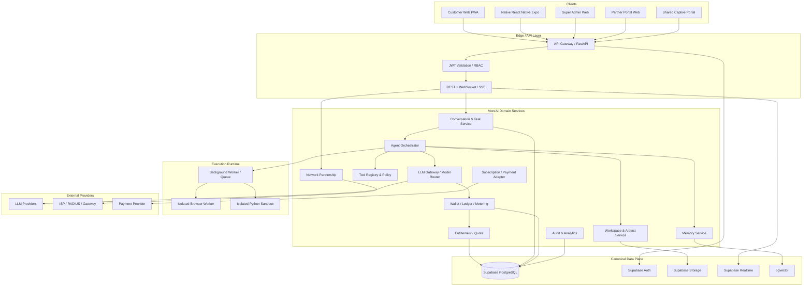
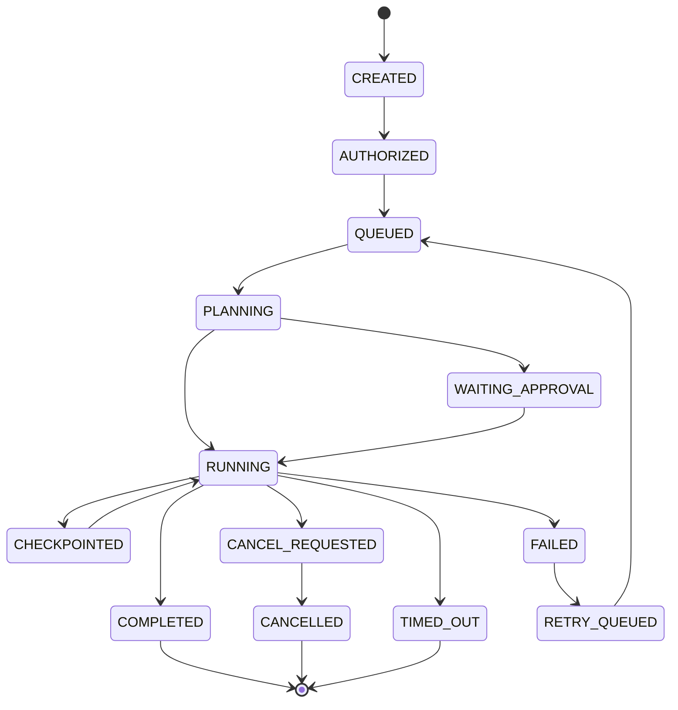
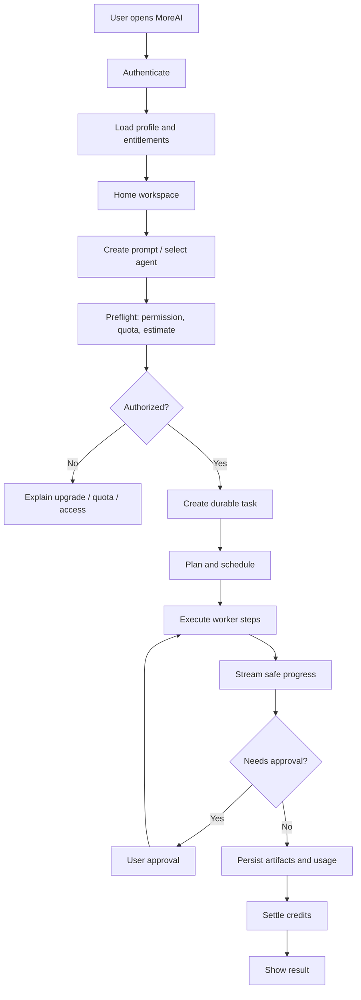

# MOREAI --- MASTER PRODUCT REQUIREMENTS DOCUMENT (MASTER PRD)

**Dokumen:** MoreAI Master PRD\
**Versi:** 1.2 --- Full backend source integration, UI preservation, dan integration-first delivery\
**Tanggal:** 11 November 2026\
**Status:** Draft induk untuk engineering discovery, source migration,
design completion, implementation, dan acceptance\
**Bahasa:** Indonesia\
**Produk:** MoreAI --- AI Workspace, Agent Platform & Network
Partnership Ecosystem

------------------------------------------------------------------------

## 0. Pernyataan penting, ruang lingkup, dan cara membaca dokumen

Dokumen ini mengonsolidasikan keputusan dan kebutuhan MoreAI yang sudah
dibahas: produk AI agent, migrasi OpenManusWeb, monorepo mandiri,
aplikasi web PWA, aplikasi Native React Native Expo, Super Admin,
Partner Portal, Captive Portal multi-tenant, FastAPI, worker, sandbox,
Supabase, sistem kredit dan entitlement, integrasi provider LLM, Network
Partnership, design system Playful Neo-Brutalist / Soft Pastel, UI/UX
mobile-first, serta workflow operasional dan roadmap.

### 0.1 Dua deliverable yang berbeda

1.  **Master PRD ini** adalah spesifikasi produk, arsitektur target,
    aturan implementasi, kontrak perilaku, workflow, data model
    konseptual, keamanan, desain, migrasi, dan acceptance criteria.
2.  **Source code OpenManusWeb** harus disalin melalui proses Git/source
    migration ke repository MoreAI. Source code tidak ditempel
    seluruhnya ke dalam dokumen PRD karena kode adalah artefak
    repository yang harus dipertahankan sebagai file dengan path,
    riwayat, dependency, aset, konfigurasi, dan lisensi aslinya.

Dengan demikian, dokumen ini mewajibkan migrasi menyeluruh atas seluruh
file source yang relevan dari upstream, tetapi **tidak mengklaim bahwa
source sudah disalin, aplikasi sudah dibangun, atau endpoint sudah
berjalan**. Pekerjaan tersebut baru berstatus selesai setelah ada
commit, manifest file, hasil build, pengujian, dan verifikasi repository
tujuan.

### 0.2 Aturan integritas source

-   Upstream: `https://github.com/YunQiAI/OpenManusWeb.git`
-   Baseline branch yang menjadi referensi audit sebelumnya:
    `dev_web_app`.
-   Repository upstream yang ditemukan bersifat publik dan README
    menyatakan proyek sebagai web app untuk OpenManus. Daftar root yang
    terlihat mencakup `.github`, `app`, `assets`, `config`, `examples`,
    `tools`, `.gitattributes`, `.gitignore`, `.pre-commit-config.yaml`,
    `CODE_OF_CONDUCT.md`, `DEVELOPMENT_LOG.md`, `LICENSE`, `README.md`,
    `README_zh.md`, `main.py`, `pytest.ini`, `requirements.txt`,
    `run_flow.py`, `setup.py`, dan `web_run.py`.
-   File `LICENSE` pada branch yang diperiksa berisi MIT License dengan
    copyright notice `Copyright (c) 2025 manna_and_poem`. Seluruh
    salinan atau substantial portions wajib mempertahankan copyright
    notice dan teks lisensi.
-   Simpan `THIRD_PARTY_NOTICES.md` di root MoreAI dan pertahankan file
    `LICENSE` upstream di direktori source mirror/vendor.
-   Jangan menghapus attribution, menyamarkan asal komponen, atau
    menyatakan seluruh implementasi upstream sebagai karya orisinal
    MoreAI.
-   Audit lisensi semua dependency dan aset tambahan secara terpisah.
    Lisensi MIT pada repository tidak otomatis melisensikan seluruh
    dependency pihak ketiga, logo, merek, model, atau data eksternal.
-   Jangan menyalin secret, API key, `.env` privat, credential, browser
    profile, log berisi data pribadi, atau artefak runtime yang tidak
    aman. Jika ada file semacam itu di repository sumber, catat dan
    karantina; jangan masukkan ke history baru. Source code, aset
    produk, file konfigurasi contoh, tests, scripts, docs, dotfiles, dan
    workflow yang sah tetap harus diinventarisasi dan dipertahankan.
-   Jangan melakukan perubahan destruktif terhadap repository upstream.

### 0.3 Status keputusan

Istilah yang dipakai: - **Confirmed**: eksplisit disepakati di
percakapan. - **Target**: rancangan arsitektur yang harus diwujudkan. -
**Proposed / tunable**: rekomendasi awal yang harus dapat dikonfigurasi
dan belum menjadi angka final. - **Open decision**: memerlukan keputusan
bisnis/operasional sebelum production. - **Not implemented**: belum ada
bukti implementasi atau verifikasi.

------------------------------------------------------------------------

# 1. Visi produk dan positioning

MoreAI adalah **AI Workspace dan Agent Platform** yang memungkinkan
individu dan organisasi menggunakan AI untuk riset, analisis, pembuatan
konten, coding, browsing, pengolahan dokumen, otomasi pekerjaan, dan
workflow multi-step. MoreAI menggabungkan agent runtime, model routing,
tool execution, memory, workspace, credit wallet, entitlement,
subscription, serta jaringan distribusi melalui partner Wi-Fi.

MoreAI bukan sekadar chat wrapper. Produk harus menyediakan pengalaman
kerja yang berkelanjutan: pengguna dapat membuat tugas, menjalankan
agent, memantau progres, mengelola hasil dan file, melanjutkan
percakapan, mengatur akses AI, serta mengakses benefit partner secara
aman.

## 1.1 Misi

-   Membuat kemampuan AI agent yang kompleks mudah digunakan melalui UI
    yang sederhana.
-   Menyatukan berbagai model dan tools melalui satu LLM Gateway / Model
    Router.
-   Menyediakan kontrol biaya dan penggunaan melalui metering, wallet,
    quota, ledger, dan subscription.
-   Mendistribusikan akses AI melalui kemitraan venue dan jaringan Wi-Fi
    tanpa mengunci produk pada satu ISP.
-   Menjaga pengalaman konsisten di Web PWA, Native Mobile, Super Admin,
    Partner Portal, dan Captive Portal.

## 1.2 Prinsip produk

1.  **One platform, multiple clients** --- seluruh aplikasi memakai API
    dan domain engine yang sama.
2.  **Backend-authoritative** --- keputusan harga, role, kredit, quota,
    akses, verifikasi, dan status pembayaran tidak boleh ditentukan
    frontend.
3.  **Supabase as canonical database** --- tidak membuat database kedua
    untuk menggantikan PostgreSQL utama.
4.  **FastAPI as business API** --- frontend tidak mengakses provider
    LLM atau menjalankan privileged logic secara langsung.
5.  **Real data only** --- tidak menggunakan fake/mock data untuk
    menyatakan fitur sudah terintegrasi. Data ilustrasi hanya boleh ada
    di design mockup dan harus diberi label.
6.  **Secure execution** --- browser dan Python execution wajib
    terisolasi, dibatasi, diaudit, dan memiliki lifecycle.
7.  **Modular integration** --- provider LLM, payment, RADIUS, gateway,
    Captive Portal, dan ISP API memakai adapter.
8.  **Fail closed for sponsored access** --- kegagalan verifikasi tidak
    boleh memberi Partner Free Access.
9.  **Paid entitlement independent** --- paid access tidak hilang hanya
    karena pengguna meninggalkan jaringan partner.
10. **Mobile-first, responsive** --- desain dimulai dari layar kecil dan
    berkembang ke tablet/desktop.

## 1.3 Target pengguna

-   Individu / personal AI users.
-   Professional, creator, researcher, developer, student.
-   Power users yang membutuhkan agent dan tool execution.
-   Partner venue: cafe, restoran, coworking, kampus, perpustakaan,
    hotel, ruang publik, fasilitas publik.
-   Partner operator dan staff cabang.
-   Super Admin, Finance Admin, Support, Security Admin, Platform
    Operator.
-   Di masa depan: ISP pusat, network operator, enterprise Wi-Fi
    provider.

------------------------------------------------------------------------

# 2. Product scope

## 2.1 In scope

### Core AI Platform

-   Authentication dan user profile.
-   Chat workspace dan conversation history.
-   Task / agent run management.
-   Planning dan step execution.
-   Agent registry dan agent marketplace.
-   LLM provider registry dan model routing.
-   Tool registry dan permission policy.
-   Browser automation.
-   Python/code execution pada isolated sandbox.
-   File upload, storage, workspace, artifact, export.
-   Memory dan personalization.
-   Streaming status, progress events, cancellation.
-   Usage metering dan audit.

### Monetization & Access

-   Wallet.
-   Immutable credit ledger.
-   Credit grant, purchase, spend, refund/reversal.
-   Usage metering per model/provider/tool.
-   General Free entitlement.
-   Partner Free entitlement.
-   Paid subscription entitlement.
-   Purchased credits.
-   Quota windows, usage limits, priority and concurrency policy.
-   Invoice/payment integration (provider adapter; provider final belum
    ditetapkan di PRD ini).

### Network Partnership

-   Partner organizations.
-   Partner members.
-   Locations / branches.
-   Wi-Fi networks.
-   Network providers / ISP metadata.
-   Per-network verification configuration.
-   Geo-WiFi verification.
-   Access codes.
-   Campaign-based rewards.
-   Partner sessions.
-   Captive Portal (shared multi-tenant; later phase).
-   RADIUS integration (later phase).
-   Gateway Connector (later phase).
-   Central ISP API adapter (later phase).
-   Hybrid verification policy.
-   Partner dashboard and analytics.
-   Super Admin governance and audit.

### Clients

-   Customer Web PWA.
-   Native React Native Expo app.
-   Super Admin Web.
-   Partner Portal Web.
-   Shared Captive Portal Web.
-   FastAPI backend.
-   Worker services.
-   Sandbox runtime.

## 2.2 Out of scope for initial baseline

-   Membuat database terpisah di luar Supabase PostgreSQL sebagai sumber
    utama.
-   Mengizinkan frontend memanggil LLM provider langsung.
-   Mengambil alih seluruh autentikasi internet pelanggan ISP. MoreAI
    hanya mengelola entitlement AI; Wi-Fi gateway tetap mengelola akses
    internet venue sesuai konfigurasi venue.
-   Menganggap IP geolocation cukup akurat sebagai pengganti
    GPS/geolocation radius 500m.
-   Menganggap browser dapat membaca SSID Wi-Fi secara universal.
-   Menjamin captive portal auto-popup pada seluruh OS/perangkat.
-   Membuat portal terpisah untuk setiap partner. Captive Portal harus
    satu aplikasi shared multi-tenant.
-   Menggunakan fake data sebagai bukti integrasi produksi.
-   Menjalankan arbitrary Python/browser JavaScript pada proses API
    utama.

------------------------------------------------------------------------

# 3. Product architecture overview

## 3.1 Logical architecture



## 3.2 Trust boundaries

-   Client applications are untrusted.
-   FastAPI is the trusted business boundary after authentication and
    authorization.
-   Worker and sandbox are isolated execution boundaries.
-   Supabase service-role key hanya boleh berada di trusted server
    environment.
-   LLM provider credentials hanya boleh berada di server-side secret
    management.
-   Partner router / RADIUS / ISP callback dianggap external input dan
    harus diverifikasi.
-   Webhook payment wajib signature verification, idempotency, replay
    protection, dan event audit.
-   File content, browser pages, tool output, model output, dan prompt
    dari user diperlakukan sebagai untrusted data.

## 3.3 Architectural invariants

1.  Satu canonical PostgreSQL project/schema family untuk domain MoreAI.
2.  Semua akses data sensitif melalui API / server-side policy; RLS
    tetap aktif sebagai defense-in-depth.
3.  Tidak ada credit issuance dari frontend.
4.  Tidak ada entitlement grant berdasarkan query client yang belum
    diverifikasi.
5.  Tidak ada LLM call tanpa usage record dan policy check.
6.  Setiap mutasi finansial/entitlement/network session harus
    idempotent.
7.  Setiap agent run memiliki durable state dan correlation ID.
8.  Browser/Python worker tidak memiliki akses bebas ke secret platform.
9.  Setiap partner network dapat memiliki verification method berbeda.
10. Fallback verification harus explicit policy; tidak boleh menurunkan
    security secara diam-diam.

------------------------------------------------------------------------

# 4. Target independent monorepo

## 4.1 Repository identity

Nama produk dan repository: `MoreAI` (nama GitHub repository tujuan
masih perlu ditetapkan). Repository tujuan harus berdiri sendiri, bukan
sekadar mengganti nama folder upstream. Upstream tetap dicatat sebagai
sumber third-party dan dapat ditelusuri.

## 4.2 Target directory structure

``` text
MoreAI/
├── apps/
│   ├── web/                         # Customer Next.js PWA
│   │   ├── app/
│   │   ├── components/
│   │   ├── features/
│   │   ├── hooks/
│   │   ├── lib/
│   │   ├── public/
│   │   ├── styles/
│   │   └── tests/
│   ├── mobile/                      # React Native Expo
│   │   ├── app/
│   │   ├── src/
│   │   │   ├── components/
│   │   │   ├── features/
│   │   │   ├── navigation/
│   │   │   ├── services/
│   │   │   ├── store/
│   │   │   └── theme/
│   │   ├── assets/
│   │   └── tests/
│   ├── admin/                       # Super Admin Web
│   ├── partner-portal/              # Partner dashboard
│   ├── captive-portal/              # Shared multi-tenant Wi-Fi portal
│   ├── api/                         # FastAPI application
│   ├── worker/                      # Async/background worker entrypoint
│   └── sandbox/                     # Isolated execution service image/config
│
├── engine/
│   ├── agents/
│   │   ├── base/
│   │   ├── react/
│   │   ├── toolcall/
│   │   ├── manus/
│   │   ├── registry/
│   │   └── policies/
│   ├── orchestration/
│   │   ├── planner/
│   │   ├── executor/
│   │   ├── task_graph/
│   │   ├── scheduler/
│   │   ├── state_machine/
│   │   └── evaluator/
│   ├── tools/
│   │   ├── browser/
│   │   ├── python/
│   │   ├── search/
│   │   ├── file/
│   │   ├── connectors/
│   │   └── registry/
│   ├── llm/
│   │   ├── providers/
│   │   ├── router/
│   │   ├── policies/
│   │   ├── streaming/
│   │   └── cost/
│   ├── memory/
│   │   ├── short_term/
│   │   ├── long_term/
│   │   ├── embeddings/
│   │   └── retrieval/
│   ├── credits/
│   │   ├── wallet/
│   │   ├── ledger/
│   │   ├── quota/
│   │   └── metering/
│   ├── entitlements/
│   ├── subscriptions/
│   └── network_partnership/
│       ├── organizations/
│       ├── locations/
│       ├── networks/
│       ├── providers/
│       ├── verification/
│       │   ├── base.py
│       │   ├── geo_wifi/
│       │   ├── captive_portal/
│       │   ├── radius/
│       │   ├── gateway/
│       │   └── central_isp/
│       ├── sessions/
│       ├── access_codes/
│       ├── campaigns/
│       ├── rewards/
│       ├── policies/
│       └── analytics/
│
├── packages/
│   ├── ui-web/
│   ├── ui-native/
│   ├── design-tokens/
│   ├── icons/
│   ├── api-client/
│   ├── types/
│   ├── validation/
│   ├── config/
│   └── localization/
│
├── supabase/
│   ├── migrations/
│   ├── functions/
│   ├── seed/
│   ├── tests/
│   └── config.toml
│
├── vendor/
│   └── openmanusweb/                # Complete upstream source mirror / provenance
│
├── infrastructure/
│   ├── docker/
│   ├── deployment/
│   ├── monitoring/
│   ├── secrets/
│   ├── networking/
│   └── scripts/
│
├── docs/
│   ├── product/
│   ├── architecture/
│   ├── api/
│   ├── data/
│   ├── security/
│   ├── design/
│   ├── operations/
│   ├── migration/
│   └── runbooks/
│
├── tests/
│   ├── unit/
│   ├── integration/
│   ├── contract/
│   ├── e2e/
│   ├── security/
│   ├── performance/
│   └── fixtures/
│
├── .github/
│   └── workflows/
├── THIRD_PARTY_NOTICES.md
├── LICENSE
├── README.md
├── CONTRIBUTING.md
├── SECURITY.md
├── CODEOWNERS
├── package.json
├── pnpm-workspace.yaml
├── turbo.json
├── pyproject.toml
├── uv.lock
├── .gitignore
└── .env.example
```

## 4.3 Monorepo tooling

Target recommendation: - pnpm workspace + Turborepo untuk
TypeScript/JavaScript packages dan apps. - Python workspace dikelola
dengan `uv`, `pyproject.toml`, dan `uv.lock`. - Shared API schema
menggunakan OpenAPI generated TypeScript client atau kontrak
schema-first. - CI memisahkan lint, typecheck, unit, integration, build,
security, dan e2e. - Docker image terpisah untuk API, worker, browser
worker, dan Python sandbox. - Jangan memaksa seluruh apps berjalan dalam
satu process. - Shared packages tidak boleh mengandung environment
secret atau business logic privileged yang hanya aman di server.

## 4.4 Source migration strategy

### Required source inventory

Inventaris semua branch/ref dan file upstream sebelum migrasi. Root
inventory yang sudah terlihat:

``` text
.github/
app/
assets/
config/
examples/
tools/
.gitattributes
.gitignore
.pre-commit-config.yaml
CODE_OF_CONDUCT.md
DEVELOPMENT_LOG.md
LICENSE
README.md
README_zh.md
main.py
pytest.ini
requirements.txt
run_flow.py
setup.py
web_run.py
```

Daftar tersebut adalah root-level inventory, bukan jaminan seluruh
nested files sudah terhitung. Migrasi wajib menghasilkan
machine-readable manifest dari seluruh tracked files, misalnya
`docs/migration/openmanusweb-file-manifest.txt`.

### Recommended migration procedure

``` bash
# 1. Mirror clone: mempertahankan seluruh refs dan Git objects
git clone --mirror https://github.com/YunQiAI/OpenManusWeb.git
cd OpenManusWeb.git
git show-ref

# 2. Buat working clone dari mirror
cd ..
git clone OpenManusWeb.git MoreAI
cd MoreAI

# 3. Tambahkan upstream remote dan checkout baseline branch yang diaudit
git remote add upstream https://github.com/YunQiAI/OpenManusWeb.git
git fetch upstream --prune
git checkout -b migration/openmanusweb-dev-web-app upstream/dev_web_app

# 4. Simpan manifest file tracked
git ls-tree -r --name-only HEAD > docs/migration/openmanusweb-file-manifest.txt

# 5. Buat source snapshot provenance di vendor/
mkdir -p vendor/openmanusweb
git archive HEAD | tar -x -C vendor/openmanusweb

# 6. Simpan upstream metadata
git log --oneline --decorate --all > docs/migration/openmanusweb-history.txt
git remote -v > docs/migration/openmanusweb-remotes.txt
```

Perintah di atas adalah prosedur yang direkomendasikan, belum dieksekusi
dalam penyusunan PRD ini. Implementer harus memastikan default branch,
branch `dev_web_app`, tag, submodule, Git LFS, generated assets, dan
semua refs sebelum menetapkan baseline final.

### Migration rules

-   Snapshot source penuh harus dapat dibandingkan dengan upstream
    commit.
-   Tidak boleh menghapus file source yang tidak dikenal hanya karena
    belum dipakai pada UI baru.
-   Setiap file harus dikategorikan: `preserved`, `adapted`, `moved`,
    `replaced`, `deprecated-with-reason`, atau `excluded-security`.
-   Setiap file yang dipindahkan ke `engine/` atau `apps/api/` harus
    memiliki mapping source path → target path.
-   Semua source assets, prompt templates, tool definitions, config
    examples, scripts, examples, tests, CI workflows, docs, dan dotfiles
    harus tercakup.
-   Jika file runtime seperti `workspace/`, logs, cache, atau browser
    state muncul, tentukan kebijakan terpisah dan jangan menyertakan
    data privat.
-   Jangan menghapus upstream history sebelum provenance snapshot dan
    manifest diverifikasi.
-   Simpan source baseline di `vendor/openmanusweb` atau git subtree
    dengan provenance. Kode hasil adaptasi di `engine/` harus memiliki
    attribution yang sesuai.
-   Pertahankan seluruh notice MIT untuk source yang disalin dan
    substantial portions.
-   Jalankan source diff, file count, binary/assets check, dan license
    scan setelah migrasi.

### Upstream source capabilities known from inspection

Dokumentasi upstream menjelaskan: - FastAPI web application. - Native
HTML/CSS/JavaScript web interface. - WebSocket real-time updates. - Chat
API, stop-session API, session result API. - File workspace APIs. - Logs
and parsed logs APIs. - Thinking/progress endpoints. - Browser and
tool-based agent execution. - Local file-system workspace for
artifacts/logs.

Sumber: `README.md`, `app/web/README.md`, `DEVELOPMENT_LOG.md`,
`requirements.txt`, dan `LICENSE` di branch `dev_web_app`.

------------------------------------------------------------------------

# 5. Source OpenManusWeb: functional baseline and adaptation map

## 5.1 Baseline agent architecture

Audit source sebelumnya mengidentifikasi kelompok modul berikut (perlu
diverifikasi ulang terhadap manifest final):

-   `app/agent/base.py`
-   `app/agent/react.py`
-   `app/agent/toolcall.py`
-   `app/agent/manus.py`
-   `app/flow/planning.py`
-   `app/tool/planning.py`
-   `app/tool/browser_use_tool.py`
-   `app/tool/python_execute.py`
-   `app/tool/google_search.py`
-   `app/tool/file_saver.py`
-   `app/llm.py`
-   `app/agent/llm_wrapper.py`
-   `app/web/app.py`
-   `app/web/log_handler.py`
-   `app/web/log_parser.py`
-   `app/web/thinking_tracker.py`
-   `app/schema.py`
-   config files, prompts, examples, assets, tests, scripts, and
    workflows.

## 5.2 Existing behavior to preserve or improve

### Agent hierarchy

-   BaseAgent: lifecycle and base state.
-   ReActAgent: reasoning/action loop pattern.
-   ToolCallAgent: tool-call interaction.
-   Manus: concrete general-purpose agent.
-   PlanningFlow: task planning and step execution.
-   PlanningTool: plan state and plan-related tool interface.

### Tools

-   Python execution.
-   Browser automation.
-   Google search.
-   File saving.
-   Termination.
-   Planning and any additional tools discovered during complete source
    inventory.

### LLM layer

-   AsyncOpenAI / AsyncAzureOpenAI compatible client usage.
-   Provider base URL and API key configuration.
-   Tool/function calling.
-   Streaming/callback behavior.
-   Retry policy.
-   Vision model configuration where supported.

### Web experience

-   Chat request and session management.
-   WebSocket live progress.
-   User-visible task progress and activity.
-   Workspace file listing and retrieval.
-   Logs and parsed logs.
-   Stop/cancel action.
-   Frontend graceful degradation when WebSocket is unavailable (as
    described in development log).

## 5.3 Risks identified in baseline audit

The following findings were noted in a prior partial source review and
must be revalidated against the exact migrated commit:

1.  `process_prompt` creates workspace and uses process-global
    `os.chdir`.
2.  It mutates environment variables during task execution.
3.  Manus agent and PlanningFlow lifecycle were constructed per request.
4.  PlanningTool keeps plans in memory.
5.  Session state and progress can be in-memory.
6.  Cancellation may occur only at step boundaries.
7.  Python `exec()` path is not a hardened sandbox by itself.
8.  Browser tool may permit JavaScript execution and broad browser
    access.
9.  Global working directory/environment mutations can cause
    cross-request concurrency bugs.
10. Durable task recovery, strong sandbox isolation, and long-term
    semantic memory were not established by the partial review.
11. ThinkingTracker is progress/observability presentation; it must not
    expose private hidden chain-of-thought. Only safe, concise activity
    summaries, task steps, tool status, and user-facing explanations may
    be shown.

These are not assertions that every current upstream version has
identical defects. They are mandatory security and architecture review
points.

## 5.4 Adaptation mapping

  --------------------------------------------------------------------------
  Upstream concern        MoreAI target              Required change
  ----------------------- -------------------------- -----------------------
  Agent classes           `engine/agents/`           Preserve behavior, add
                                                     dependency injection
                                                     and policy boundaries

  PlanningFlow            `engine/orchestration/`    Durable task graph,
                                                     checkpoints, retries,
                                                     recovery

  PlanningTool            Planner service + DB       Persist plan and step
                                                     state

  LLM client              `engine/llm/`              Central router,
                                                     metering, provider
                                                     policy, timeout and
                                                     fallback

  Browser tool            `engine/tools/browser/`    Isolated browser
                                                     worker, domain
                                                     allowlist, audit

  Python tool             `engine/tools/python/` +   Container isolation,
                          sandbox                    quotas, no host access

  Search tool             `engine/tools/search/`     Provider adapters,
                                                     source provenance

  FileSaver               Workspace service          Supabase Storage,
                                                     signed access, artifact
                                                     metadata

  WebSocket               API realtime gateway       Authenticated task
                                                     stream, event
                                                     persistence/replay

  Local session dict      Task/session repository    Durable PostgreSQL
                                                     state

  Local config            Server config + secret     No secrets in client or
                          store                      committed config

  Logs                    Structured telemetry       Redaction, retention,
                                                     trace IDs

  HTML/JS web UI          Next.js PWA                Rebuild UI with shared
                                                     design system

  Static templates        New app layouts            Preserve interaction
                                                     requirements, not
                                                     obsolete presentation
  --------------------------------------------------------------------------

------------------------------------------------------------------------

# 6. Application surfaces and detailed functional requirements

## 6.1 Customer Web PWA --- `apps/web`

### Purpose

Primary responsive browser experience for personal AI workspace, chat,
agents, files, billing, access and account management.

### Navigation

-   Home / Workspace.
-   Chat history.
-   Agents.
-   Tools / Connectors.
-   Tasks / Runs.
-   Files / Artifacts.
-   Memory.
-   Credits / Wallet.
-   Plans / Subscription.
-   Partner Wi-Fi Access.
-   Notifications.
-   Profile / Settings / Help.

### Screens and behavior

#### A. Public entry and authentication

-   Welcome / product introduction.
-   Sign up, sign in, password reset, OAuth provider flows.
-   Email verification and session management.
-   Terms and privacy consent.
-   Onboarding preferences.
-   Loading, error, expired session and rate-limited states.

#### B. Home workspace

-   Greeting and active workspace.
-   Credit and entitlement status.
-   Recent conversations and tasks.
-   Quick action prompts.
-   Suggested agents and tools.
-   Partner access availability card if the user is in an eligible
    campaign/network.
-   Clear separation between paid, partner-sponsored, and general free
    access.

#### C. Chat workspace

-   Conversation list and search.
-   Conversation detail.
-   Message composer.
-   File attachments.
-   Agent selector.
-   Model selector (only models allowed by entitlement and policy).
-   Tool permission prompts.
-   Streaming assistant response.
-   User-facing activity timeline.
-   Stop/cancel task.
-   Retry / regenerate where safe.
-   Copy/export.
-   Citation/source display.
-   Artifact preview.
-   Error, timeout, quota exceeded, provider failure and insufficient
    credits states.

#### D. Agent marketplace

-   Browse/search/filter agents.
-   Agent detail, capability, supported tools, data access scope, credit
    estimate and policy.
-   Start agent task.
-   Agent version and availability.
-   User feedback and rating (moderated).
-   No agent may silently exceed permissions declared in its manifest.

#### E. Tools and connectors

-   Tool directory.
-   Connector authorization and revoke.
-   Browser/search/file/Python tool capabilities.
-   Permission scope, privacy description and limits.
-   Tool run confirmation for risky actions.
-   Tool execution history.
-   Tool output viewer.

#### F. Tasks and run monitor

-   Task queue and run history.
-   Run detail and progress.
-   Step state: queued, running, waiting approval, completed, failed,
    cancelled, timed out.
-   Safe user-facing activity summaries (not private hidden reasoning).
-   Retry from checkpoint when idempotent.
-   Pause/cancel when supported.
-   Download artifacts.
-   Failure reason and support correlation ID.

#### G. Workspace and files

-   Folder/file list.
-   Upload and preview.
-   Generated artifact browser.
-   File metadata, owner, task link, retention.
-   Download via signed URL.
-   Access control and virus/content scanning policy.
-   No direct arbitrary filesystem path access.

#### H. Memory

-   Memory status and consent.
-   User can review, correct, disable, or request deletion through
    supported privacy controls.
-   Memory source and scope labels.
-   Memory must not silently ingest unrelated private files.
-   Separate conversation history from durable user memory.

#### I. Wallet and billing

-   Paid credit balance.
-   Credit transactions.
-   Credit package catalog.
-   Subscription plans.
-   Usage history by task/model.
-   Payment checkout and payment status.
-   Invoice/receipt.
-   Refund/reversal status.
-   Clear display of sponsored quota separate from paid credits.

#### J. Partner Wi-Fi activation

-   List or detect available partner campaign only from server-verified
    evidence.
-   Explain required verification method.
-   Geo-WiFi flow: Wi-Fi/network proof + user-permitted geolocation +
    venue access code.
-   Captive Portal flow: signed gateway/session proof; code optional per
    campaign.
-   RADIUS/gateway/ISP methods as adapters.
-   Explain location permission and purpose.
-   Show access session status and remaining sponsored quota.
-   If verification fails, do not grant Partner Free. General Free
    remains available if user is eligible.
-   Paid Access remains usable independently.

#### K. Profile/settings

-   Profile and security.
-   Device/session management.
-   Notification preferences.
-   Language and appearance.
-   Light/dark theme.
-   Privacy and memory.
-   Connected integrations.
-   Account deletion and export requests.

## 6.2 Native Mobile --- `apps/mobile` (React Native Expo)

### Purpose

Native mobile client with the same product capabilities and domain
policies as Web PWA, optimized for touch, native lifecycle and device
permissions.

### Required capabilities

-   Sign-in and secure session.
-   Chat, streaming, task monitor.
-   File picker, camera/document attachment where permitted.
-   Push notification registration.
-   Deep links and universal links.
-   Biometric unlock as optional local convenience (not replacement for
    server authentication).
-   Secure token storage using platform secure storage.
-   Geolocation permission for Geo-WiFi.
-   App state handling, offline/poor-network states.
-   Share/export artifacts.
-   Native navigation and safe areas.
-   Subscription and purchase flow through the approved payment policy
    (store policy review required if in-app digital purchases are
    offered).

### Native-specific UX

-   Thumb-friendly navigation.
-   Bottom tabs for primary destinations.
-   Bottom sheets for agent/model selection.
-   Full-screen task execution detail.
-   Keyboard-aware composer.
-   Native permission rationale before OS permission dialog.
-   No silent location collection.
-   Do not claim the app can read Wi-Fi SSID universally; network
    evidence must come from supported native APIs or gateway
    integration.

### Parity rule

The same server-side entitlement, credit, session, agent and tool
policies apply to web and native. UI may differ; business outcomes may
not.

## 6.3 Super Admin Web --- `apps/admin`

### Purpose

Platform control plane. Only privileged roles may enter. All privileged
actions are audited.

### Main modules

1.  Platform overview and service health.
2.  User directory and user detail.
3.  Roles, permissions, staff invitations.
4.  Agent registry and versions.
5.  Tool registry and policies.
6.  LLM provider configuration.
7.  Model routing and cost policies.
8.  Usage and cost analytics.
9.  Credit packages, wallet and ledger explorer.
10. Subscription and payment reconciliation.
11. Partner organizations and members.
12. Locations and Wi-Fi networks.
13. Verification policy builder.
14. Campaigns, codes and rewards.
15. Network sessions and revocation.
16. Partner usage and sponsored cost allocation.
17. Security events and audit logs.
18. Feature flags and configuration.
19. Support operations and user impersonation controls (if enabled,
    heavily audited and time-limited).
20. System settings.

### Role model (target)

-   `super_admin`: full platform governance.
-   `platform_admin`: platform operations excluding selected sensitive
    finance/security controls.
-   `finance_admin`: payment, credit, pricing and reconciliation.
-   `support_admin`: support workflows with limited PII exposure.
-   `security_admin`: access/security review and incident response.
-   `partner_manager`: partner onboarding and partner governance.
-   `read_only_analyst`: reporting only.

Role definitions and permission scopes must be implemented server-side.
Frontend route guards are supplementary only.

## 6.4 Partner Portal --- `apps/partner-portal`

### Purpose

Partner organization and venue operations dashboard.

### Modules

-   Partner organization overview.
-   Locations/branches.
-   Wi-Fi networks per location.
-   Verification method status and setup instructions.
-   Staff/member access.
-   Campaign request and campaign view.
-   Access code batches and QR distribution.
-   Active and historical sessions.
-   Sponsored credit usage.
-   Campaign redemption.
-   Analytics by venue, network, campaign and period.
-   Reports/export.
-   Billing/sponsored budget view where contract permits.
-   Support and onboarding checklist.

### Partner roles

-   `partner_owner`: organization-level administration.
-   `partner_admin`: manage branches/networks/campaign requests.
-   `location_manager`: selected venue only.
-   `partner_staff`: access code distribution and basic session support.
-   `partner_analyst`: read-only analytics.

Partner members must only access their own organization and authorized
locations. Tenant isolation is mandatory.

## 6.5 Shared Captive Portal --- `apps/captive-portal`

### Purpose

One multi-tenant portal application that renders partner-specific
branding/configuration using signed context from the network
gateway/controller.

### Requirements

-   One deployment and codebase for all partners.
-   Resolve partner, location, network and campaign via verified signed
    token / gateway context.
-   Do not trust arbitrary query parameters as proof of network
    presence.
-   MikroTik Hotspot adapter as an initial candidate; later
    UniFi/controller adapters.
-   Optional code requirement per campaign.
-   Link MoreAI account or create/sign in.
-   Show terms, privacy and venue identity.
-   Verify gateway session proof server-side.
-   Issue a MoreAI entitlement session only after valid proof and policy
    check.
-   Return appropriate success/failure page to gateway.
-   Provide QR and manual URL fallback.
-   Explain that captive portal auto-popup depends on OS/router behavior
    and cannot be guaranteed universally.
-   Keep Wi-Fi internet authentication separate from MoreAI AI
    entitlement.
-   Use explicit walled-garden configuration for required MoreAI
    domains; avoid broad unrestricted bypass.
-   Rate-limit portal attempts and prevent replay.

------------------------------------------------------------------------

# 7. AI agent engine and orchestration

## 7.1 Agent runtime responsibilities

-   Receive a user task with authenticated user, workspace, entitlement,
    tool policy and correlation ID.
-   Validate request and estimate/authorize usage.
-   Create durable task record.
-   Select agent version.
-   Build task plan.
-   Validate tool access and approval requirements.
-   Execute steps through worker.
-   Stream safe progress events.
-   Meter model and tool usage.
-   Persist outputs and artifacts.
-   Complete, fail, cancel or pause the task.
-   Settle credit usage transactionally according to policy.
-   Emit audit/telemetry events.

## 7.2 Agent lifecycle state machine



## 7.3 Planning and execution

-   Planner creates structured steps with objective, dependencies,
    expected output, tool requirement, risk and estimated usage.
-   Planner output is validated against schema.
-   Plan version and step order are persisted.
-   Executor schedules ready steps.
-   Independent safe steps may run concurrently within configured
    limits.
-   Mutating/external actions may require explicit user approval.
-   Step result, retry count, duration, tool calls and usage are
    persisted.
-   A checkpoint is written after each meaningful step.
-   Recovery resumes from last valid checkpoint only if idempotency and
    external side-effect policy allow.
-   A failed tool call must not silently be treated as success.
-   Agent must stop on exhausted budget, revoked entitlement, policy
    violation or cancellation.

## 7.4 Evaluation

-   Task outcome quality.
-   Tool success rate.
-   Correctness and groundedness.
-   Citation/source quality where applicable.
-   Cost per completed task.
-   Latency and time-to-first-token.
-   Retry/failure rate.
-   User feedback.
-   Regression datasets and task suites.
-   Evaluation must not leak private chain-of-thought.

## 7.5 Memory architecture

-   Short-term: conversation and current task context.
-   Long-term: user-approved preferences and useful durable context.
-   Semantic retrieval: pgvector embeddings.
-   Metadata and ownership: PostgreSQL.
-   File memory: references to authorized Storage objects, not
    uncontrolled full copies.
-   User privacy controls: inspect, edit, disable, export/delete
    according to policy.
-   Memory access must be scoped by user, workspace, tenant and consent.
-   Retrieval results are untrusted context and cannot override
    system/security policy.

------------------------------------------------------------------------

# 8. LLM Gateway and Model Router

## 8.1 Responsibilities

-   Provider registry.
-   Model registry and capability metadata.
-   Provider credentials and secret rotation.
-   Routing by capability, cost, latency, region, availability and
    policy.
-   Retry and fallback.
-   Rate limit and concurrency.
-   Streaming response normalization.
-   Tool/function calling normalization.
-   Vision and multimodal capability metadata.
-   Token and cost metering.
-   Provider health and circuit breaker.
-   Request/response redaction policy.
-   Usage reconciliation.

## 8.2 Provider abstraction

Each provider adapter should implement: - `validate_config` -
`list_or_sync_models` (where supported) - `capabilities` - `chat` -
`stream_chat` - `tool_call` - `vision` (when supported) -
`estimate_cost` - `health_check` - normalized error mapping.

Provider API key must never be exposed to clients or logged.

## 8.3 Routing policy

Router may consider: - User plan / entitlement. - Agent capability
requirement. - Context window. - Tool calling support. - Vision/audio
support. - Provider availability. - Cost budget. - Latency target. -
Region and data policy. - Admin allowlist. - User-selected model
preference where permitted.

If provider fallback changes model, UI should disclose selected model
where appropriate.

## 8.4 Metering

Every model request must record: - request ID and task ID. -
user/workspace. - provider and model. - input/output token counts when
available. - cached token counts when available. - image/audio usage
dimensions where applicable. - provider reported cost and internal
normalized cost. - pricing version. - currency and exchange-rate source
if cost conversion is used. - latency, status and error category. -
credit charge and reconciliation state.

No LLM call may bypass the central metering path.

------------------------------------------------------------------------

# 9. Tool system and execution security

## 9.1 Tool registry

Each tool definition includes: - stable tool ID and version. - name and
description. - input/output JSON schema. - capability tags. - permission
scope. - risk class. - required approval mode. - execution
environment. - timeout and resource limits. - idempotency behavior. -
audit category. - availability by plan/agent.

## 9.2 Browser automation

-   Runs in isolated browser worker/container.
-   Separate browser context per task or approved session scope.
-   No access to host filesystem or internal cloud metadata endpoints.
-   Domain allowlist/denylist.
-   SSRF protection and private IP blocking.
-   Download scanning and file size limits.
-   Cookie/session isolation.
-   User approval for login, payment, form submission or irreversible
    action.
-   Capture action log and result, not sensitive page contents beyond
    allowed retention.
-   JavaScript execution disabled unless a tool capability explicitly
    requires it and is policy-approved.
-   Browser timeout, concurrency and cost budget enforced.

## 9.3 Python execution

-   Dedicated ephemeral container or microVM sandbox.
-   Non-root user.
-   Read-only base image.
-   Temporary workspace.
-   CPU, memory, process, disk, network and wall-clock limits.
-   No host mounts.
-   No Docker socket.
-   No production secrets.
-   Network disabled by default; controlled egress only when required.
-   Kill process tree on timeout/cancel.
-   Persist only approved artifacts to object storage.
-   Audit code execution metadata; avoid retaining unnecessary sensitive
    code/output.
-   Arbitrary `exec()` in API process is prohibited.

## 9.4 File tools

-   File path normalized and scoped.
-   No path traversal.
-   MIME/extension validation.
-   File size limits.
-   Malware scanning where applicable.
-   Signed download links with expiry.
-   Object ownership/tenant checks.
-   File lifecycle and retention policies.

------------------------------------------------------------------------

# 10. Credit, wallet, quota, entitlement and subscription

These domains must remain separate. A balance is not the same thing as
access entitlement; a sponsored quota is not paid credit.

## 10.1 Wallet

Represents purchased/paid credit balance and related financial state.

## 10.2 Immutable ledger

All credit changes are ledger entries: - purchase credit. - promotional
grant. - partner-sponsored usage allocation (where applicable). - usage
debit. - refund. - reversal. - manual adjustment (privileged, reason and
approval required). - expiry (only if product policy introduces it).

Ledger entries are append-only. Corrections use reversal/compensating
entries, not destructive updates.

## 10.3 Entitlement

Determines what a user is allowed to access: - General Free. - Partner
Free. - Paid subscription. - Purchased credit access. - Admin/internal
entitlement. - Promotional entitlement.

Entitlement policy contains start/end, source, quota, allowed
model/tool/agent, priority, concurrency and scope.

## 10.4 General Free

Proposed baseline from discussion: - 100 credits per rolling 6-hour
window. - No rollover is a proposed rule, not final approved business
policy. - Exact reset semantics, timezone, burst limits, concurrency and
abuse policy require configuration and product approval. - General Free
is available subject to account and abuse policies.

## 10.5 Partner Free

Confirmed model: - Available only when user is verified on a partner
network and has valid campaign eligibility/access code. - Session-based
access. - Campaign-based rewards. - Hybrid verification architecture. -
When user leaves partner network or proof/session expires, Partner Free
entitlement ends. - General Free may become available if the user
qualifies. - Partner quota is separate from purchased wallet credits. -
No Partner Free grant if verification fails. - Each partner, location
and network can have its own verification method and policy.

## 10.6 Paid access

Confirmed requirement: - User may separately subscribe/pay or purchase
credits. - Paid access must remain independent from partner Wi-Fi
connection. - Leaving a partner network must not revoke paid
subscription or paid credits. - Partner-sponsored benefit is additive
and does not replace paid entitlement.

## 10.7 Entitlement resolution

Recommended resolution order: 1. Validate identity and account status.
2. Load all active entitlements. 3. Check task/model/tool eligibility.
4. Determine applicable priority and concurrency. 5. Choose funding
source according to policy. 6. Reserve quota/credits atomically. 7.
Execute task. 8. Settle actual usage. 9. Release unused reservation or
create compensating adjustment. 10. Persist audit and usage records.

The policy must explicitly define whether partner sponsored quota or
paid credits is consumed first when both exist. This remains an open
business decision. UI must show the source of consumption before
execution where material.

## 10.8 Atomicity and idempotency

-   Unique idempotency key per payment, credit grant, debit, entitlement
    issuance and webhook.
-   Use DB transaction / RPC for atomic balance and ledger mutation.
-   Lock or use safe concurrency strategy for wallet/quota windows.
-   Never trust client-submitted amount or balance.
-   Duplicate webhook must not duplicate credit.
-   Reversal must reference original transaction.
-   Failed job settlement must be recoverable and auditable.

------------------------------------------------------------------------

# 11. Network Partnership system

## 11.1 Business model

MoreAI partners directly with venue operators, not only with central
ISPs. A cafe may use Biznet, a restaurant IndiHome, a campus its own
Wi-Fi, or a hotel another provider. MoreAI partnership is with the
venue/operator, while ISP metadata is recorded as network context.

Direct ISP central partnership remains a future option. The architecture
must support it without requiring it for initial launch.

### Initial venue categories

-   Cafe and restaurant.
-   Coworking space.
-   Campus and university.
-   Public library.
-   Hotel and accommodation.
-   Public venue and facility.
-   Community space.
-   Retail and commercial venue.
-   Other approved partner locations.

## 11.2 Domain entities

-   Partner Organization.
-   Partner Member.
-   Partner Location / Branch.
-   Network Provider (ISP / internal / managed Wi-Fi).
-   Partner Network / SSID metadata.
-   Verification Configuration.
-   Campaign.
-   Campaign Rule.
-   Access Code Batch / Code.
-   Verification Attempt.
-   Verification Evidence.
-   Network Session.
-   Session Event.
-   Sponsored Entitlement.
-   Reward / Quota Allocation.
-   Partner Usage Allocation.
-   Audit Event.

## 11.3 Verification methods --- selectable per network

Super Admin can configure a method independently for each partner,
location and Wi-Fi network. Branches belonging to one organization may
use different methods.

### Method A --- Geo-WiFi

Initial default candidate for early partner rollout.

Evidence layers: 1. Network/Wi-Fi evidence from supported and verifiable
source. 2. Browser/app geolocation permission and coordinate/accuracy.
3. Venue access code / campaign token.

Requirements: - Default radius example 500m, configurable per
location. - Use Haversine distance. - Evaluate reported accuracy and
boundary uncertainty. - Ask for re-check or fail closed near boundary. -
Explicit browser/device permission. - IP geolocation is not a substitute
for GPS radius. - Do not claim browser can read SSID universally. -
Store minimal evidence and verification outcome; avoid continuous
location tracking. - Location permission must explain purpose. - If
device has no usable location, use another explicitly configured
verification adapter or deny partner access; do not silently weaken
policy.

### Method B --- Captive Portal

-   Gateway/controller redirects client to shared MoreAI portal.
-   Gateway sends signed session context.
-   MoreAI validates signature, timestamp, nonce, network and session
    state.
-   GPS not required if authenticated gateway session is sufficient
    under policy.
-   Access code may be optional depending on campaign.
-   Portal links user identity and network session.
-   Router/controller integration required; portal auto-popup is
    OS/network behavior, not guaranteed by MoreAI.
-   QR/manual URL fallback.
-   MikroTik Hotspot is a possible first adapter; other adapters later.

### Method C --- RADIUS

-   RADIUS authentication/accounting evidence.
-   Validate shared secret or secure transport arrangement.
-   Handle Start, Interim-Update, Stop accounting.
-   Map NAS/client/session identifiers to partner network.
-   Replay protection and session correlation.
-   RADIUS data is not automatically proof of user identity in MoreAI;
    account linking is required.

### Method D --- Gateway Connector

-   Adapter to router/controller/vendor API.
-   Secure API credentials and signature.
-   Session state and client binding.
-   Webhook or polling strategy.
-   Vendor-specific adapter interface.
-   Credential rotation and audit.

### Method E --- Central ISP API

Future integration: - Provider subscriber or access identity. - Provider
verification callbacks. - Provider consent and contractual data scope. -
Rate limit and outage fallback. - Subscriber identifiers must be
minimized and protected. - ISP adapter must not be hard-coded into core
entitlement engine.

### Method F --- Hybrid

-   Combine two or more evidence sources.
-   Explicit boolean policy (AND/OR/threshold) configured by Super
    Admin.
-   Explicit fallback sequence and failure semantics.
-   Fallback must not silently reduce assurance.
-   Record which evidence satisfied the policy.

## 11.4 Unified Verification Engine

All adapters normalize evidence to a common contract:

``` json
{
  "verification_id": "uuid",
  "method": "geo_wifi|captive_portal|radius|gateway|central_isp|hybrid",
  "partner_id": "uuid",
  "location_id": "uuid",
  "network_id": "uuid",
  "user_id": "uuid",
  "device_id": "uuid-or-null",
  "evidence": [],
  "policy_version": "version",
  "verified_at": "ISO-8601",
  "expires_at": "ISO-8601",
  "assurance": "low|medium|high",
  "decision": "verified|rejected|review",
  "reason_code": "machine-readable"
}
```

The contract is conceptual; exact Pydantic schema and evidence types
must be versioned and implemented.

Unified flow: 1. Receive verification attempt. 2. Resolve
partner/location/network. 3. Load active policy. 4. Select adapter(s).
5. Verify cryptographic/network/location/code evidence. 6. Evaluate
policy. 7. Persist attempt and normalized evidence. 8. If verified,
create network session. 9. Resolve campaign and reward. 10. Issue
sponsored entitlement/quota transactionally. 11. Stream session state to
client. 12. Monitor heartbeat/expiry/revocation.

## 11.5 Session lifecycle

Suggested tunable starting values: - Heartbeat interval around 60
seconds. - Proof TTL around 2--3 minutes. - Grace period for short
transient interruption.

These are not fixed product promises and must be load/security tested.

Lifecycle: - `pending` - `verified` - `active` - `grace` - `expired` -
`revoked` - `rejected`

Rules: - Revalidate using method-specific evidence. - Browser tab state
is not trusted proof of Wi-Fi presence. - Backend session proof is
authoritative. - Network change / gateway stop / proof expiration
revokes sponsored access. - Paid entitlement remains unaffected. -
Session event log is append-only. - Duplicate heartbeat or gateway event
is idempotent.

## 11.6 Campaign-based reward

Campaign fields: - campaign name and description. - partner and location
scope. - eligible network(s). - start/end. - reward type and quota. -
claim limit. - per-user/per-device/per-session limits. - access code
required or not. - verification policy. - priority and campaign stacking
rule. - total budget / cap. - active/paused/ended status. - terms and
privacy copy.

Access code: - random, high entropy, non-guessable. - store hashed where
possible. - scoped to campaign/venue/network. - expiration and
redemption limits. - rate-limited attempts. - one-time or reusable
behavior configured. - staff QR/code distribution. - code must not
itself prove Wi-Fi presence unless policy explicitly defines it as one
evidence factor.

## 11.7 Provider independence

-   Partner can use any ISP.
-   MoreAI partner is the venue/operator.
-   Provider is metadata or technical adapter.
-   Central ISP integration is optional future capability.
-   No hard-coded assumption that every venue uses a named ISP.

------------------------------------------------------------------------

# 12. Database architecture --- Supabase PostgreSQL

## 12.1 Canonical data principles

-   Supabase PostgreSQL is the system of record.
-   Supabase Auth is identity provider.
-   Supabase Storage is object storage.
-   Supabase Realtime is for approved realtime subscriptions/events.
-   pgvector supports embedding retrieval.
-   Database migrations are version-controlled.
-   RLS is enabled on tenant/user-scoped tables.
-   Privileged operations use trusted server-side functions/API.
-   No second database should become the source of truth.
-   Queue technology may be introduced as infrastructure if needed, but
    durable business/task state remains recorded in PostgreSQL.

## 12.2 Proposed table domains

### Identity and tenancy

-   `profiles`
-   `user_devices`
-   `workspaces`
-   `workspace_members`
-   `roles`
-   `permissions`
-   `role_permissions`
-   `user_role_assignments`
-   `admin_audit_logs`

### Conversation and agent

-   `conversations`
-   `conversation_messages`
-   `agent_definitions`
-   `agent_versions`
-   `agent_runs`
-   `agent_run_steps`
-   `agent_run_events`
-   `agent_approvals`
-   `tool_definitions`
-   `tool_versions`
-   `tool_execution_records`
-   `task_artifacts`

### LLM and metering

-   `llm_providers`
-   `llm_models`
-   `llm_routing_policies`
-   `llm_usage_records`
-   `provider_cost_records`
-   `pricing_versions`
-   `model_health_events`

### Files and memory

-   `workspace_files`
-   `file_access_events`
-   `memory_items`
-   `memory_embeddings`
-   `memory_sources`
-   `memory_consent_events`

### Credit and billing

-   `credit_wallets`
-   `credit_ledger`
-   `credit_reservations`
-   `credit_usage_records`
-   `quota_windows`
-   `credit_packages`
-   `subscriptions`
-   `subscription_events`
-   `payment_orders`
-   `payment_webhook_events`
-   `invoices`
-   `refund_records`

### Partner and network

-   `partner_organizations`
-   `partner_members`
-   `partner_locations`
-   `network_providers`
-   `provider_partnerships`
-   `partner_networks`
-   `network_verification_configs`
-   `network_verification_attempts`
-   `network_verification_evidence`
-   `network_verification_sessions`
-   `network_sessions`
-   `network_session_events`
-   `network_campaigns`
-   `network_campaign_rules`
-   `network_campaign_codes`
-   `network_campaign_claims`
-   `user_entitlements`
-   `entitlement_policies`
-   `partner_usage_daily`
-   `partner_cost_allocations`
-   `partnership_audit_logs`

### Platform operations

-   `feature_flags`
-   `system_settings`
-   `webhook_deliveries`
-   `outbox_events`
-   `idempotency_keys`
-   `security_events`
-   `support_cases`

Table names are proposed domain names, not evidence of existing schema.
Final migrations require schema design review, foreign-key and index
design, retention policy, and RLS test suite.

## 12.3 Required DB constraints

-   Foreign keys for all tenant/user references.
-   Unique provider identifiers within scope.
-   Unique idempotency keys per operation scope.
-   Unique active campaign code hash where applicable.
-   Check constraints for balances and quota non-negativity.
-   Timestamp and status consistency.
-   Immutable ledger trigger or restricted grants.
-   Append-only event tables where required.
-   Transactional RPC for credit grant/debit/reservation/settlement.
-   Concurrency-safe campaign claim limit.
-   No direct client update of role, wallet balance, entitlement or
    verification result.
-   Index by tenant, user, status, created_at, expires_at,
    correlation_id and external event ID as appropriate.

## 12.4 RLS and tenant isolation

-   User sees only their profile, conversations, files, wallet
    summaries, entitlements and authorized workspaces.
-   Partner member sees only assigned organization and locations.
-   Partner staff has location-specific scope.
-   Admin access uses server-verified role and permission.
-   Service role bypass is restricted to backend only.
-   Realtime publication is limited to user/tenant-scoped channels.
-   Security tests must attempt cross-tenant reads/writes.
-   RLS policy must not rely on a client-supplied role string.

## 12.5 Supabase Auth integration

-   JWT verification in FastAPI.
-   Map `auth.users.id` to profile.
-   Profile provisioning only for verified Auth identity.
-   Role assignment through trusted admin service.
-   Refresh/session expiry handled.
-   OAuth callback URLs validated.
-   Service-role key only in API/worker secret store.
-   Native secure token storage.

------------------------------------------------------------------------

# 13. API and backend architecture

## 13.1 FastAPI service boundaries

`apps/api` owns: - authentication middleware/dependencies. - request
validation. - authorization. - business service invocation. - REST
API. - WebSocket/SSE task events. - OpenAPI schema. - error
normalization. - rate limiting. - audit and correlation. -
health/readiness endpoints.

Business domain logic belongs in `engine/` or domain service packages,
not inside route handlers.

## 13.2 API conventions

-   Versioned prefix: `/api/v1`.
-   JSON request/response schemas.
-   UUID identifiers.
-   UTC ISO-8601 timestamps.
-   Cursor pagination for large event/history lists.
-   Standard error envelope.
-   Correlation/request ID.
-   Idempotency-Key for mutation endpoints.
-   Rate limit headers where appropriate.
-   No secret or raw provider error leakage.

## 13.3 API domains and proposed endpoint map

### Identity

-   `GET /api/v1/me`
-   `PATCH /api/v1/me`
-   `GET /api/v1/me/sessions`
-   `DELETE /api/v1/me/sessions/{session_id}`

### Conversations

-   `POST /api/v1/conversations`
-   `GET /api/v1/conversations`
-   `GET /api/v1/conversations/{conversation_id}`
-   `PATCH /api/v1/conversations/{conversation_id}`
-   `DELETE /api/v1/conversations/{conversation_id}`
-   `POST /api/v1/conversations/{conversation_id}/messages`

### Agent runs

-   `POST /api/v1/agent-runs`
-   `GET /api/v1/agent-runs`
-   `GET /api/v1/agent-runs/{run_id}`
-   `POST /api/v1/agent-runs/{run_id}/cancel`
-   `POST /api/v1/agent-runs/{run_id}/retry`
-   `POST /api/v1/agent-runs/{run_id}/approvals`
-   `GET /api/v1/agent-runs/{run_id}/events`
-   `WS /api/v1/agent-runs/{run_id}/stream` (or authenticated SSE)

### Agents and tools

-   `GET /api/v1/agents`
-   `GET /api/v1/agents/{agent_id}`
-   `GET /api/v1/tools`
-   `GET /api/v1/tools/{tool_id}`

### Files

-   `POST /api/v1/files/upload-url`
-   `POST /api/v1/files/complete`
-   `GET /api/v1/files`
-   `GET /api/v1/files/{file_id}`
-   `POST /api/v1/files/{file_id}/download-url`
-   `DELETE /api/v1/files/{file_id}`

### Wallet and usage

-   `GET /api/v1/wallet`
-   `GET /api/v1/wallet/ledger`
-   `GET /api/v1/usage`
-   `GET /api/v1/entitlements`
-   `GET /api/v1/quotas`
-   `GET /api/v1/credit-packages`

### Subscription/payment

-   `GET /api/v1/plans`
-   `POST /api/v1/checkout`
-   `GET /api/v1/orders/{order_id}`
-   `POST /api/v1/webhooks/payments/{provider}`

### Network partnership user endpoints

-   `POST /api/v1/network/verification-attempts`
-   `GET /api/v1/network/verification-attempts/{verification_id}`
-   `POST /api/v1/network/sessions/{session_id}/heartbeat`
-   `POST /api/v1/network/sessions/{session_id}/end`
-   `GET /api/v1/network/sessions/current`
-   `GET /api/v1/network/campaigns/eligible`

### Partner endpoints

-   `GET /api/v1/partner/me`
-   `GET /api/v1/partner/locations`
-   `POST /api/v1/partner/locations`
-   `GET /api/v1/partner/networks`
-   `POST /api/v1/partner/networks`
-   `GET /api/v1/partner/campaigns`
-   `POST /api/v1/partner/campaign-requests`
-   `GET /api/v1/partner/analytics`
-   `GET /api/v1/partner/sessions`

### Admin endpoints

-   `GET /api/v1/admin/users`
-   `GET /api/v1/admin/users/{user_id}`
-   `POST /api/v1/admin/users/{user_id}/roles`
-   `GET /api/v1/admin/partners`
-   `POST /api/v1/admin/partners`
-   `GET /api/v1/admin/networks`
-   `PUT /api/v1/admin/networks/{network_id}/verification-policy`
-   `POST /api/v1/admin/campaigns`
-   `PATCH /api/v1/admin/campaigns/{campaign_id}`
-   `GET /api/v1/admin/verification-attempts`
-   `POST /api/v1/admin/network-sessions/{session_id}/revoke`
-   `GET /api/v1/admin/audit-logs`
-   `GET /api/v1/admin/llm/providers`
-   `PUT /api/v1/admin/llm/providers/{provider_id}`
-   `GET /api/v1/admin/usage`
-   `GET /api/v1/admin/finance/ledger`

The endpoint list is a target contract. Exact request/response schema,
permission matrix, rate limits, pagination, and idempotency requirements
must be specified in OpenAPI before client implementation.

## 13.4 WebSocket / SSE event contract

Events: - `run.created` - `run.queued` - `run.planning` -
`run.step.started` - `run.step.progress` - `run.waiting_approval` -
`run.step.completed` - `run.artifact.created` - `run.usage.updated` -
`run.completed` - `run.failed` - `run.cancelled` -
`network.session.updated`

Each event includes: - event ID. - event type. - run/session ID. -
correlation ID. - created timestamp. - schema version. - safe
user-facing payload. - sequence number for replay ordering.

Do not stream private chain-of-thought or secrets. Store and stream only
concise activity/status summaries.

------------------------------------------------------------------------

# 14. Worker, queue and runtime infrastructure

## 14.1 Worker responsibilities

-   Poll/consume queued jobs.
-   Acquire lease with expiry.
-   Validate task state and policy.
-   Execute task steps.
-   Persist checkpoints.
-   Publish events.
-   Handle retry/backoff.
-   Reconcile stale jobs.
-   Settle usage.
-   Respect cancellation and deadlines.

## 14.2 Durable execution

-   PostgreSQL persists task/run/step state.
-   Queue may use PostgreSQL-backed job/outbox initially or a dedicated
    queue service as operational infrastructure.
-   Queue delivery is at-least-once; handlers must be idempotent.
-   Use transactional outbox to avoid DB/event publish dual-write gaps.
-   Worker lease expiry allows recovery.
-   Dead-letter state and manual retry are required.
-   Avoid holding DB transactions open during long model/tool calls.

## 14.3 Runtime separation

-   API container: HTTP and realtime gateway only.
-   Worker container: orchestration.
-   Browser worker: browser-specific sandbox.
-   Python sandbox: isolated code execution.
-   Scheduled worker: expiry, campaign, reconciliation and cleanup jobs.
-   Each service has health/readiness and resource limits.

------------------------------------------------------------------------

# 15. Payments, subscriptions and finance

## 15.1 Payment lifecycle

`created → pending → provider_confirmed → credited/activated → reconciled`

Alternative terminal states: - failed. - expired. - cancelled. -
refunded. - partially_refunded (if supported).

Credit must only be granted after trusted provider confirmation or
approved manual reconciliation.

## 15.2 Webhook rules

-   Verify signature.
-   Validate event timestamp.
-   Persist raw event securely with redaction.
-   Deduplicate by provider event ID.
-   Handle out-of-order events.
-   Use idempotent state transition.
-   Reconcile order amount/currency.
-   Create ledger entries transactionally.
-   Emit audit event.
-   Alert on inconsistent state.

## 15.3 Financial reporting

-   Gross transaction amount.
-   Net receipts.
-   Provider fees.
-   Refunds.
-   Credit issued.
-   Credit consumed.
-   LLM COGS.
-   Tool/runtime COGS.
-   Partner-sponsored costs.
-   Gross margin.
-   Outstanding liability/unused purchased credits (accounting policy
    required).

Pricing and financial values must be configurable; PRD does not
establish final price points.

------------------------------------------------------------------------

# 16. MoreAI Design System

## 16.1 Design authority and visual reference

**Design authority:** UI/UX reference image stored in the main repository at:

`.aistudio/artifacts/brain/4d52674d-4fe2-4441-a5bf-48030e74c0e3/.tempmediaStorage/media_1794208413882_ecc68f24.jpg`

The reference presents the MoreAI × IndiHome customer experience: white/light surfaces, MoreAI/IndiHome red as the dominant brand/action color, deep navy typography, restrained blue informational accents, green connection/success states, and very light cool-gray page backgrounds. The visual language is clean, high-contrast, mobile-first, approachable, and product-led.

This reference **supersedes the former Playful Neo-Brutalist / Soft Pastel palette** in this PRD. Do not introduce mint/lavender/pink/butter as the primary brand system, ink-heavy outlines, hard offset shadows, or a generic pastel theme. Existing repository UI is the implementation reference and must not be restyled as part of backend integration.

The image is a raster reference. Hex values below are the canonical initial token values sampled/approximated from the visual reference for implementation consistency; if a later approved brand asset or source design file provides exact official values, record the change in an ADR and update all token outputs together.

## 16.2 Brand color tokens

### Brand

| Token | Hex | Usage |
|---|---|---|
| `color.brand.primary` | `#E31E24` | MoreAI primary red; primary actions, key brand emphasis |
| `color.brand.primaryHover` | `#C9161D` | Hover/pressed emphasis |
| `color.brand.primarySoft` | `#FDEBEC` | Soft brand background, selected states |
| `color.brand.indihome` | `#E21D2B` | IndiHome partner brand accent; preserve partner logo lockup |
| `color.brand.navy` | `#0A1B3A` | Primary headings, navigation, strong text |
| `color.brand.navySoft` | `#142B50` | Secondary navy surface/text |

### Neutral and surface

| Token | Hex | Usage |
|---|---|---|
| `color.text.primary` | `#101828` | Main body text |
| `color.text.secondary` | `#475467` | Supporting text |
| `color.text.muted` | `#667085` | Metadata, helper text |
| `color.text.inverse` | `#FFFFFF` | Text on strong brand/navy surfaces |
| `color.canvas` | `#F6F8FC` | Main app/page background |
| `color.surface.default` | `#FFFFFF` | Cards, dialogs, panels |
| `color.surface.subtle` | `#F1F4F9` | Secondary panels and input backgrounds |
| `color.surface.raised` | `#FFFFFF` | Elevated cards/popovers |
| `color.border.default` | `#E4E9F1` | Standard border/divider |
| `color.border.strong` | `#CBD5E1` | Stronger field/container border |
| `color.overlay` | `#0A1B3A` at 48% | Modal/backdrop overlay |

### Functional accents and semantic colors

| Token | Hex | Soft surface | Usage |
|---|---|---|---|
| `color.accent.blue` | `#2878E5` | `#EAF2FF` | Information, tools, links, selected informational icon |
| `color.accent.cyan` | `#20A7C9` | `#E7F8FC` | Network/data visualization accent only |
| `color.accent.magenta` | `#D9469B` | `#FCEAF4` | Creative/AI credit category accent, not primary action |
| `color.success` | `#16A34A` | `#E8F7ED` | Connected, verified, completed |
| `color.warning` | `#D97706` | `#FFF4E5` | Expiring, pending attention |
| `color.danger` | `#DC2626` | `#FEECEC` | Error, destructive, failed |
| `color.info` | `#2878E5` | `#EAF2FF` | Informational messages |

Rules:
- MoreAI red is the primary CTA and brand anchor. Do not use red for every icon, chart, or decorative element.
- Deep navy is the main text/navigation anchor. Use white text on red/navy only after contrast validation.
- Green indicates a real verified/connected/success state only; never imply a live network state with static decoration.
- Blue/cyan/magenta are supporting category colors. Do not let them compete with the primary red.
- Preserve official MoreAI and IndiHome logo artwork and proportions; never recolor partner logos through CSS filters.
- Do not use a color alone to communicate state; pair it with text/iconography.

## 16.3 Light and dark themes

Light theme is the default and follows the supplied reference. Use `color.canvas` for the page, white surfaces for cards, navy/near-black text, subtle cool-gray borders, and red for primary actions.

Dark theme is a separately designed semantic mapping, not a raw inversion:
- Canvas: `#0B1220`
- Default surface: `#111C2E`
- Raised surface: `#17243A`
- Primary text: `#F8FAFC`
- Secondary text: `#CBD5E1`
- Muted text: `#94A3B8`
- Border: `#29384F`
- Brand primary: `#F0444B`
- Brand primary hover: `#FF6268`
- Success: `#4ADE80`
- Warning: `#FBBF24`
- Danger: `#F87171`
- Info: `#60A5FA`

Dark theme must be validated independently for contrast, focus, disabled, selected, and semantic states. Existing dark-mode behavior in the main repository is protected; token adoption must not trigger a broad visual redesign.

## 16.4 Typography

- Primary UI font: Plus Jakarta Sans when already bundled/available; otherwise preserve the existing repository font stack and use a documented fallback.
- System/data fallback: Inter, then system sans-serif.
- Code and technical values: JetBrains Mono, then ui-monospace.
- Use clear Indonesian-language readability, proper diacritics, and stable line-height.
- Do not load a new remote font or change global typography solely as part of backend integration.

Recommended scale: Display 40/48 px; H1 32/40 px; H2 24/32 px; H3 20/28 px; body 16/24 px; body-small 14/20 px; caption 12/16 px. Compact mobile screens may reduce display sizes while keeping body text readable.

## 16.5 Shape, spacing, borders, elevation, and motion

- Spacing base: 4 px; use the existing UI spacing unless a missing component requires a new value.
- Radius: sm 8 px; md 12 px; lg 16 px; xl 20 px; pill 999 px.
- Borders: 1 px subtle separators; 1 px standard controls/cards; 2 px only for clear focus/selection emphasis.
- Elevation: subtle, soft shadow only where hierarchy requires it; avoid heavy hard-offset shadows and excessive glassmorphism.
- Motion: 120 ms fast, 180 ms standard, 260 ms emphasis; respect prefers-reduced-motion.
- Mobile touch targets: minimum 44 × 44 px.
- Responsive reference widths: 360, 390, 768, 1024, 1440 px.

## 16.6 Component and interaction specifications

The repository's existing components and screens remain the visual source of truth. New components must match their neighboring screen patterns and these tokens:
- Primary button: solid brand red, white label, clear hover/pressed/loading/disabled/focus states.
- Secondary button: white/light surface, navy text, subtle neutral border; use red outline only where the existing design pattern calls for it.
- Destructive button: semantic danger; require confirmation for irreversible actions.
- Inputs: white/light neutral surface, subtle border, visible label, helper/error/disabled/focus states; never rely on placeholder alone.
- Cards: white surface, subtle cool-gray border, restrained shadow, rounded corners; no thick black outline.
- Status: explicit icon + text + semantic color.
- Chat, task, file, agent, credit, network, captive portal, partner and admin components must preserve existing layout and interaction patterns.
- Every interactive element needs keyboard, focus, loading, empty, error, disabled and success behavior as applicable.

## 16.7 Cross-platform token architecture

Single source of truth: `packages/design-tokens`.
- Keep semantic token names stable across Web, Native, Admin, Partner Portal and Captive Portal.
- Store source tokens in JSON/TypeScript; generate CSS custom properties for Web and a typed theme object for React Native.
- Token layers: primitive palette → semantic role → component token. Components must consume semantic tokens, not scatter hex values.
- Include light/dark theme mappings and contrast metadata.
- Token changes must not be applied wholesale to existing repository screens during the backend integration phase. Adopt tokens only for new UI or a separately approved visual migration.
- Admin may use denser data layouts while preserving brand colors. Partner Portal and Captive Portal must retain clear, accessible operational states and fast loading.

## 16.8 Accessibility

Target WCAG 2.2 AA: text/non-text contrast, keyboard navigation, visible focus, semantic headings, screen-reader labels, form error association, touch targets, reduced motion, text scaling, zoom/reflow and non-color-only status. Test red-on-white, white-on-red, navy-on-white, muted text and all semantic badges. Do not assume brand colors automatically pass contrast requirements; adjust foreground/background pairings without changing the brand token itself.

## 16.9 Existing UI/UX preservation rule

For the main implementation repository, existing UI/UX is a protected surface:
1. Do not redesign, restyle, rearrange, rename, remove or replace existing screens, navigation, components, copy, responsive behavior or interactions.
2. Backend work must connect to existing components through typed API clients, hooks, server actions or minimal adapters appropriate to the current architecture.
3. Change a UI file only when the smallest necessary change is required to connect real data/actions, handle real loading/error/empty states, or fix a demonstrable integration defect.
4. Build a new UI only for a required PRD workflow that does not exist in the repository. New UI must follow the supplied reference image and this section's tokens.
5. Before/after screenshots and a changed-file explanation are required for any UI-file modification. If a visual difference is unrelated to a required integration, revert it.
6. Do not run a global token/theme migration during the backend foundation work.

------------------------------------------------------------------------

# 17. UI/UX screen inventory and interaction requirements

The screen inventory below is a product specification, not a claim that
all screens are already visually complete in Figma.

## 17.1 Customer Web / Native shared journeys

1.  Welcome.
2.  Sign up.
3.  Sign in.
4.  Verify email.
5.  Forgot password.
6.  Onboarding preferences.
7.  Home workspace.
8.  Chat history.
9.  New conversation.
10. Conversation detail.
11. Agent selector.
12. Agent marketplace.
13. Agent detail.
14. Task planning/progress.
15. Task result/artifact.
16. Tool directory.
17. Connector authorization.
18. File workspace.
19. File preview.
20. Memory summary.
21. Wallet overview.
22. Credit ledger.
23. Credit package selection.
24. Checkout.
25. Payment result.
26. Subscription plan.
27. Subscription management.
28. Partner access discovery.
29. Partner verification method explanation.
30. Geo-WiFi verification.
31. Access code entry.
32. Verification success.
33. Verification failure.
34. Active partner session.
35. Session expired.
36. Profile.
37. Settings.
38. Device/session management.
39. Notifications.
40. Help/support.
41. Privacy/data controls.

## 17.2 Super Admin screen inventory

1.  Admin login/MFA.
2.  Overview.
3.  Platform health.
4.  User list.
5.  User detail.
6.  Role/permission matrix.
7.  Agent registry.
8.  Agent version detail.
9.  Tool registry.
10. Tool permission policy.
11. LLM provider list.
12. Provider detail/secret status.
13. Model catalog.
14. Model routing rules.
15. Usage analytics.
16. Cost/COGS analytics.
17. Wallet/ledger explorer.
18. Credit package management.
19. Subscription management.
20. Payment reconciliation.
21. Partner organization list.
22. Partner detail.
23. Partner member management.
24. Location management.
25. Network management.
26. Verification policy builder.
27. Geo-fence editor.
28. Captive Portal configuration.
29. RADIUS configuration.
30. Gateway connector configuration.
31. Central ISP adapter configuration.
32. Hybrid policy editor.
33. Campaign list.
34. Campaign editor.
35. Code batch manager.
36. Network verification attempts.
37. Active network sessions.
38. Session revocation.
39. Sponsored usage allocation.
40. Audit logs.
41. Security events.
42. Feature flags.
43. System settings.
44. Support operations.

## 17.3 Partner Portal screen inventory

1.  Partner sign-in.
2.  Organization dashboard.
3.  Location list.
4.  Location detail.
5.  Network list.
6.  Network setup guide.
7.  Verification method status.
8.  Campaign list.
9.  Campaign detail.
10. Campaign request.
11. Access code batch.
12. QR distribution.
13. Active visitor sessions.
14. Session detail.
15. Usage analytics.
16. Sponsored quota summary.
17. Reports/export.
18. Partner member/team management.
19. Support.

## 17.4 Captive Portal screens

1.  Partner-branded welcome.
2.  Account sign-in/link.
3.  Terms/privacy consent.
4.  Access code (if required).
5.  Verification progress.
6.  Success/connected.
7.  Rejected/expired.
8.  Help/manual fallback.

## 17.5 Responsive breakpoints

Required viewport test widths: - 360 px. - 390 px. - 768 px. - 1024
px. - 1440 px.

Expected behavior: - 360/390: single-column mobile layout, bottom
navigation, drawer/sheet for secondary navigation. - 768: tablet layout;
responsive side rail or collapsible navigation. - 1024: compact
desktop/tablet; tables may become cards where needed. - 1440: full
desktop dashboard, side navigation, content max-width and data tables.

Every screen must define: - default state. - loading state. - empty
state. - error state. - permission denied state. - disabled state. -
success state. - responsive behavior. - keyboard/focus behavior. -
accessibility labels.

## 17.6 UI/UX quality gate

A screen is not complete if it only contains a blank frame, placeholder
text, a title with no usable content, or unstyled primitive boxes.

Acceptance: - Visible, purposeful visual hierarchy. - Realistic content
structure and component composition. - Consistent design tokens. -
Functional primary action. - All key interaction states. - No clipping
or overlapping. - No content overflow at target breakpoints. - Correct
text styles and fonts. - Prototype links for primary journeys. - Desktop
and mobile behavior documented. - Data illustrations clearly labeled
when not connected to backend.

------------------------------------------------------------------------

# 18. Prototype and user journeys

## 18.1 Core AI task journey



## 18.2 Partner activation journey --- Geo-WiFi

1.  User opens MoreAI at partner venue.
2.  App displays partner activation option only when eligible
    evidence/configuration is available.
3.  User selects Activate Partner Access.
4.  App explains Wi-Fi evidence, location and code requirement.
5.  User explicitly grants geolocation permission.
6.  Client submits proof inputs and code to FastAPI.
7.  Backend validates identity, network mapping, geolocation
    accuracy/radius, code and campaign.
8.  Unified Verification Engine records result.
9.  Session Engine creates session.
10. Entitlement Engine issues sponsored quota.
11. Client displays active Partner Free access and session expiry.
12. Heartbeat/revalidation continues according to policy.
13. On exit, proof loss or expiration, sponsored entitlement ends.
14. General Free is available if eligible; paid access remains active.

## 18.3 Partner activation journey --- Captive Portal

1.  Device connects to venue Wi-Fi.
2.  Router/controller redirects to shared portal.
3.  Portal receives signed gateway context.
4.  Backend validates gateway session and nonce.
5.  User signs in or links MoreAI account.
6.  Campaign code is requested only if configured.
7.  Entitlement is issued.
8.  Portal reports success to gateway.
9.  MoreAI session and network events are tracked.
10. Gateway stop/session expiration revokes sponsored access.

## 18.4 Admin partner onboarding

1.  Admin creates partner organization.
2.  Admin invites partner owner.
3.  Admin creates locations/branches.
4.  Admin registers networks and provider metadata.
5.  Admin selects verification method per network.
6.  Admin configures campaign and reward.
7.  Admin creates access code batch if needed.
8.  Admin validates integration configuration.
9.  Admin activates network/campaign.
10. Partner receives setup instructions and QR/code material.
11. Usage and audit become visible.

------------------------------------------------------------------------

# 19. Security, privacy and compliance requirements

## 19.1 Authentication and authorization

-   JWT signature, issuer, audience, expiry and subject validated.
-   Role and permissions checked server-side.
-   MFA for privileged roles.
-   Session revocation.
-   Brute-force and credential-stuffing protection.
-   Rate limiting.
-   Partner tenant isolation.

## 19.2 Secrets

-   Secrets in deployment secret manager/environment injected securely.
-   Never commit `.env`, API keys, Supabase service key, RADIUS secret
    or provider credentials.
-   Rotate secrets.
-   Redact secrets from logs and traces.
-   Different secrets per environment.
-   Least privilege.

## 19.3 Network security

-   TLS.
-   Signed callbacks.
-   Nonce and timestamp validation.
-   Replay protection.
-   IP allowlist only as supplemental control.
-   SSRF controls.
-   Private network restrictions.
-   Gateway credential rotation.
-   RADIUS secret handling.
-   Captive Portal domain/walled garden minimization.

## 19.4 Privacy

-   Explicit location permission.
-   Minimize geolocation retention.
-   Do not continuously track location.
-   Store verification outcome and minimum evidence needed.
-   Data access by purpose and tenant.
-   User export/deletion workflows.
-   Retention and deletion policy.
-   Sensitive prompt/file handling.
-   No hidden reasoning disclosure.

## 19.5 AI safety

-   Prompt injection treated as untrusted input.
-   Tool permission enforcement independent of model output.
-   High-impact action confirmation.
-   Model cannot grant its own permissions or credits.
-   Tool output sanitized before UI rendering.
-   Data exfiltration controls.
-   Model output cannot override system or security policy.

## 19.6 Audit

Audit privileged and financial/network actions: - actor. - action. -
target. - previous/new state where safe. - reason. - timestamp. -
correlation ID. - source channel. - result. - IP/device metadata only as
policy permits.

------------------------------------------------------------------------

# 20. Reliability, performance and observability

## 20.1 Reliability

-   API readiness/liveness.
-   Worker heartbeat.
-   Stale job recovery.
-   Idempotent retries.
-   Circuit breakers for provider outage.
-   Dead-letter queue and operator recovery.
-   Database backups and restore test.
-   Storage lifecycle.
-   Graceful degradation.
-   WebSocket/SSE reconnect and event replay.

## 20.2 Performance targets (initial targets; tune after baseline)

These are proposed engineering SLOs, not verified performance: - API
read p95: under 500 ms for ordinary database-backed reads under expected
load. - API mutation p95: under 800 ms excluding external provider
processing. - Chat first visible status: under 1 second where
infrastructure permits. - Stream event delivery: near real-time, with
reconnect/replay. - PWA interactive load: budget based on mobile network
and optimized bundles. - No long-running agent execution inside
request/response lifecycle. - Set explicit per-provider and per-tool
timeouts.

## 20.3 Observability

-   Structured logs.
-   Metrics.
-   Distributed tracing.
-   Correlation IDs across API → worker → tool → provider.
-   Error tracking.
-   Provider latency/cost.
-   Queue depth/age.
-   Worker saturation.
-   Credit settlement mismatch.
-   Network verification failure rate.
-   Partner session expiry/revocation.
-   Security event alerts.

## 20.4 Operational dashboards

-   Platform health.
-   Agent task success/failure.
-   LLM provider health.
-   COGS and cost per task.
-   Queue health.
-   Payment reconciliation.
-   Credit ledger consistency.
-   Partner verification funnel.
-   Active network sessions.
-   Campaign quota consumption.

------------------------------------------------------------------------

# 21. Testing and acceptance criteria

## 21.1 Source migration acceptance

-   All upstream refs inventoried.
-   Full tracked-file manifest generated.
-   File count and path comparison documented.
-   All required files preserved or dispositioned with reason.
-   Source license and copyright retained.
-   Dependency/license inventory produced.
-   No secrets or unsafe runtime artifacts copied.
-   Source tests executed and failures documented.
-   Upstream-to-target mapping complete.

## 21.2 Backend acceptance

-   OpenAPI complete for required domains.
-   JWT validation.
-   RBAC and RLS tests.
-   Idempotency tests.
-   Transactional ledger tests.
-   Task state transition tests.
-   Worker crash/recovery tests.
-   Event replay tests.
-   Provider timeout/fallback tests.
-   Sandbox escape/security tests.
-   Webhook replay/duplicate/out-of-order tests.

## 21.3 Credit and entitlement acceptance

-   Concurrent debit cannot overspend.
-   Duplicate payment webhook cannot double-credit.
-   Partner quota is not mixed with paid wallet.
-   Leaving partner network revokes only Partner Free.
-   Paid entitlement remains active.
-   Failed verification never issues partner entitlement.
-   Quota resets according to configured window.
-   Ledger is immutable and reversible via compensating entries.

## 21.4 Network partnership acceptance

-   Multiple venues using different ISPs supported.
-   Different branches can use different verification methods.
-   Geo-WiFi requires all configured evidence.
-   GPS permission is explicit.
-   IP geolocation cannot replace configured GPS radius.
-   Captive Portal signed gateway proof is validated.
-   RADIUS accounting is correlated and idempotent.
-   Gateway connector secret is protected.
-   Central ISP adapter can be added without modifying entitlement core.
-   Hybrid fallback is explicit.
-   Partner tenant isolation passes.

## 21.5 UI acceptance

-   All listed screens implemented with meaningful content.
-   No blank screen/frame.
-   No placeholder content in release UI.
-   Responsive widths 360/390/768/1024/1440.
-   Navigation and prototype links work.
-   Loading, empty, error, success, permission and disabled states.
-   Keyboard and screen reader review.
-   Contrast WCAG 2.2 AA.
-   PWA installability and offline fallback.
-   Native safe-area and device permission review.
-   Design tokens shared between web/native.
-   All primary journeys complete end-to-end.

## 21.6 Release gate

No release is marked complete solely because a page loads. Required: -
build pass. - lint/typecheck pass. - tests pass or documented waiver. -
security checks. - database migrations reviewed. - RLS tests. -
integration health. - rollback plan. - observability. - acceptance
evidence. - deployment verification.

------------------------------------------------------------------------

# 22. Development phases and dependency roadmap

## 22.0 Mandatory integration-first delivery policy

**Priority override:** Before implementing any additional product feature/domain from this PRD, complete the source-copy, backend adaptation, FastAPI, Supabase and existing frontend integration gates below. The repository already contains a functioning Next.js frontend and Supabase schema. The work is to connect and harden the backend reference inside the main monorepo, not replace the frontend.

The implementation target is `https://github.com/fadliansyah36/More-AI-Portal-Indihome` (default branch `main`). The sole backend source reference is `https://github.com/YunQiAI/OpenManusWeb.git`. Keep upstream provenance, exact commit SHA, license notices and a source-to-target manifest. Do not claim source-copy completion until a file manifest and comparison prove it.

### Mandatory phase order

| Phase | Name | Required deliverables and exit gate |
|---|---|---|
| 00 | Repository Baseline & UI Freeze | Inventory main repo, current UI routes/components, package scripts, current API routes, Supabase schema/RLS, environment variable names and current build/test baseline. Save baseline screenshots and commit SHA. Declare UI protected paths. |
| 01 | Upstream Source Pin & Provenance | Inspect OpenManusWeb license, branch, exact commit SHA, full source tree, dependencies and security risks. Create source manifest, license/NOTICE, file hashes and file-by-file classification (backend/runtime, frontend/UI, docs/examples/assets, build/config). The selected execution source is branch `dev_web_app`, commit `3ceaa9182b39bbb9898ddda0a4b1c50c2758ab5f`, tree `41258ca11d4299beab17e4172fbcf8303eac1a6b` with 111 tracked files (recursive tree untruncated). Upstream `main` at audit was `8d6dda9c27043ab0d3d5c7ae18062eae56763fe5` with 63 files and did not contain the required `app/web` server layer; it was not selected. |
| 02 | Monorepo Backend Workspace Foundation | Create isolated workspaces without moving or renaming existing frontend paths. Add `apps/api` (FastAPI), `apps/worker`, `apps/sandbox` as needed, `engine/`, `packages/api-client`, `packages/types`, `packages/validation`, `packages/design-tokens` only if absent, `vendor/openmanusweb` source snapshot, `infrastructure/`, `supabase/`, `docs/`. Define Python and JS workspace/build boundaries. |
| 03 | Complete Upstream Source Copy | Copy the **entire pinned upstream repository** into `vendor/openmanusweb`, preserving paths, all backend/system code, architecture, domains, agent/engine modules, tools, workflows, orchestration, prompts, schemas, LLM/provider clients, API/server code, configuration, dependency/build files, tests, docs, examples, assets and license notices. This is a complete source copy, not a selective port. Keep upstream UI source in the archival snapshot for provenance if present, but exclude it from active MoreAI product frontend/deployment. Prove completeness with path, size and blob-hash comparison. Any exclusion (e.g. secrets, VCS internals, generated caches or prohibited files) requires an exact path and reason. Keep adapted production code separate from the pristine snapshot. |
| 04 | Full Backend Integration & Security Hardening | Integrate the full upstream backend capability set into MoreAI backend workspaces, preserving domain and workflow coverage. Adapt interfaces only as required for FastAPI, Supabase, multi-tenant authorization, durable workers and MoreAI policies. No backend module, domain, agent, engine, tool or workflow may be silently omitted. Remove unsafe global CWD/environment mutation and in-memory-only task state. Isolate Python/browser execution; enforce resource, network, SSRF and secret boundaries. Preserve upstream attribution. |
| 05 | Supabase Schema Reconciliation | Inspect existing schema, migrations, indexes, constraints, RLS, triggers, functions and storage policies. Map every backend entity to existing tables first. Add only forward-only, idempotent migrations for proven gaps. No duplicate canonical tables, no destructive reset, no service-role key in frontend. |
| 06 | FastAPI Core & OpenAPI Contract | Implement versioned FastAPI routes, Pydantic schemas, auth context, tenant authorization, error envelope, pagination, idempotency, request correlation, health/readiness and OpenAPI. API handlers call domain services, not ad hoc business logic. |
| 07 | Worker, Durable Runs & Event Lifecycle | Integrate upstream workflow/agent execution lifecycle end-to-end: queue/outbox worker, durable run/step/event/checkpoint lifecycle, cancellation, retry, timeout, recovery and artifact persistence. HTTP request lifecycle must not own long-running agent execution. |
| 08 | Complete LLM, Tool, Workflow & Orchestration Integration | Connect the upstream LLM stack, model/provider clients, prompts/schemas, agent types, planner, flow/orchestration, tool registry and every supported tool. Add MoreAI gateway/routing/metering/entitlement controls without deleting upstream capability. Browser/Python tools run in isolated environments with explicit policy and approval gates. |
| 09 | Existing Frontend API Integration | Add typed API client and minimal adapters/hooks to connect current Next.js UI to FastAPI. Replace demo/fallback behavior with real API responses progressively; preserve screen design and interactions. Connect auth/session, chat/agent runs, task progress, files/artifacts, credits/entitlements and partner/network journeys to actual persisted data. |
| 10 | End-to-End Integration Verification | Prove browser → Next.js client → FastAPI → worker/engine → LLM/tool → Supabase persistence → event/status → UI rendering. Test auth/RLS/tenant isolation, streaming, cancellation, errors, retries, idempotency, artifacts, credit metering and partner-session boundaries. |
| 11 | Integration Release Gate & Freeze | Require CI green, backend/frontend builds, migration validation, RLS/security tests, API contract tests, end-to-end smoke tests, UI regression screenshots and evidence report. No additional feature/domain phase may start until all mandatory gates pass or an explicitly approved exception is documented. |

### Post-integration product phases

After Phase 11 is accepted, continue with the remaining PRD product roadmap. Existing completed functionality must be assessed against evidence; do not assume it needs to be rebuilt.

| Phase | Name | Scope |
|---|---|---|
| 12 | Identity & Access Completion | Supabase Auth, profiles, workspace membership, RBAC/RLS hardening and access lifecycle gaps |
| 13 | Workspace & Memory | Conversation persistence, files/artifacts, consented memory and pgvector |
| 14 | Credit, Wallet & Entitlement | Immutable ledger, reservations, settlement, quotas, subscriptions and access policies |
| 15 | Partner Core | Partner organizations, members, locations, networks and provider relationships |
| 16 | Unified Network Verification | Geo-WiFi, Captive Portal, RADIUS/gateway/ISP adapters and normalized evidence |
| 17 | Campaign & Reward | Partner campaigns, sponsored quota, rewards and claims |
| 18 | Super Admin Partnership | Governance, policies, audit and network operations |
| 19 | Partner Portal Completion | Venue management, gateway configuration, staff, vouchers and analytics |
| 20 | Customer Web PWA Completion | Complete PRD workflows using the existing UI as the baseline |
| 21 | Native Mobile | Expo app and native permission/session flows |
| 22 | Shared Captive Portal Completion | Multi-tenant portal and gateway adapters |
| 23 | Production Hardening | Security, scale, disaster recovery, performance, observability and release readiness |

Phases 12–23 may overlap only when dependencies are satisfied and no work violates the integration-first gate.

## 22.1 Phase exit criteria

Every phase must have: scope and acceptance criteria; ADR where relevant; DB migration and rollback if schema changes; OpenAPI/API contract; unit, integration and end-to-end tests; security review for trust-boundary changes; evidence (screenshots, test output, commit links, schema diff and deployment status); known limitations; and rollback strategy.

**Mandatory Phase 11 evidence checklist:**
- Upstream source snapshot is complete and traceable to a pinned commit.
- Adapted backend modules have explicit source mapping and security review.
- FastAPI starts, health/readiness checks pass, and OpenAPI is generated and validated.
- Supabase migrations apply cleanly against the existing project; RLS and tenant-isolation tests pass.
- Frontend API calls use the typed client and do not expose provider/service-role secrets.
- Critical existing UI journeys work without unapproved visual or navigation changes.
- Agent runs persist and can be resumed/cancelled/retried according to policy.
- Worker, LLM/tool runtime, usage metering and artifacts are verified with non-production test credentials.
- CI, build, lint/type checks, migration checks and integration tests are green.
- A final integration report lists tested endpoints, UI routes, DB objects, evidence, failures and accepted limitations.

------------------------------------------------------------------------

## 22.1 Phase exit criteria

Every phase must have: - Scope and acceptance criteria. - Architecture
decisions (ADR) where relevant. - DB migrations if schema changes. - API
contract. - UI states if user-facing. - Unit and integration tests. -
Security review for trust-boundary changes. - Evidence (screenshots,
test output, commit links, deployment status). - Known limitations and
rollback strategy.

------------------------------------------------------------------------

# 23. Environment and deployment model

## 23.1 Environments

-   Local development.
-   CI ephemeral test.
-   Preview/review.
-   Staging (recommended for integration verification).
-   Production.

If a team chooses not to use a separate staging environment, it must
still provide equivalent safe integration verification and rollback
controls. Production must not be used as the only test environment for
destructive changes.

## 23.2 Configuration

-   `.env.example` only contains names/placeholders.
-   Separate secrets per environment.
-   Supabase URL and anon key can be client-exposed only according to
    Supabase security model; service-role key never client-side.
-   LLM keys server-only.
-   Payment webhook secrets server-only.
-   Network adapter credentials encrypted and scoped.

## 23.3 Deployment units

-   `web`.
-   `mobile` distribution pipeline.
-   `admin`.
-   `partner-portal`.
-   `captive-portal`.
-   `api`.
-   `worker`.
-   `browser-worker`.
-   `python-sandbox`.
-   scheduled jobs.

## 23.4 Rollback

-   Versioned DB migrations and backward-compatible deploy sequencing.
-   Feature flags for risky modules.
-   API compatibility window.
-   Container image rollback.
-   Queue compatibility and poison-message handling.
-   Data correction through audited migrations, not ad-hoc destructive
    SQL.

------------------------------------------------------------------------

# 24. Feature flags and configuration catalogue

Examples: - `ai.agent_runs.enabled` - `ai.browser_tool.enabled` -
`ai.python_tool.enabled` - `ai.memory.enabled` -
`billing.wallet.enabled` - `billing.subscriptions.enabled` -
`network.geo_wifi.enabled` - `network.captive_portal.enabled` -
`network.radius.enabled` - `network.gateway_connector.enabled` -
`network.central_isp.enabled` - `network.hybrid_verification.enabled` -
`client.native.enabled` - `client.partner_portal.enabled`

Flags must be server-evaluated for privileged features. Client flags are
for UI visibility only, never authorization.

------------------------------------------------------------------------

# 25. Analytics and KPI framework

## Product

-   Active users.
-   Activation rate.
-   Weekly/monthly retention.
-   Conversations per active user.
-   Agent runs per active user.
-   Task completion rate.
-   User satisfaction.

## AI operations

-   Successful runs.
-   Failed runs.
-   Median/p95 task duration.
-   Tool success rate.
-   LLM cost per task.
-   Credits per task.
-   Cost per active user.
-   Provider error/latency.

## Monetization

-   Paid conversion.
-   Subscription renewal.
-   Credit purchase rate.
-   Average revenue per user.
-   Credit utilization.
-   Refund rate.
-   Gross margin.

## Network partnership

-   Active partner organizations.
-   Active locations.
-   Active Wi-Fi networks.
-   Verification success rate by method.
-   Partner session count.
-   Unique verified visitors.
-   Campaign claim/redemption.
-   Sponsored credits issued/consumed.
-   Cost per verified visitor.
-   Partner retention and expansion.

KPI definitions must specify grain, time zone, numerator/denominator,
exclusions, data freshness and owner.

------------------------------------------------------------------------

# 26. Open decisions requiring explicit product/business approval

These items were not fully finalized in the discussion and must not be
silently hard-coded:

1.  Final General Free reset semantics: rolling 6-hour window vs fixed
    windows; no-rollover confirmation.
2.  Exact General Free credit quota and abuse limits.
3.  Partner-sponsored quota amount, duration, claim limits and campaign
    stacking.
4.  Whether partner quota or paid credits is consumed first when both
    are active.
5.  Whether paid subscription includes recurring credits, priority,
    model/tool access or all three.
6.  Credit package pricing and currency display.
7.  Payment provider and supported payment methods.
8.  Refund and purchased-credit expiry policy.
9.  Geo-WiFi network proof method for browsers that cannot reliably
    identify SSID.
10. Exact geofence radius per partner; 500m is an example/default
    candidate, not universal.
11. Verification heartbeat, proof TTL and grace period per adapter.
12. Captive Portal first gateway/controller target (MikroTik is a
    candidate).
13. RADIUS topology and accounting source.
14. First central ISP API partner.
15. Campaign reward stacking and budget exhaustion behavior.
16. Native app store purchase compliance.
17. Memory retention, consent, deletion and embedding model policy.
18. Production regions, data residency and backup RPO/RTO.
19. Final repository name and GitHub organization.
20. Exact upstream commit SHA and branch/tag baseline after complete ref
    audit.

All these must be configurable where possible and documented in
Architecture Decision Records (ADRs).

------------------------------------------------------------------------

# 27. Architecture Decision Records (initial)

## ADR-001 --- Supabase PostgreSQL is canonical data store

**Decision:** Use the existing/selected Supabase project as canonical
PostgreSQL, Auth, Storage, Realtime and pgvector foundation.\
**Reason:** Avoid fragmented databases and duplicate sources of truth.\
**Consequence:** Migrations, RLS and schema ownership become strict
release gates.

## ADR-002 --- FastAPI is the trusted business API

**Decision:** All business-sensitive actions pass through FastAPI/domain
services.\
**Reason:** Central authorization, validation, metering, idempotency and
audit.\
**Consequence:** Clients cannot call LLM provider or privileged DB
operations directly.

## ADR-003 --- One shared multi-tenant Captive Portal

**Decision:** Build one portal app, configured per
partner/location/network.\
**Reason:** Operational simplicity and consistent security.\
**Consequence:** Signed gateway context and tenant resolution are
required.

## ADR-004 --- Venue-first Network Partnership

**Decision:** Partner directly with venues, regardless of their ISP.\
**Reason:** Faster distribution without waiting for central ISP
partnership.\
**Consequence:** Provider metadata and adapters remain modular.

## ADR-005 --- Verification adapter architecture

**Decision:** Geo-WiFi, Captive Portal, RADIUS, Gateway Connector,
Central ISP and Hybrid are normalized through Unified Verification
Engine.\
**Reason:** Per-network flexibility without coupling core entitlement
logic to vendor APIs.\
**Consequence:** Adapter contract, evidence schema and policy engine are
required.

## ADR-006 --- Separate Wallet, Ledger, Quota and Entitlement

**Decision:** Financial balance, sponsored quota, usage and access are
distinct domain concepts.\
**Reason:** Prevent incorrect charging and entitlement leakage.\
**Consequence:** Transactional settlement and clear UI disclosures.

## ADR-007 --- MoreAI × IndiHome brand-aligned design system

**Decision:** Adopt the repository's MoreAI × IndiHome UI reference: primary red, deep navy, white/light cool-gray surfaces, restrained blue/cyan/magenta accents, green verified/success states, subtle borders and soft elevation. The old Playful Neo-Brutalist / Soft Pastel palette is superseded.

**Reason:** Match the actual main-repository UI/UX and MoreAI/IndiHome brand presentation.

**Consequence:** Central semantic tokens are maintained in `packages/design-tokens`; existing screens are protected from restyling during backend integration. New screens only follow these tokens.

## ADR-008 --- Preserve upstream provenance

**Decision:** Keep complete upstream source snapshot and MIT notices,
while adapting code into MoreAI modules.\
**Reason:** Reproducibility, attribution and license compliance.\
**Consequence:** File manifest and source-to-target mapping are
required.

------------------------------------------------------------------------

# 28. Deliverables checklist

## Product and architecture

-   [ ] Master PRD approved.
-   [ ] Architecture diagrams.
-   [ ] ADRs.
-   [ ] Threat model.
-   [ ] API contracts.
-   [ ] Database ERD and migrations.
-   [ ] Permission matrix.
-   [ ] Workflow sequence diagrams.

## Source migration

-   [ ] Complete mirror clone.
-   [ ] Ref/branch/tag inventory.
-   [ ] Full tracked-file manifest.
-   [ ] Source snapshot under `vendor/openmanusweb`.
-   [ ] Source-to-target mapping.
-   [ ] MIT License preserved.
-   [ ] `THIRD_PARTY_NOTICES.md`.
-   [ ] Dependency/license scan.
-   [ ] Secret/runtime artifact review.
-   [ ] Source tests and baseline report.

## Design

-   [ ] Design tokens.
-   [ ] Typography and semantic styles.
-   [ ] Web components.
-   [ ] Native components.
-   [ ] Customer PWA screen set.
-   [ ] Native screen set.
-   [ ] Super Admin screen set.
-   [ ] Partner Portal screen set.
-   [ ] Captive Portal screen set.
-   [ ] Light and dark theme.
-   [ ] Responsive QA 360--1440 px.
-   [ ] Prototype links and interactions.
-   [ ] Accessibility review.
-   [ ] Visual regression baseline.

## Engineering

-   [ ] Monorepo workspaces.
-   [ ] FastAPI service.
-   [ ] Supabase migrations.
-   [ ] Auth/RBAC/RLS.
-   [ ] Agent runtime.
-   [ ] LLM router.
-   [ ] Tool registry.
-   [ ] Browser worker.
-   [ ] Python sandbox.
-   [ ] Workspace/file service.
-   [ ] Memory service.
-   [ ] Credit ledger and wallet.
-   [ ] Entitlement/quota engine.
-   [ ] Subscription/payment adapter.
-   [ ] Partner core.
-   [ ] Unified Verification Engine.
-   [ ] Geo-WiFi.
-   [ ] Campaign and reward.
-   [ ] Super Admin.
-   [ ] Partner Portal.
-   [ ] Captive Portal.
-   [ ] RADIUS/Gateway/ISP adapters.
-   [ ] Observability and audit.
-   [ ] Security and release gates.

------------------------------------------------------------------------

# 29. Definition of Done

A MoreAI feature is considered complete only when:

1.  Product behavior is documented.
2.  UI states and responsive behavior are designed.
3.  API contract is versioned.
4.  Backend authorization is enforced.
5.  Database migrations and RLS are implemented where needed.
6.  Business logic is server-authoritative.
7.  Idempotency and failure recovery are implemented for critical
    mutations.
8.  Telemetry and audit are present.
9.  Unit/integration/contract/e2e tests pass.
10. Security and privacy review is complete.
11. UI is visually complete and not an empty frame.
12. No placeholder or fake data is represented as live integration.
13. Operational runbook and rollback exist.
14. Evidence is attached to the PR/release.

------------------------------------------------------------------------

# 30. Upstream source references

-   Repository: https://github.com/YunQiAI/OpenManusWeb
-   Baseline branch inspected:
    https://github.com/YunQiAI/OpenManusWeb/tree/dev_web_app
-   Upstream README:
    https://github.com/YunQiAI/OpenManusWeb/blob/dev_web_app/README.md
-   Web app README:
    https://github.com/YunQiAI/OpenManusWeb/blob/dev_web_app/app/web/README.md
-   Development log:
    https://github.com/YunQiAI/OpenManusWeb/blob/dev_web_app/DEVELOPMENT_LOG.md
-   Requirements:
    https://github.com/YunQiAI/OpenManusWeb/blob/dev_web_app/requirements.txt
-   License:
    https://github.com/YunQiAI/OpenManusWeb/blob/dev_web_app/LICENSE

### Verified upstream notes

-   Upstream README describes OpenManusWeb as a web app for OpenManus
    and points to `app/web/README.md` for the interface.
-   Web README describes FastAPI/Python, HTML/CSS/JavaScript, WebSocket
    and local filesystem storage for generated files/logs.
-   Web README lists chat, stop, session, file, logs, thinking and
    progress endpoints.
-   Development log describes responsive layout, real-time WebSocket
    updates, polling fallback, task progress summaries and stop-request
    behavior.
-   The inspected LICENSE is MIT and includes the upstream copyright
    notice. Preserve it when copying source.

------------------------------------------------------------------------

# 31. Final implementation instruction

The engineering team must treat this Master PRD as the product and
architecture baseline, then execute in dependency order:

1.  Audit and freeze exact upstream commit/ref.
2.  Mirror and inventory the complete source repository.
3.  Preserve all source files and license notices in MoreAI provenance
    area.
4.  Build independent monorepo foundation.
5.  Port and harden agent runtime, planner, tools and LLM layer.
6.  Implement FastAPI and Supabase schema/RLS.
7.  Implement credit, entitlement and subscription domains.
8.  Implement partner core and unified verification.
9.  Build the complete design system and real UI screens.
10. Implement customer Web PWA, Native, Super Admin, Partner Portal and
    shared Captive Portal.
11. Integrate workers, sandbox, providers and network adapters.
12. Run full QA, security, responsive and production-readiness gates.

**No feature may be marked complete because a directory, page, endpoint
stub or mockup exists. Completion requires working behavior, correct
integration, data persistence, policy enforcement, tests and evidence.**

**Source-copy rule:** The complete upstream codebase must be present in
the MoreAI repository as a traceable source snapshot and/or fully mapped
port. This PRD is not itself the code archive. Do not claim "all source
copied" until the Git manifest and source comparison prove it.


# 32. Main Repository Binding & UI/UX Preservation (v1.1)

- **Implementation repository:** https://github.com/fadliansyah36/More-AI-Portal-Indihome.git
- **Backend reference repository:** https://github.com/YunQiAI/OpenManusWeb.git
- **Supabase project reference:** `uunfgimtokhucegqbpce` (project URL supplied by product owner: https://uunfgimtokhucegqbpce.supabase.co)
- **Reference image:** `.aistudio/artifacts/brain/4d52674d-4fe2-4441-a5bf-48030e74c0e3/.tempmediaStorage/media_1794208413882_ecc68f24.jpg`

The main repository is the canonical application and deployment target. Existing Next.js frontend routes, components, navigation, styles and user journeys are protected. OpenManusWeb is the authoritative source codebase for the complete backend/system capabilities to be copied and integrated; it is not a selective inspiration-only reference. Copy the full upstream repository snapshot to `vendor/openmanusweb` for provenance, then integrate all backend-capable modules and behavior into MoreAI. Exclude upstream user-facing frontend/UI from the active product runtime only; do not omit API/server/session/streaming/event logic that supports backend capabilities just because it was originally exposed through an upstream web server. Re-express those capabilities as FastAPI contracts for the existing MoreAI frontend. Do not create a second application shell. Use a monorepo layout that preserves existing paths and introduces backend workspaces alongside them. Supabase is the canonical business data store; reconcile the current project schema before any migration. Do not assume the reference project contains all required production integrations or that copying source equals a working integration.

**Execution boundary:** The scope of the first delivery is source preservation/copy, backend adaptation, FastAPI, worker/runtime, Supabase reconciliation, API contracts, frontend wiring and end-to-end verification. Feature additions beyond this foundation are blocked until Phase 11 passes.


# 33. OpenManusWeb Full Backend Source Integration Contract (v1.2)

## 33.1 Source authority

- Upstream: https://github.com/YunQiAI/OpenManusWeb.git
- Main target: https://github.com/fadliansyah36/More-AI-Portal-Indihome.git (branch main)
- Pinned execution source: branch `dev_web_app`, commit `3ceaa9182b39bbb9898ddda0a4b1c50c2758ab5f`, tree `41258ca11d4299beab17e4172fbcf8303eac1a6b` (111 tracked files; recursive tree untruncated).
- Upstream `main` at audit was commit `8d6dda9c27043ab0d3d5c7ae18062eae56763fe5` (63 tracked files) and did not contain the required `app/web` server layer; it was not selected.

## 33.2 What must be copied and integrated

Copy the entire pinned upstream repository into `vendor/openmanusweb`, preserving original paths and provenance. The source snapshot includes (not limited to):
- all agent types, base abstractions, planning/react/tool-call/SWE/Manus implementations;
- flow/workflow classes, flow factories, planning and orchestration logic;
- tool abstractions, tool registry/collections, bash, browser, Python, search, file, editor, planning, termination and chat-completion tools;
- LLM client, provider integrations, request/response and streaming/tool-call handling;
- prompts, schemas, configuration, exceptions, logging and runtime entry points;
- dependency manifests, build scripts, tests, examples, documentation, assets, CI and license notices.

The archival snapshot is complete even where a file is not deployed at runtime. In parallel, integrate all backend-capable modules and behavior into the MoreAI production architecture. Preserve capability coverage; adapt transport, persistence, security, tenant context, policy and provider integration to MoreAI rather than dropping features.

## 33.3 What is excluded from the active product

- Do not use or deploy the upstream user-facing frontend, pages, templates, styling or frontend assets as the MoreAI application UI.
- Do not omit backend API/server/session/streaming/event/service logic solely because upstream exposed it through a web server. Extract/re-express those capabilities as FastAPI endpoints and services consumed by the existing Next.js frontend.
- Keep original upstream frontend files in the source archive for provenance unless they contain secrets or another documented prohibited artifact.

## 33.4 Required proof of completeness and parity

Maintain two linked inventories:
1. **Source-copy manifest:** every upstream tracked file, source commit, path, blob SHA/hash, size, destination path and copy/exclusion status.
2. **Backend capability parity matrix:** every backend-capable source module/domain/feature mapped to the integrated MoreAI module, API/service contract, persistence dependency and test evidence. Statuses: copied-only, integrated, adapted, blocked-with-reason, or explicitly excluded-approved.

A file count alone is insufficient. A successful import/build alone is insufficient. Backend integration is complete only when every backend capability is accounted for and all required user journeys pass end-to-end from existing frontend → FastAPI → engine/worker → LLM/tools → Supabase → frontend state/events.

## 33.5 Separation and safety

- Keep `vendor/openmanusweb` pristine and traceable. Place adapted production code in `apps/api`, `apps/worker` and `engine/`.
- Preserve license/copyright notices and comply with upstream license terms.
- Harden unsafe upstream implementation patterns in adapted production code; do not silently mutate the pristine source archive.
- Keep source-copy completion, backend integration completion and product feature completion as three distinct statuses.

------------------------------------------------------------------------


## 34. Frontend-to-Backend Data Access Boundary

### 34.1 Browser access rule

The MoreAI browser client may connect directly to Supabase Auth only for authentication lifecycle operations: sign-in, sign-up, OAuth, session retrieval/refresh, sign-out, password recovery and MFA. The browser must not directly access PostgREST tables, database RPCs, Supabase Storage, Realtime, Edge Functions or business-data subscriptions.

### 34.2 Canonical business-data workflow

```text
Browser UI
  ├── Supabase Auth (authentication lifecycle only)
  └── FastAPI API (Bearer Supabase access token)
        ├── JWT verification and principal resolution
        ├── Tenant / ownership / RBAC / ABAC authorization
        ├── Domain services and agent orchestration
        ├── Durable worker / outbox / checkpoint lifecycle
        └── Supabase PostgreSQL / Storage / RPC (server-side only)
```

All business data and mutations must pass through FastAPI, including conversations, agent definitions/runs/events, tools, artifacts, wallet and ledger, credits, quota, entitlements, partner/network domains, administration and analytics. The API must enforce the authenticated user and tenant scope before using privileged server-side database access.

### 34.3 Secret boundary

- Browser: Supabase URL + publishable/anon key for Auth only, and the public FastAPI base URL.
- FastAPI: Supabase server-side credentials only where required; provider credentials never returned to the browser.
- Worker: service-role credential and provider credentials in server-side secret storage only.
- Never place service-role keys, provider keys or internal credentials in `NEXT_PUBLIC_*`, client components, browser bundles, logs, source maps or downloadable artifacts.

### 34.4 Release gate

Agent execution must remain disabled until an enabled provider/model/routing policy, provider secret reference, active user entitlement, applicable quota policy, funded wallet/credit conversion and healthy durable worker are all verified. The API must fail closed rather than creating a queued run that cannot execute. Any exception to this boundary requires a reviewed ADR and security sign-off.
